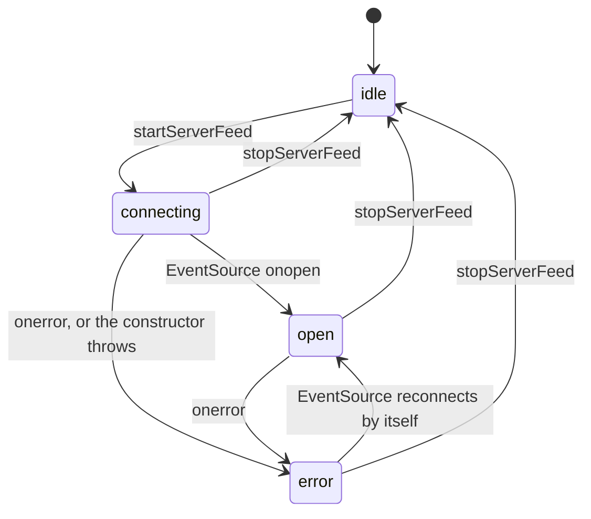

# Debug state machines

## Server feed

The debug overlay's event stream from the server (`ServerFeedState` in `trace/server-feed.ts`).

Reconnection belongs to the browser's `EventSource`; this module adds no retry of its own. A
malformed frame is skipped without changing state. Callbacks from a source that has been
replaced are ignored.
