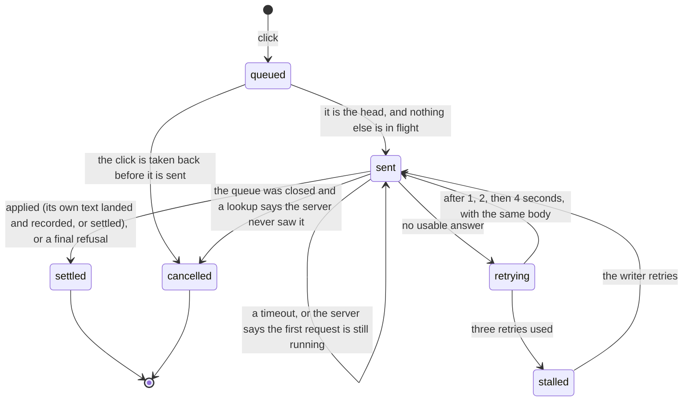
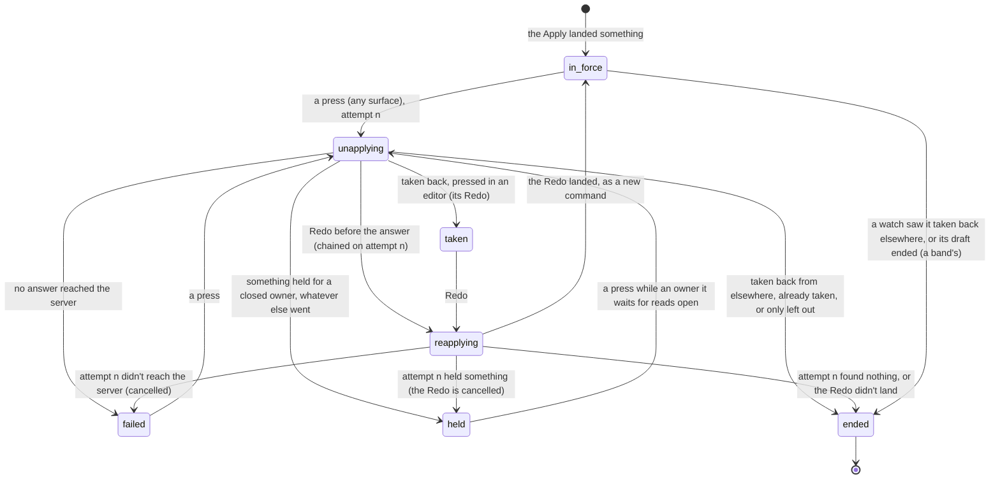
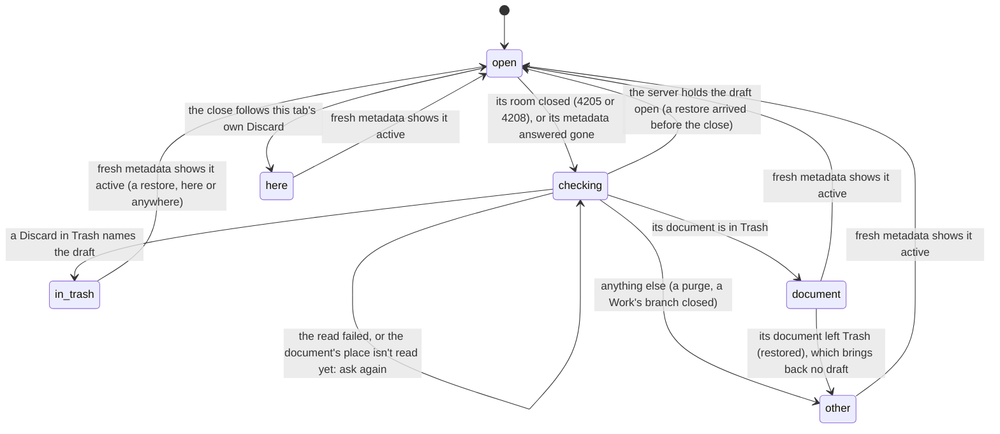

# Draft review state machines

## Apply click command

One Apply or Undo click on a draft change, from the click to the server's answer
(`ApplyClickQueue` in `apply-click-queue.ts`). Apply lands a draft's change on the live
document; Undo here takes an Apply back. Commands for one item run strictly in order:
only the head is ever sent. How the queue fits review is in [draft-review.md](draft-review.md).

- **A click can be taken back only before it is sent.** Once `sent`, the server may have it,
  and the same command id is resent until the server answers.
- **A timeout is not a failure.** The request is sent again under the same id at once, and
  again for as long as the server answers `running` (the first request still holds the id);
  the head stays `sent`, shown as Applying. Only a resend that times out too, or any other
  lost answer, moves to `retrying`.
- **No answer is not a refusal.** A thrown request, or an answer for another command id, keeps
  the head where it is. A stalled head holds every later command behind it, because sending
  them around it would apply changes out of order.
- **A frozen Apply settles when the server's record shows it**, not on the answer, when its own
  item's text landed. The server keeps a row for each applied command, and the command settles
  once its id is among them. A click with no frozen cut (a tree cut alone, or a whole-draft cut
  sent with no room open) settles on the answer: no room here records it. An answer whose entry
  for this item (`itemOf`, by the queue's node) says its text was settled, or carried no text,
  settles at once, whatever a sibling of the same command landed. An Undo settles when the rows it
  reversed are gone.
- **An Undo waits for the Apply it takes back** and is sent when either half of that Apply
  landed; when neither did, the Undo ends `cancelled` without a request.
- **An Undo's answer is acted on when it arrives** (`heard`): the notice, the history and a held
  Apply's state don't wait for its rows to leave the room. One whose draft half waits for its
  closed draft (`draftHalfWaits`) settles at once, since its rows never leave. A Redo pressed
  before the answer narrows to what the Undo took back, and is cancelled when it took nothing or
  held something.
- **`landed`** means the rows show the Apply happened but its answer was never read, or the
  queue was destroyed while the command waited on its rows. The writer sees a success.
- A closed queue stops sending and only looks up what its sent head became.
- **A member of an Apply of several is `sent` by its group** (`group-apply.ts`): its send waits
  until every member is its own queue's head, then the group posts the one command, and each
  member's queue settles from its own entry in the same answer.

The pattern:
[a command that may have landed](../../../../../../.context/state-machines/command-that-may-have-landed.md).

## An Apply's Undo

One Apply as one state machine (`AppliedCommand` in `apply-history.ts`, its `state`). Every Undo
of it presses it: the sidebar's step, an applied row's or a chat card's Undo, and Ctrl+Z in each
editor showing one of its documents; every Redo is that editor's. Each surface derives what it shows
from the state and keeps none: the history entries and `canUndo`, the Changes row's Undo, the card's
control and line, the held lines, and session retention (`hasEntries`).

- **One answer moves the state once.** Un-Apply attempt `n`'s answer is applied by the attempt
  (`answered`); a Redo chained on `n` goes on only when the answer took the Apply back
  (`takenBack`), and otherwise is cancelled and the answer decides. The command in force keeps
  its id until the Redo's command lands: a queue replay that is cancelled or refused gives
  `handle.current` back to the original.
- **`held` is in force, with no Redo.** It keeps its place on the sidebar's stack and in every
  history. It waits while every owner it waits for reads closed: in the tab's lists, or by the
  answer's evidence when the tab hasn't read the owner since the press was sent (`readAt` before
  `askedAt`). Owner changes re-derive every surface at once.
- **Re-entry is the owner's.** A Redo that lands shows the entry again in every live history at
  its place (taken hides the other histories' entries rather than removing them) and puts the
  sidebar's step back on the stack (`entered`); ports return data only.
- **A late answer names its own press.** An editor's entry goes back to Undo after a press that
  left the Apply in force only if it is still the Redo entry that press made
  (`DocumentHistory`'s `presses`).
- **A band's Apply** joins the sidebar's stack as the same object when it is held with a tree
  change (`joinStack`), since tree changes are undone there.

The pattern:
[a command that may have landed](../../../../../../.context/state-machines/command-that-may-have-landed.md).

## Draft end and reopen

One draft's end, as this tab's `DraftCommandOwner` holds it (`ended` on `DraftCommandState`,
keyed by draft id). It decides what every surface showing the draft does: the review owner, the
route, the page's paint and the editor's status pill each read `ended`, and nothing else.

- **`checking` asks the server, never the order things arrived in** (`resolveEnd`, answered by
  `AccountFeatureLifetime`): fresh draft metadata first, then Trash's Discard list, then where
  the document stands. A restore whose answer beat the old close restarts the kept session in
  place (`reopenDraftRoom`) instead of ending it. A failed read, or a document whose place
  isn't read yet, decides nothing: the page keeps the draft and asks again, backing off from 1s
  to 30s while a surface shows it, and on its next `gone` metadata answer.
- **An answer speaks for when its read started** (`DraftMetadataAnswer.readAt`): the cache
  takes a direct read only if it started after the stored answer, and `metadataActive` compares
  `readAt` with `endedAt`, so a read in flight across a Discard can't reopen the draft.
- **`in_trash` and `document` stay on screen** (`staysOnScreen`): the draft's text, read-only,
  with the status pill's Restore (the Discard's, or the document's). `here` and `other` leave
  for Live; `here` has its notice's Undo.
- **Reopening needs an answer newer than the end** (`metadataActive` compares the answer's time
  with `endedAt`): a cached active answer read before the close can't undo it. Two readers
  deliver it: a surface holding the draft's room (`useRoomBindings`), and admission of a page
  that names the draft (`reconcileClosed`), so a draft the writer's own Discard closed opens again
  after a restore even when nothing held its room.
- Apply sets `hidden` while it is queued, which leaves the review at once whatever `ended` turns
  out to be.

## Loads, not machines

`ReviewState` in `review-runtime.ts` (`ready` false until the room has synced and projected)
and `DraftChangesData` in `draft-changes.ts` (`idle`, `loading`, `error`, `ready`, `gone`) are
[load status](../../../../../../.context/state-machines/load-status.md). The one rule beyond the
pattern: an `error` must never be shown as an empty list of changes.
