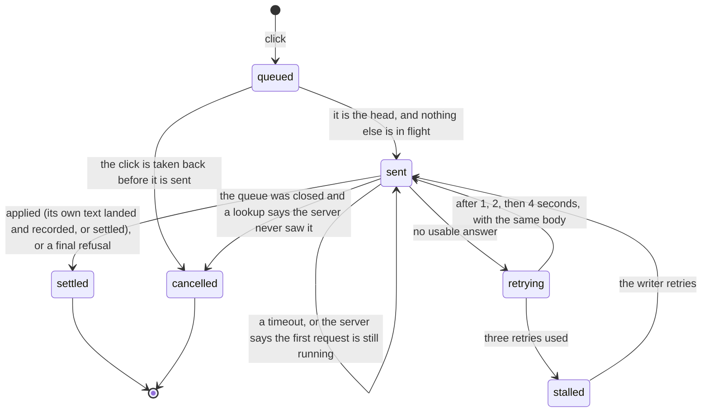
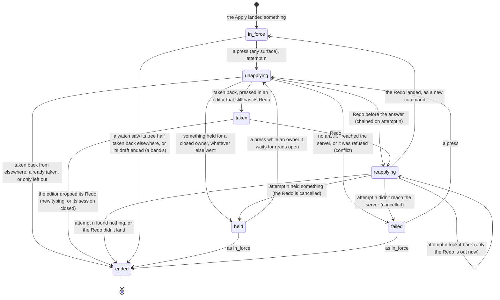
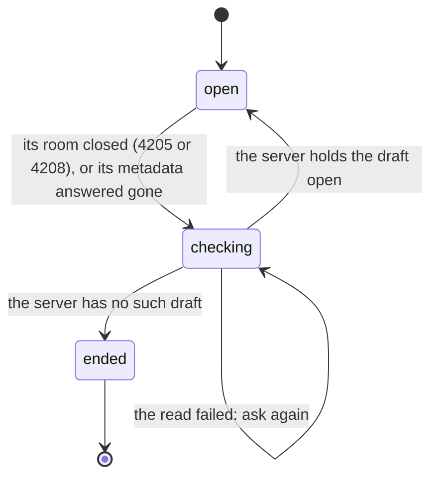

# Draft review state machines

## Apply click command

One Apply or Undo click on a draft change, from the click to the server's answer
(`ApplyClickQueue` in `apply-click-queue.ts`). Apply lands a draft's change on the live
document; Undo here takes an Apply back. Commands for one item run strictly in order:
only the head is ever sent. How the queue fits review is in [draft-review.md](draft-review.md).

- **The client never refuses a click.** Its room ending before the send releases the wait for
  the room's typing and the click is sent: a whole-draft click as the whole cut, any other built
  again at the head from the draft read from the server (`cancelled` when none of its changes is
  there), and either settles on its answer. An Apply pressed after the room ended is built the
  same way. The read waits like a send: unanswered, it is tried again, then stalls with Retry. A Redo whose Un-Apply did not land is `cancelled`:
  the Apply it would repeat still stands.
- **A click can be taken back only before it is sent.** Once `sent`, the server may have it,
  and the same command id is resent until the server answers.
- **A timeout is not a failure.** The request is sent again under the same id at once, and
  again for as long as the server answers `running` (the first request still holds the id);
  the head stays `sent`, shown as Applying. Only a resend that times out too, or any other
  lost answer, moves to `retrying`.
- **No answer is not a refusal.** A thrown request, or an answer for another command id, keeps
  the head where it is. A stalled head holds every later command behind it, because sending
  them around it would apply changes out of order.
- **A frozen Apply settles when the server's record shows it**, not on the answer, when its own
  item's text landed. The server keeps a row for each applied command, and the command settles
  once its id is among them. A click with no frozen cut (a tree cut alone, or a whole-draft cut
  sent with no room open) settles on the answer: no room here records it. An answer whose entry
  for this item (`itemOf`, by the queue's node) says its text was settled, or carried no text,
  settles at once, whatever a sibling of the same command landed. An Undo settles when the rows it
  reversed are gone.
- **An Undo waits for the Apply it takes back** and is sent when either half of that Apply
  landed; when neither did, the Undo ends `cancelled` without a request.
- **An Undo's answer is acted on when it arrives** (`heard`): the notice, the history and a held
  Apply's state don't wait for its rows to leave the room. A Redo pressed
  before the answer narrows to what the Undo took back, and is cancelled when it took nothing or
  held something.
- **`landed`** means the rows show the Apply happened but its answer was never read, or the
  queue was destroyed while the command waited on its rows. The writer sees a success.
- A closed queue stops sending and only looks up what its sent head became.
- **A member of an Apply of several is `sent` by its group** (`group-apply.ts`): its send waits
  until every member is its own queue's head, then the group posts the one command, and each
  member's queue settles from its own entry in the same answer.

The pattern:
[a command that may have landed](../../../../../../.context/state-machines/command-that-may-have-landed.md).

## An Apply's Undo

One Apply as one state machine (`AppliedCommand` in `apply-history.ts`, its `state`). Every Undo
of it is `ask`: the sidebar's Ctrl+Z asks it, and an applied row's Undo and
Ctrl+Z in each editor showing one of its documents or the draft it came from, opened before the
Apply or after, `press` it, which says the answer on the
sidebar's rows too. Every Redo is that editor's. Nothing reaches the Apply except through its
state: each surface derives what it shows from the state and keeps none (the history entries and
`canUndo`, the sidebar's stack, the Changes row's Undo, the held lines, and session retention). A
chat card's Undo is not one of them: it is the server's `reverse_turn`, which reads each applied
change from the Apply's `carried`.

- **One answer moves the state once.** Un-Apply attempt `n`'s answer is applied by the attempt
  (`answered`); a Redo chained on `n` goes on only when the answer took the Apply back
  (`takenBack`), and otherwise is cancelled and the answer decides.
- **The command in force keeps its id until the Redo's command lands.** The queue's handle names
  its latest click for the next Un-Apply (`current`) and publishes the Apply in force
  (`inForce`, which the port's `commandId` reads through `applyInForce()`) only once a replay lands, so
  `AppliedCommands.find` reaches the same owner throughout.
- **`taken` is the editor's Redo, not the Apply's last word.** An answer that took part and left
  a group changed since still leaves that group in force on the server, which keeps listing the
  Apply in force on the server until every group is taken back. `AppliedCommands.find` returns no
  owner for a `taken` Apply while the editor keeps its Redo.
- **The state places it on the sidebar's stack** (`Seat`): it sits there from in force until it
  is taken back or ends, and through an Un-Apply of it that is out, which a sidebar press goes
  past. Leaving ends every registration with it: the step, the watch on its tree half, the
  account list it read, and its notice. A Redo that lands sits it again, on top, a band's that
  joined the stack too. So a press after `ended` reaches nothing.
- **`held` is in force, with no Redo.** It keeps its place on the sidebar's stack and in every
  history. It waits while every owner it waits for reads closed. The held answer is evidence the
  Apply keeps until a read of that owner lands that started after the press was sent (`readAt`
  against `askedAt`); from then on the tab's read decides, and an owner the tab can't tell about
  (its list dropped from the cache) reads open. A press that passes over it reads each owner
  again that has no read landed since (`reread`), so one failed read doesn't leave it passed
  over until a reload. `ClosedOwners` keeps each read's
  start itself, so a cache that drops a list can't make the evidence come back. Owner changes
  re-derive every surface at once.
- **A late answer names its own press.** An editor's entry goes back to Undo after a press that
  left the Apply in force only if it is still the Redo entry that press made
  (`DocumentHistory`'s `presses`).
- **A band's Apply** joins the sidebar's stack as the same object when it is held with a tree
  change (`joinStack`, `placeOn`), since tree changes are undone there.
- **One server port** (`serverPort`): the sidebar's, a band's once its review let go of the room,
  A `conflict` answer (the Un-Apply's id is another command's) took nothing:
  the press failed, and the next one sends a new id. The queue's port reads its `unsent` Un-Apply
  the same way.

The pattern:
[a command that may have landed](../../../../../../.context/state-machines/command-that-may-have-landed.md).

## Draft end

One draft's end, as this tab's `DraftCommandOwner` holds it (`ended` on `DraftCommandState`,
keyed by draft id). A draft ends only when its Work or its document is purged: a Discard, a
restore and an Apply of a delete all leave it open. It decides what every surface showing the
draft does: the review owner, the route and the page's paint each read `ended`, and nothing else.

- **`checking` asks the server, never the order things arrived in** (`resolveEnd`, answered by
  `AccountFeatureLifetime`): fresh draft metadata. A failed read decides nothing: the page keeps
  the draft and asks again, backing off from 1s to 30s while a surface shows it, and on its next
  `gone` metadata answer.
- **`ended` is final** and the page leaves for Live: the draft's rows are deleted.
- Apply sets `hidden` while it is queued, which leaves the review at once whatever `ended` turns
  out to be.

## Loads, not machines

`ReviewState` in `review-runtime.ts` (`ready` false until the room has synced and projected)
and `DraftChangesData` in `draft-changes.ts` (`idle`, `loading`, `error`, `ready`, `gone`) are
[load status](../../../../../../.context/state-machines/load-status.md). The one rule beyond the
pattern: an `error` must never be shown as an empty list of changes.
