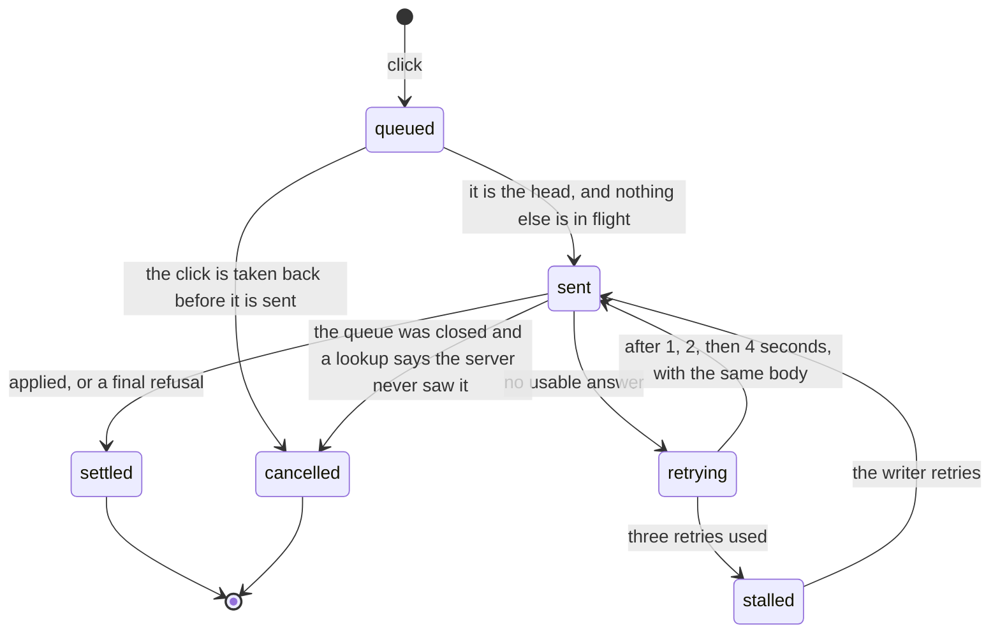

# Draft review state machines

## Apply click command

One Apply or Undo click on a draft change, from the click to the server's answer
(`ApplyClickQueue` in `apply-click-queue.ts`). Apply lands a draft's change on the live
document; Undo here takes an Apply back. Commands for one item run strictly in order:
only the head is ever sent. How the queue fits review is in [draft-review.md](draft-review.md).

- **A click can be taken back only before it is sent.** Once `sent`, the server may have it,
  and the same command id is resent until the server answers.
- **No answer is not a refusal.** A thrown request, or an answer for another command id, keeps
  the head where it is. A stalled head holds every later command behind it, because sending
  them around it would apply changes out of order.
- **An Apply settles when the server's record shows it**, not on the answer. The server keeps
  a row for each applied command, and the command settles once its id is among them. An Undo
  settles when the rows it reversed are gone.
- **`landed`** means the rows show the Apply happened but its answer was never read, or the
  queue was destroyed while the command waited on its rows. The writer sees a success.
- A closed queue stops sending and only looks up what its sent head became.

The pattern:
[a command that may have landed](../../../../../../.context/state-machines/command-that-may-have-landed.md).

## Loads, not machines

`ReviewState` in `review-runtime.ts` (`ready` false until the room has synced and projected)
and `DraftChangesData` in `draft-changes.ts` (`idle`, `loading`, `error`, `ready`, `gone`) are
[load status](../../../../../../.context/state-machines/load-status.md). The one rule beyond the
pattern: an `error` must never be shown as an empty list of changes.
