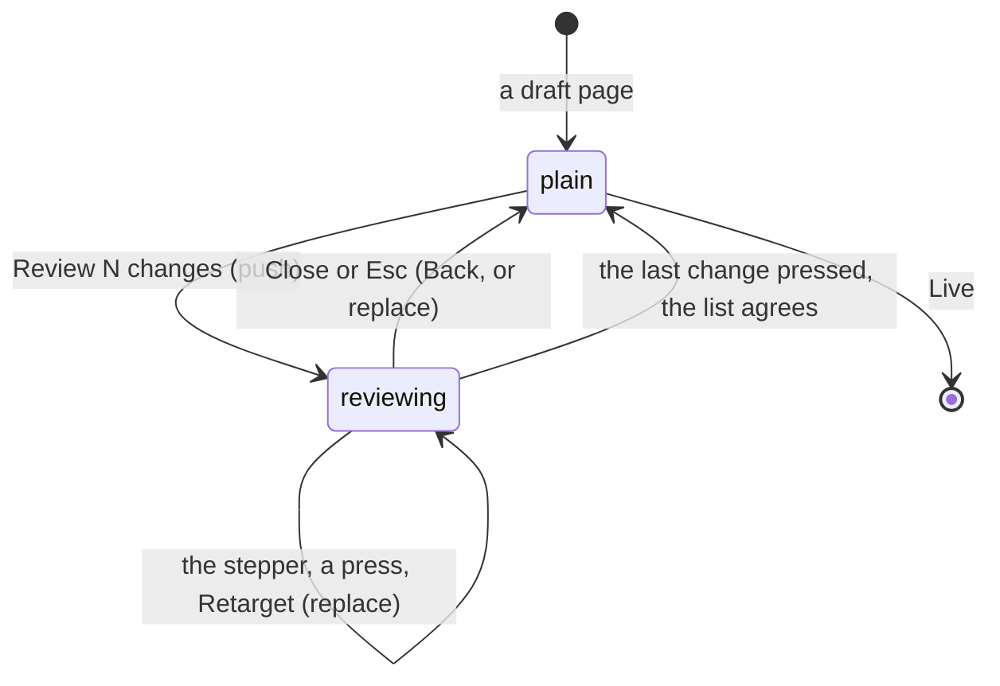
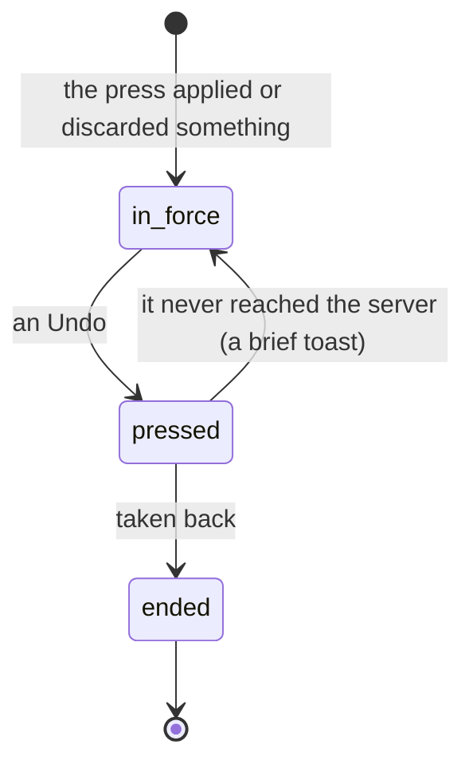

# Draft review state machines

An Apply or Discard of a change, a document, the draft or the Work is a press
(`usePressCommands`, `client/query/press-commands.ts`): one command sent through the command
driver, which waits until the rooms have this tab's edits and then resends it under the same id
until the server answers. How it fits review is in [draft-review.md](draft-review.md).

## Review changes

Not a store: the host's address (main) or stored slot (the side) holds it, and
`useHostReviewMode` reads it.

## A press's Undo

The browser keeps no state machine for a press, Apply or Discard alike. `PressEntries`
(`press-history.ts`) holds the press's command id and one step on the sidebar's Undo stack while
it is in force (`PressStep`, `core/project-tree/tree-undo.ts`). Every Undo of it is `undo()`: its
notice's or row's Undo, or the sidebar's Ctrl+Z. A press while one is out hears the same answer.
A chat card's Undo is not one of them: it is the server's `reverse_turn`.

- **The Undo is the press's `unpress`**, once: the server takes back that press's tree records,
  and a second Undo of the same press takes nothing.
- `owner.presses` holds every entry; the owner ends them when the account closes.

The pattern:
[a command that may have landed](../../../../../../.context/state-machines/command-that-may-have-landed.md).

## Loads, not machines

`DraftChangesData` in `draft-changes.ts` (`idle`, `loading`, `ready`, `gone`) is
[load status](../../../../../../.context/state-machines/load-status.md).
