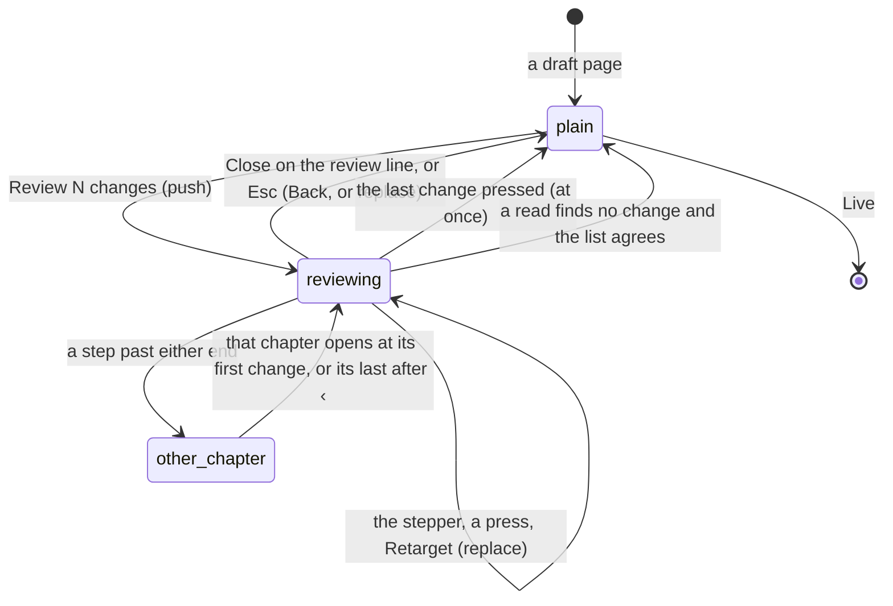

# Draft review state machines

An Apply or Discard of a change, a document, the draft or the Work is a press
(`usePressCommands`, `client/query/press-commands.ts`): one command sent through the command
driver, which waits until the rooms have this tab's edits and then resends it under the same id
until the server answers. How it fits review is in [draft-review.md](draft-review.md).

## Review changes

Not a store: the host's address (main) or stored slot (the side) holds it, and
`useHostReviewMode` reads it. The rows its editor last read sit in the host's `ReviewSurface`
(`review-mode.ts`), which "Review N changes" and the review line's stepper read.

- **Pressing the last change closes at once**; only a read that comes back empty waits for the
  list (`listed === false`), since a fork still syncing reads empty before the list does.
- **Esc has one handler per host** (`ReviewEscapeScope`), at page scope: it skips a key a menu,
  dialog or field already handled, and acts for its own host, or for main when the focus is in
  no host.
- **The stepper crosses chapters**: past the last change it opens the next chapter with changes;
  ‹ before the first opens the previous one at its last change (`ReviewSurface.landOnLast`).

## A press's Undo

The browser keeps no state machine for a press, Apply or Discard alike. `PressEntries`
(`press-history.ts`) holds the press's command id and one step on the sidebar's Undo stack while
it is in force (`PressStep`, `core/project-tree/tree-undo.ts`). Every Undo of it is `undo()`: its
notice's or row's Undo, the sidebar's Ctrl+Z, or the editor's. A press while one is out hears the
same answer. A chat card's Undo is not one of them: it is the server's `reverse_turn`.

The editor's Ctrl+Z gets its step (`EditorPressStep`) when the press is made, on every editor open
on a pressed document, so typing after the press is undone first. Its Undo waits for the press's
answer and then is `undo()`; Redo presses again under the same step.

```mermaid
stateDiagram-v2
  [*] --> sent: a press (the editor step is pushed)
  sent --> [*]: it took nothing (the editor step leaves)
  sent --> in_force: the press applied or discarded something
  in_force --> pressed: an Undo
  pressed --> in_force: it never reached the server (a brief toast; the editor step comes back)
  pressed --> ended: taken back
  ended --> [*]
```

- **The Undo is the press's `unpress`**, once: the server takes back that press's records, and a
  second Undo of the same press takes nothing.
- **Ended anywhere, the steps go together**: taken back from the sidebar or a notice, the editor's
  step leaves too; one Ctrl+Z took back stays for Redo.
- `owner.presses` holds every entry; the owner ends them when the account closes.

The pattern:
[a command that may have landed](../../../../../../.context/state-machines/command-that-may-have-landed.md).
