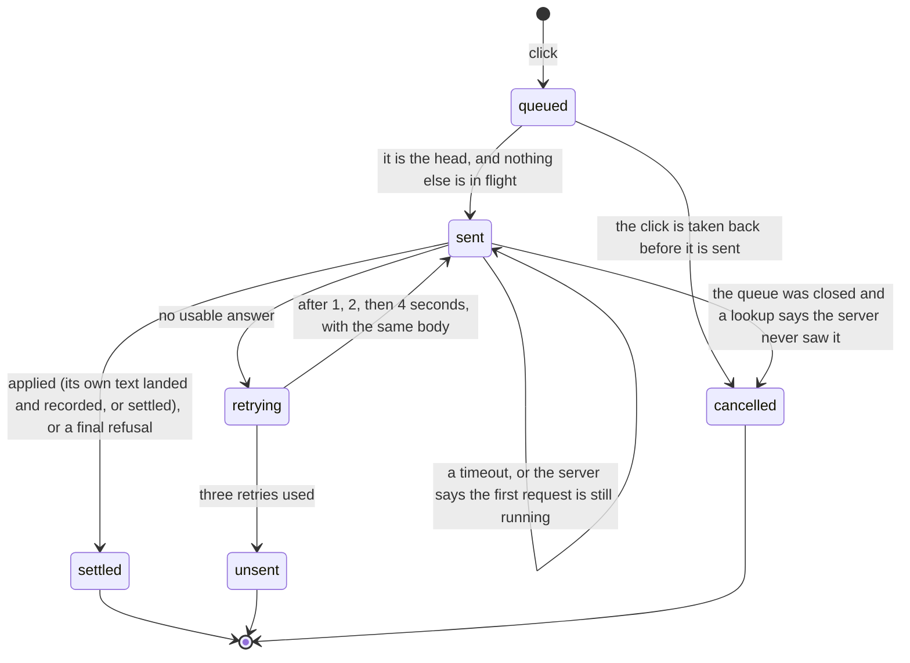
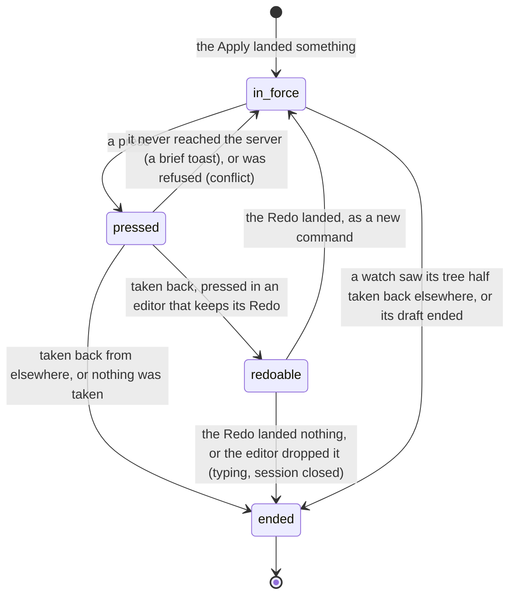
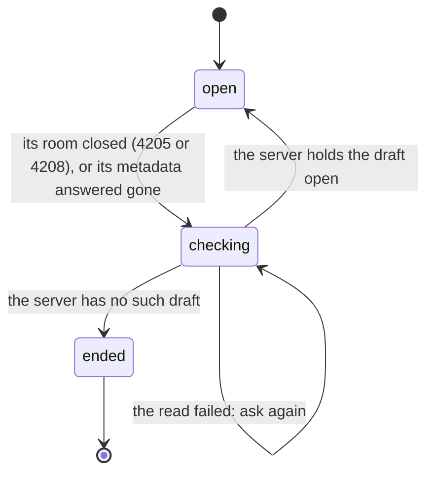

# Draft review state machines

## Apply click command

One Apply or Undo click on a draft change, from the click to the server's answer
(`ApplyClickQueue` in `apply-click-queue.ts`). Apply lands a draft's change on the live
document; Undo here takes an Apply back. Commands for one item run strictly in order:
only the head is ever sent. How the queue fits review is in [draft-review.md](draft-review.md).

- **The client never refuses a click.** Its room ending before the send releases the wait for
  the room's typing and the click is sent: a whole-draft click as the whole cut, any other built
  again at the head from the draft read from the server (`cancelled` when none of its changes is
  there), and either settles on its answer. An Apply pressed after the room ended is built the
  same way. The read waits like a send: unanswered, it is tried again, then the click settles `unsent`. A Redo whose Un-Apply did not land is `cancelled`:
  the Apply it would repeat still stands.
- **A click can be taken back only before it is sent.** Once `sent`, the server may have it,
  and the same command id is resent until the server answers.
- **A timeout is not a failure.** The request is sent again under the same id at once, and
  again for as long as the server answers `running` (the first request still holds the id);
  the head stays `sent`, shown as Applying. Only a resend that times out too, or any other
  lost answer, moves to `retrying`.
- **No answer is not a refusal.** A thrown request, or an answer for another command id, keeps
  the head where it is. The head is tried again at 1, 2 and 4 seconds; after that it settles `unsent` (the change
  is pending again, and the press shows the failure pill) and the commands behind it go.
- **A frozen Apply settles when the server's record shows it**, not on the answer, when its own
  item's text landed. The server keeps a row for each applied command, and the command settles
  once its id is among them. A click with no frozen cut (a tree cut alone, or a whole-draft cut
  sent with no room open) settles on the answer: no room here records it. An answer whose entry
  for this item (`itemOf`, by the queue's node) says its text was settled, or carried no text,
  settles at once, whatever a sibling of the same command landed. An Undo settles when the rows it
  reversed are gone.
- **An Undo waits for the Apply it takes back** and is sent when either half of that Apply
  landed; when neither did, the Undo ends `cancelled` without a request.
- **An Undo's answer is acted on when it arrives** (`heard`): the notice and the history don't wait
  for its rows to leave the room. A Redo pressed before the answer narrows to what the Undo took
  back, and is cancelled when it took nothing.
- **`landed`** means the rows show the Apply happened but its answer was never read, or the
  queue was destroyed while the command waited on its rows. The writer sees a success.
- A closed queue stops sending and only looks up what its sent head became.
- **A member of an Apply of several is `sent` by its group** (`group-apply.ts`): its send waits
  until every member is its own queue's head, then the group posts the one command, and each
  member's queue settles from its own entry in the same answer.

The pattern:
[a command that may have landed](../../../../../../.context/state-machines/command-that-may-have-landed.md).

## An Apply's Undo

The browser keeps no state machine for an Apply. `ApplyEntries` (`apply-history.ts`) holds its
command id and puts one entry in the history of each live session of its documents, plus a step on
the sidebar's stack. Every Undo of it is `undo(from)`: the sidebar's Ctrl+Z, an applied row's
Undo, Ctrl+Z in an editor (`from`). A press while one is out hears the same answer. A chat card's
Undo is not one of them: it is the server's `reverse_turn`.

- **Redo names its Un-Apply and nothing else.** The entry sends `redoOf` with the Un-Apply's id;
  the server reads from its own records what that Un-Apply took (the effect rows it marked, its
  `treeUndone`) and applies those groups again. So a change another chat proposed since, or the
  same change in a document the Un-Apply left, is never applied with it. A Redo pressed before
  the Un-Apply answered waits for the answer.
- **The step leaves the sidebar's stack once taken back**, with its watch and notice; a Redo that
  lands puts it on top again under the new command's id.
- **Nothing is held for a closed owner.** An Un-Apply takes what it can; what a closed owner
  keeps stays applied and the card's own Undo decides whether to offer it.
- **A band's Apply** goes through the item queue while the review shows the room, so the review
  paints the Un-Apply and Redo at once (`queuePort`); the queue's replay is painted from the
  selection the Un-Apply took and sent as `redoOf`. Once the review lets go of the room the entry
  switches to the server's port (`serverPort`), which the sidebar's steps use throughout.

The pattern:
[a command that may have landed](../../../../../../.context/state-machines/command-that-may-have-landed.md).

## Draft end

One draft's end, as this tab's `DraftCommandOwner` holds it (`ended` on `DraftCommandState`,
keyed by draft id). A draft ends only when its Work or its document is purged: a Discard, a
restore and an Apply of a delete all leave it open. It decides what every surface showing the
draft does: the review owner, the route and the page's paint each read `ended`, and nothing else.

- **`checking` asks the server, never the order things arrived in** (`resolveEnd`, answered by
  `AccountFeatureLifetime`): fresh draft metadata. A failed read decides nothing: the page keeps
  the draft and asks again, backing off from 1s to 30s while a surface shows it, and on its next
  `gone` metadata answer.
- **`ended` is final** and the page leaves for Live: the draft's rows are deleted.
- Apply sets `hidden` while it is queued, which leaves the review at once whatever `ended` turns
  out to be.
- Suggestion mode has no draft rooms to close: its items stay `open` (`askEnd` asks nothing). A
  pressed row leaves the Work's list, and a list read brings it back if the press failed.

## Loads, not machines

`ReviewState` in `review-runtime.ts` (`ready` false until the room has synced and projected)
and `DraftChangesData` in `draft-changes.ts` (`idle`, `loading`, `error`, `ready`, `gone`) are
[load status](../../../../../../.context/state-machines/load-status.md). The one rule beyond the
pattern: an `error` must never be shown as an empty list of changes.
