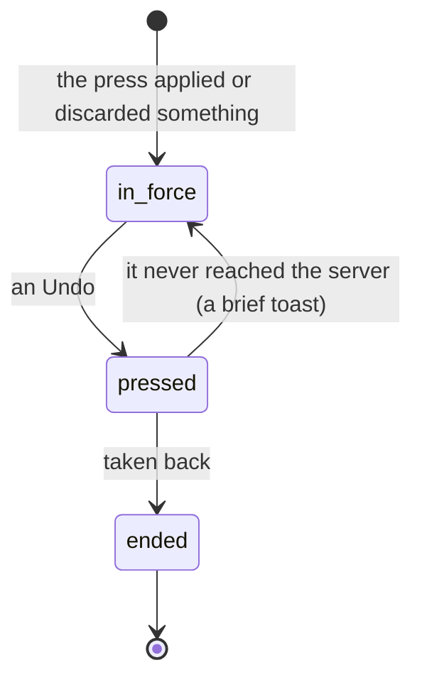

# Draft review state machines

A Work's draft is its tree records (phase 1 has no text drafts). An Apply or Discard of a
document, a folder or the Work is a press (`usePressCommands`, `client/query/press-commands.ts`):
one command the server runs over the items' tree changes, sent through the command driver, which
keeps resending it under the same id until the server answers. How the press fits review is in
[draft-review.md](draft-review.md).

## A press's Undo

The browser keeps no state machine for a press, Apply or Discard alike. `PressEntries`
(`press-history.ts`) holds the press's command id and one step on the sidebar's Undo stack while
it is in force (`PressStep`, `core/project-tree/tree-undo.ts`). Every Undo of it is `undo()`: its
notice's or row's Undo, or the sidebar's Ctrl+Z. A press while one is out hears the same answer.
A chat card's Undo is not one of them: it is the server's `reverse_turn`.

- **The Undo is the press's `unpress`**, once: the server takes back that press's tree records,
  and a second Undo of the same press takes nothing.
- `owner.presses` holds every entry; the owner ends them when the account closes.

The pattern:
[a command that may have landed](../../../../../../.context/state-machines/command-that-may-have-landed.md).

## Loads, not machines

`DraftChangesData` in `draft-changes.ts` (`idle`, `loading`, `ready`, `gone`) is
[load status](../../../../../../.context/state-machines/load-status.md).
