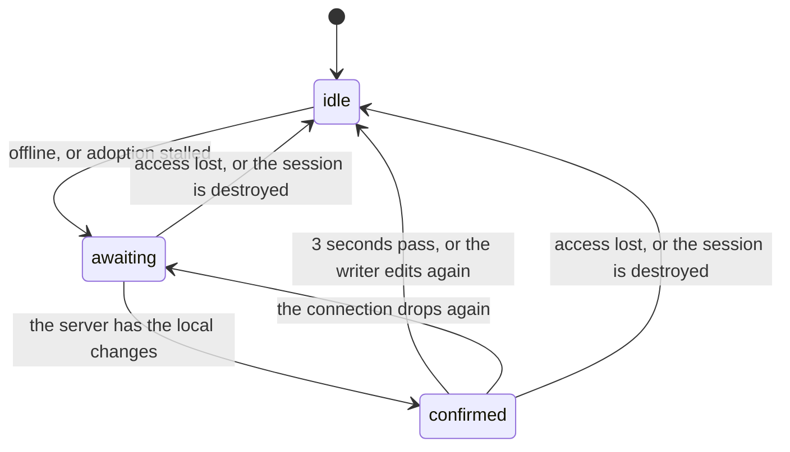

# Editor feature state machines

## Sync pill outage phase

The sync pill is the small status label in the editor. This machine is whether it is telling
the writer about an outage, or confirming that an outage's edits reached the server (`OutagePhase` and `nextPhase` in `SyncStatus.tsx`). It advances on
every [document session](../../../core/editor/.context/state-machines.md) snapshot.

- **The phase and the snapshot are stored together** and advanced in one state update, so no
  render falls between "offline" and "saved".
- **A healthy session never leaves `idle`.** The confirmation exists to answer "did my offline
  edits make it?"; showing it after ordinary typing would flicker on every keystroke. For the
  same reason an edit made while `confirmed` hides the pill instead of returning to `awaiting`.
- **A stalled adoption counts as an outage.** A document edited before the account's session
  registry has taken it over is kept in the browser only. While that takeover (adoption) fails
  or is refused, edits stay local, exactly as when offline.
- A refused update (`updatesRefused`) is not a phase. It is checked first and replaces the pill.
