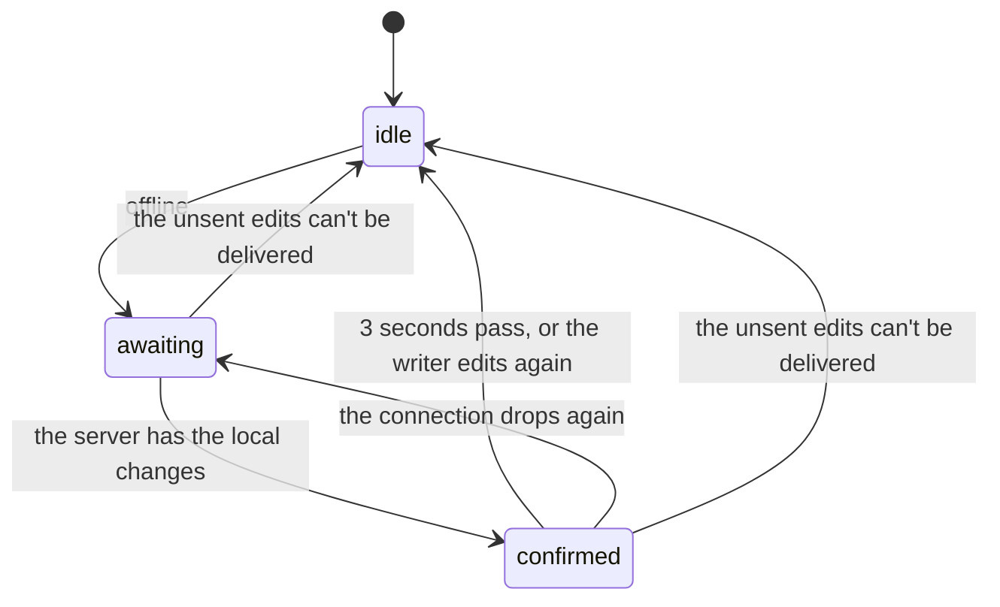

# Editor feature state machines

## Sync pill outage phase

The sync pill is the small status label in the editor. This machine is whether it is telling
the writer about an outage, or confirming that an outage's edits reached the server (`OutagePhase` and `nextPhase` in `SyncStatus.tsx`). It advances on
every [document session](../../../core/editor/.context/state-machines.md) snapshot.

- **The phase and the snapshot are stored together** and advanced in one state update, so no
  render falls between "offline" and "saved".
- **A healthy session never leaves `idle`.** The confirmation exists to answer "did my offline
  edits make it?"; showing it after ordinary typing would flicker on every keystroke. For the
  same reason an edit made while `confirmed` hides the pill instead of returning to `awaiting`.
- **Can't be delivered is the session's answer, `canDeliverUnsentEdits()`:** the room ended
  (access lost, reset, terminal, destroyed) or the server admitted it read-only, as it does an
  archived Work's draft. A browser with typing still unsent when the Work is archived
  (offline then, or online with it in flight) reconnects read-only; the pill goes quiet instead of saying "offline", the
  archived notice says why, and the typing stays on screen for an Unarchive to deliver.
- A refused update (`updatesRefused`) is not a phase. It is checked first and replaces the pill.
