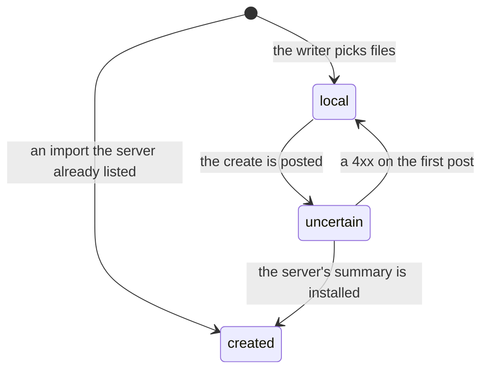
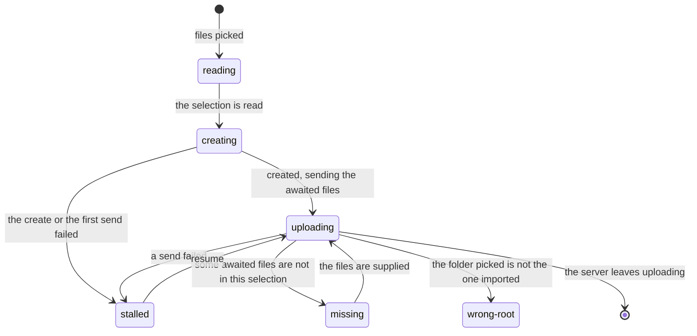

# Import state machines (app)

The server converts an import's uploaded files out of sight, then reveals them in the
project's tree all at once. Its import job is the truth:
[server import](../../../../../server/server/domains/import/.context/state-machines.md). This
tab adds two things in memory, in `import-coordinator.ts`: whether its create request landed,
and what its own upload is doing. `importState` in `import-presentation.ts` combines both with
the server's summary into the one word the writer sees.

## Creation

Whether the server has the import this tab started (`RecordState.creation`).

A 4xx sends the record back to `local` only when this was the first post. Once an earlier
create went unanswered, a refused replay cannot prove that create did not land, so the record
stays `uncertain` and Stop first replays the create and then stops it. This is
[a command that may have landed](../../../../../../.context/state-machines/command-that-may-have-landed.md).

## Local upload phase

What this tab is doing for the import (`LocalUpload.phase`; absent when it is doing nothing).

One tab uploads an import at a time, under a Web Lock and an `UploadAttempt`; a new attempt
ends the old one only after it holds the lock. A tab without the lock sets `elsewhere` rather
than a phase. Every asynchronous step checks that its attempt and the record's revision are
still current before writing, so a late answer from a superseded attempt is dropped.

## What the writer sees

`importState` checks in this order, and the first match wins:

| Shown | When |
|---|---|
| `stop` | Stop was asked and not yet answered |
| `reading` | Local phase `reading` or `creating` |
| `expired` | Server `cancelled` |
| `done`, `needs-look` | Server `finished`, by whether any entry needs a look |
| `adding` | Stop was asked after the server had already revealed the import, or every file is converted and waiting for the reveal |
| `failed` | Server `failed` |
| `waiting`, `organizing` | Server `organizing` |
| `missing`, `wrong-root`, `stalled`, `uploading` | Server `uploading`, by local phase |
| `elsewhere`, `paused` | Server `uploading` and this tab is not sending |

The order matters: `stop` and `reading` come before the server's state because they describe
what the writer just did, and the summary on hand may predate it.
