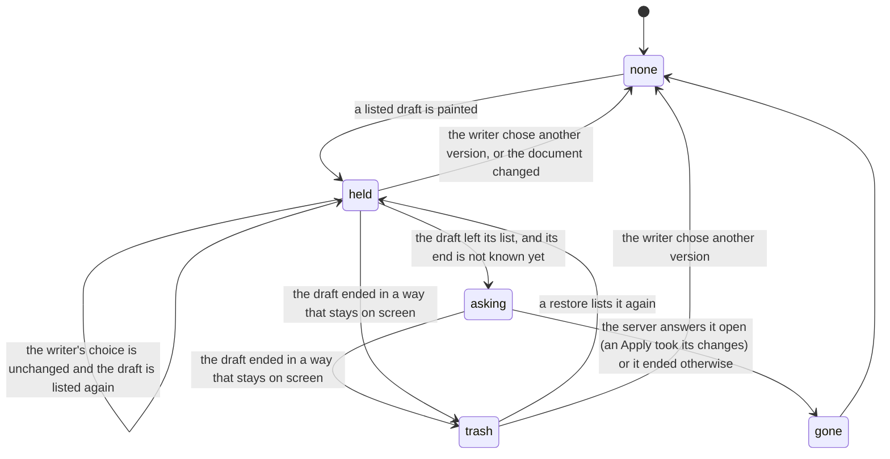

# Held paint

What a document keeps painting once the draft it shows leaves its owner's list
(`useDocumentPaint` in `views.ts`). A Discard made elsewhere, or its document going to Trash,
takes the draft out of the list, but the page stays on it until the writer chooses another
version. The draft's own end is [Draft end and reopen](../../draft-review/.context/state-machines.md).

- **`asking` paints the draft, not Live**: a draft that left its list is either in Trash (keep
  it) or open with nothing to show (let it go), and only the server says which. The page reads
  current metadata once (`fetchCurrentDraftMetadata`); `gone` closes it through the command
  owner, which then says whether it stays.
- **`held` is state, not a ref read during render**: the effect that follows the list sets it,
  and the next render paints from it.
- **The writer's choice ends the hold**: the key is the pin and the sidebar's Live/Draft choice
  when the draft was painted; any change to them drops it.
