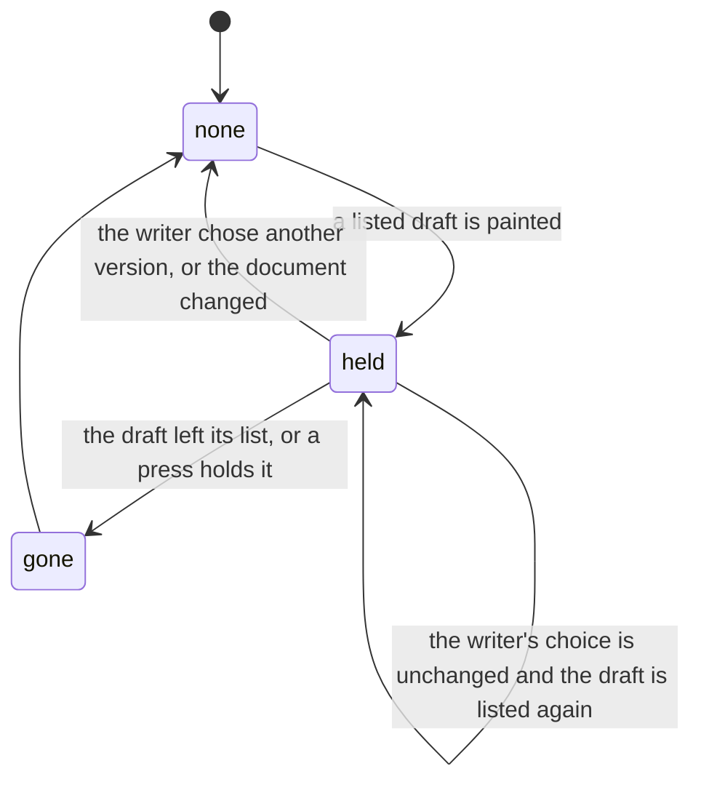

# Held paint

What a document keeps painting once the draft it shows leaves its owner's list
(`useDocumentPaint` in `views.ts`). An Apply or Discard made elsewhere takes the draft out of the
list, and the page goes on to what is left.

- **`held` is state, not a ref read during render**: the effect that follows the list sets it,
  and the next render paints from it.
- **The writer's choice ends the hold**: the key is the pin and the sidebar's Live/Draft choice
  when the draft was painted; any change to them drops it.
