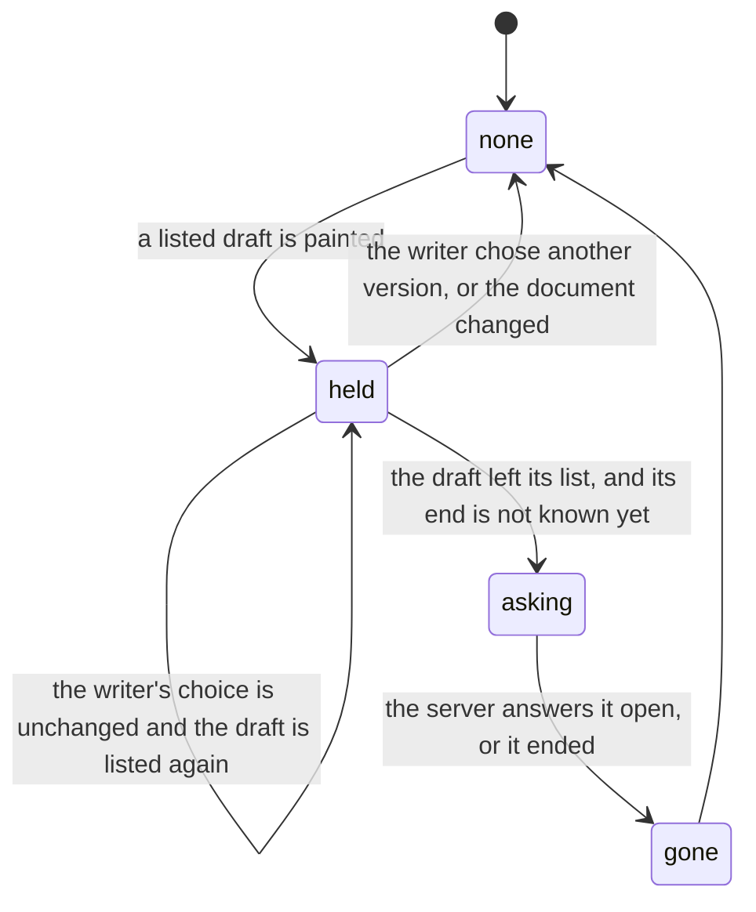

# Held paint

What a document keeps painting once the draft it shows leaves its owner's list
(`useDocumentPaint` in `views.ts`). A Discard of every change made elsewhere, or its Work being purged,
takes the draft out of the list, but the page stays on it until the writer chooses another
version. The draft's own end is [Draft end](../../draft-review/.context/state-machines.md).

- **`asking` paints the draft, not Live**: a draft that left its list is open with nothing to show or
  ended, and only the server says which. The page asks the command owner (`askEnd`), the one
  check that reads the server and asks again after a failed read while the draft is held; any
  answer lets the page go on.
- **`held` is state, not a ref read during render**: the effect that follows the list sets it,
  and the next render paints from it.
- **The writer's choice ends the hold**: the key is the pin and the sidebar's Live/Draft choice
  when the draft was painted; any change to them drops it.
