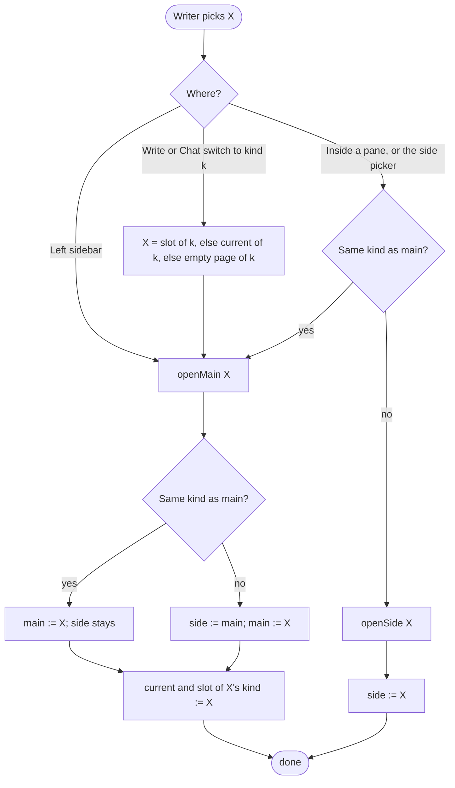
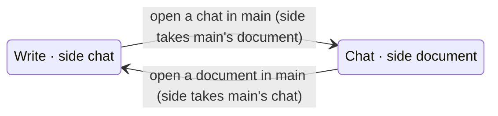

# Pane state machine: what main and the side show

The owner's rules for where an item opens and what each pane shows after it (2026-11-12). This is
the source of truth for pane placement. **Changing how main or the side picks its item means
changing this page in the same commit:** the rules, the tables and the diagrams together. A
placement rule in code that this page doesn't state is a bug in one of the two.

Status: current. The code implements this page: `useMainArrival` writes the slots and main's tabs,
`place(item)` is the one placement command, and the Write | Chat switch opens the slot of its
kind in main (`shell/MainModeSwitch.tsx`). Every swap, whatever opened it (the switch, Open in main, a pick or a link), glides in one place: `layout/SlotGrid.tsx` animates any host whose slot changed. Where this page and the
code disagree, one of them is a bug.

## State

- **main**: an item, or its kind's empty page (the editor with no document; the new-chat composer,
  which is also the project's home).
- **side**: an item of the **other** kind from main, or its empty state. Beside a document the side
  holds a chat (empty: a new chat's composer); beside a chat it holds a document (empty: the
  document list). Main's kind is never in the side: no two chats, no two documents on screen.
- **slots**: one per kind, the last item of that kind on screen in either pane, or none. Main's
  arrival writes its kind's slot (none on its empty page: the editor with no document, the new-chat
  composer); a pick or link into the side writes the other. **The side shows the slot of the kind
  main is not.** That is the whole of "the side takes what main left": a change of kind needs no
  swap step, because the slot of the kind main left already holds main's last item.
- **current document**, **current chat**: the last item of each kind main showed, which is each
  lane's selected tab. A slot is not a current item: the side's pick fills a slot, not a lane.
- **mode** (Write | Chat) is not stored: it is the kind of main's item. Main keeps tabs per kind
  (two lanes); the band draws the mode's lane.

## Opening an item

`openMain(X)`:

1. Same kind as main: X replaces main. The side is untouched.
2. Other kind: the panes swap kinds. The side takes what main showed (an empty editor page leaves
   the side empty), then main shows X.
3. X becomes the current item of its kind (its lane's selected tab) and fills that kind's slot.

`openSide(X)`: X is the other kind from main; it fills its kind's slot, which the side shows. The side's picker offers only the
other kind.

In one line: **main's kind opens in main, the other kind opens beside, and the left sidebar always
opens in main.** Main and the side always hold different kinds, so from either pane this is the
same rule (`placeIn(kind, main)`); only the sidebar, outside every pane, opens in main without asking.

## Events

| Event | Result |
|---|---|
| Pick in the left sidebar | `openMain(X)` |
| Pick inside main or the side | main's kind: `openMain(X)`; the other kind: `openSide(X)` |
| Pick in the side's picker | `openSide(X)`; it lists only the other kind |
| Write or Chat switch to kind k | `openMain(slot of k ?? current of k ?? empty page of k)`: the panes swap kinds, the side's item first |
| Close main's tab | main shows the next tab of its kind, else its empty page; the side stays |
| Delete or remove the side's item | the side shows its empty state |
| A chat tab's chat is deleted (here or in another window) | its tab closes; the probe of the owner gate finds a delete elsewhere on a return to the window, or within 30s |

Home is the new-chat composer: it suggests what to continue and documents to open beside it, and a
suggested document is the other kind, so it opens in the side.

## Modes

Two states, one per mode; the side always holds the other kind. Moves within a state (main replaced
by its own kind, the side replaced by its own kind) are left out.

## Example

| Step | main | side |
|---|---|---|
| Start | ch1 | chat1 |
| Open ch2 from the left sidebar | ch2 | chat1 |
| Open chat2 from the left sidebar | chat2 | ch2 |
| Press Write | ch2 | chat2 |
| Chapter link inside the side's chat2 | ch5 | chat2 |
| Chat link inside main's ch5 | ch5 | chat3 |
