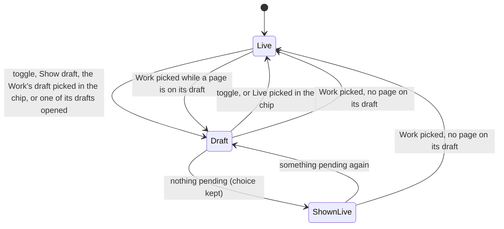

# Sidebar version: the Live/Draft toggle

The shell's one version state above a single document (`features/project/tree-version.tsx`).
It decides which tree every sidebar source shows and acts on, and which version every page
shows. Change the code and this page together.

## State

- **choice** (`live` | `draft`): the writer's, kept per (account, project) in this browser tab
  and seeded from the device (`client/project-shell/store.ts`, `tree-version`).
- **offered**: the picked Work (or, under None, the chat on screen's: its Work's drafts, or its
  own when it has no Work) has an active branch with something pending: a drafted document in its list, or a pending tree record in the browser's
  copy (a folder change alone lists no document).
- **showing** = `draft` when offered and choice is `draft`, else `live`, for the sidebar.
  A page reads the choice itself through the one rule below, so a Work whose last change was
  applied shows its drafts again when changes come back.

## Rules

- On **Draft** the sidebar's trees are the Work's view, replayed in the browser
  (`TreeListSession.replay(view, pendingText)`), and every `TreeActions` record carries the
  Work's branch as `draft`. On **Live** they are live. Trash restore stays live: Trash lists
  live's Trash.
- **One rule for a page's version** (`shownDraft`, `features/project/views.ts`), read by the
  paint, the address (`use-review-address-sync.ts`) and a tab's activation (`useOpenInMain`):
  a pin to another owner's draft shows it; the choice on Draft, or a page live doesn't have,
  shows the Work's draft where its list has one; else Live. Flipping writes only the choice; a
  pin to the Work's own draft carries only the focused change. A review address naming the
  Work's draft sets the choice to Draft.
- **Readers behind an action read the view it writes:** the move menus, the destination picker,
  Scratch's trees, the folder menu, the identity bar's commit and a linked document's create read
  `useTreeVersion()`. The Work's `TreeVersion` is one value per branch (`draftTreeVersion`).
- **The page's version chip is the same state.** Picking the Work's draft or Live in its menu
  sets the toggle, and opening any of the Work's drafts (a Changes row, the chat's dock, a
  review link: `review-launch.tsx`) puts it on Draft. The chip on Live is neutral with a jade
  dot while a draft waits, jade on Draft.
- **On Live** each row the Work changes carries a jade dot, and a page the Work drafts says
  what the draft does to it with Show draft (`LiveDraftNotice`). A page the draft created stays
  on its draft and says live has no version of it; its chip reads Draft.
- **The Work chip** under None names the chat's Work when its drafts drive the toggle, with the
  count Changes shows; the pick itself stays None.
- **A Work pick** keeps every page that is on one of the picked Work's drafts on it, and then puts
  the toggle on Draft; every other page showing a draft returns to Live with the toggle
  (`pickWorkViews`, written with the scope in `useWorkScope`). A writer who opened a Work's
  draft under another scope and then picks that Work stays on the draft. A page live doesn't
  have keeps its draft and does not move the toggle.
- **An archived or deleted Work stays picked** (`use-work-scope.ts`): only the writer's pick
  changes the scope, here or on another device. The chip says Archived or Deleted with Unarchive
  or Restore in its menu; Changes and the Draft view show its draft read-only (`TreeVersion.ended`
  refuses every tree action there with its reason). Its Scratch on Live reads and offers no
  change (`useWorkSourceWritable`). The pick follows a lifecycle change made elsewhere at once: the
  server wakes the Works list with the Work's `draft-owner-hint`.
- The sidebar's **Ctrl+Z** takes back the latest step of the source on screen made in the view
  showing (`core/project-tree/tree-undo.ts`). It hears the press anywhere in the sidebar, which
  takes focus itself when a click lands on no control. A delete's notice Undo is the same step
  (`undoStep`): whichever runs first, the other finds nothing, and a press ends the notice. The stack is record ids per list copy, in memory;
  a reload empties it. A step `undoChange` refuses is dropped with a notice and the press goes
  on to the one before it. A change since applied is taken back live. An Apply is one step in
  either view: the press asks the server's Un-Apply, and a refusal (the tree changed since) is
  skipped the same way; on the Changes tab a press takes the latest step of any source.

A wrong edit here shows one tree in the sidebar while actions write into another.
