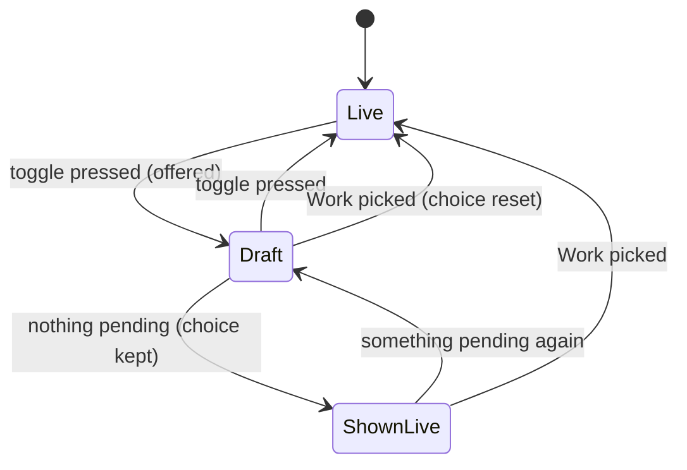

# Sidebar version: the Live/Draft toggle

The shell's one version state above a single document (`features/project/tree-version.tsx`).
It decides which tree every sidebar source shows and acts on, and main's page follows it when
it is flipped. Change the code and this page together.

## State

- **choice** (`live` | `draft`): the writer's, kept per (account, project) in this browser tab
  and seeded from the device (`client/project-shell/store.ts`, `tree-version`).
- **offered**: the picked Work (or, under None, the chat's lineage) has an active branch with
  something pending: a drafted document in its list, or a pending tree record in the browser's
  copy (a folder change alone lists no document).
- **showing** = `draft` when offered and choice is `draft`, else `live`. Nothing else reads the
  choice.

## Rules

- On **Draft** the sidebar's trees are the Work's view, replayed in the browser
  (`TreeListSession.replay(view, pendingText)`), and every `TreeActions` record carries the
  Work's branch as `draft`. On **Live** they are live. Trash restore stays live: Trash lists
  live's Trash.
- **Flipping** moves main's document to the Work's draft of it (a pin, as the version menu
  does) or back to Live; a document live has no version of keeps its draft.
- **A Work pick** returns the toggle to Live with every page (`returnDraftsToLive`).
- The sidebar's **Ctrl+Z** takes back the latest step of the source on screen made in the view
  showing (`core/project-tree/tree-undo.ts`). The stack is record ids per list copy, in memory;
  a reload empties it. A step `undoChange` refuses is dropped with a notice and the press goes
  on to the one before it. A change since applied is taken back live.

A wrong edit here shows one tree in the sidebar while actions write into another.
