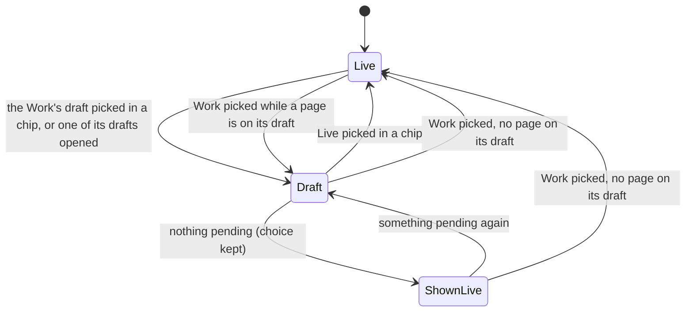

# Sidebar version: the Live/Draft chip

The shell's one version state above a single document (`features/project/tree-version.tsx`).
It decides which tree every sidebar source shows and acts on, and which version every page
shows. Change the code and this page together.

The sidebar shows it as the page's version chip (`DraftSwitcher`, drawn by `TreeVersionChip`
beside Changes, outside the tab strip so it never scrolls away): it names the version showing,
"Live" (with a jade dot, since a draft waits) or "Draft" (jade), and its menu offers Live and the
Work's draft. "The toggle" below means this state, whichever chip sets it.

## State

- **choice** (`live` | `draft`): the writer's, kept per (account, project) in this browser tab
  and seeded from the device (`client/project-shell/store.ts`, `tree-version`).
- **offered**: the picked Work (or, under None, the chat on screen's: its Work's drafts, or its
  own when it has no Work) has an active draft with something pending: a drafted document in its list, or a pending tree record in the browser's
  copy (a folder change alone lists no document).
- **showing** = `draft` when offered and choice is `draft`, else `live`, for the sidebar.
  A page reads the choice itself through the one rule below, so a Work whose last change was
  applied shows its drafts again when changes come back.

## Rules

- On **Draft** the sidebar's trees are the Work's view, replayed in the browser
  (`TreeListSession.replay(view)`), and every `TreeActions` record carries the
  Work's draft as `draft`. On **Live** they are live. Trash restore stays live: Trash lists
  live's Trash.
- **One rule for a page's version** (`shownDraft`, `features/project/views.ts`), read by the
  paint, the address (`use-review-address-sync.ts`) and a tab's activation (`useOpenInMain`):
  a pin to another owner's draft shows it; the choice on Draft, or a page live doesn't have,
  shows the Work's draft where its list has one; else Live. Flipping writes only the choice; a
  pin to the Work's own draft carries only the focused change. A review address naming the
  Work's draft sets the choice to Draft.
- **Readers behind an action read the view it writes:** the move menus, the destination picker,
  Scratch's trees, the folder menu, the identity bar's commit and a linked document's create read
  `useTreeVersion()`. The Work's `TreeVersion` is one value per draft (`draftTreeVersion`).
- **The page's version chip is the same state, and the same control.** Picking the Work's draft
  or Live in its menu sets the toggle, and opening any of the Work's drafts (a Changes row, the chat's dock, a
  review link: `review-launch.tsx`) puts it on Draft. The chip on Live is neutral with a jade
  dot while a draft waits, jade on Draft. Each chip shows only while there is another version
  to switch to: the sidebar's while the Work has pending changes (**offered**), the page's while
  the document has a draft of any owner, or its review is open (it carries the review's Close
  review, and on a phone its Apply and Discard).
- **On Live** each row the Work changes carries a jade dot, and so does the chip of a page any
  chat drafts: the chip's menu lists the drafts and what each does to the page. Nothing is said
  above the page. A page the draft created stays on its draft; its chip reads Draft.
- **The Work chip** under None names the chat's Work when its drafts drive the toggle, with the
  count Changes shows; the pick itself stays None.
- **A change of the scope's draft owner** (a Work pick, or under None another chat on screen
  whose drafts are another owner's, or a new chat's composer, which has none) keeps every page
  that is on one of the new owner's drafts on it, and a page only a draft holds on its draft;
  every other page showing a draft returns to Live (`enterScope`). So a pin, and the focused
  change it carries, ends when the owner changes. A Work pick writes it with the scope in
  `useWorkScope`, so the first render under the Work is already right, and then puts the toggle
  on Draft if a page stayed on the Work's draft, else on Live: a writer who opened a Work's draft
  under another scope and then picks that Work stays on the draft. Every owner change, a Work
  pick's included, runs it again from `TreeVersionProvider`; after a pick that run finds nothing
  to change. A chat switch leaves the toggle as it is. No chat on screen (the side closed or
  holding a document, the phone's document), or a chat whose row is still loading, is no owner
  known and changes nothing: a pin written then is checked at the next known owner. A No Work
  pick enters no owner (`null`), so pages on the chat's own draft return to Live with the toggle.
- **An archived or deleted Work stays picked** (`use-work-scope.ts`): only the writer's pick
  changes the scope, here or on another device. The chip says Archived or Deleted with Unarchive
  or Restore in its menu. An archived Work's Draft view reads and offers its tree controls as an
  active one does; a create, rename, move or delete there is sent like any other, the server stamps
  it `dropped` ("Work was closed"), every replay leaves it out, and its row says so
  (`core/project-tree/tree-bounces.ts`, `use-tree-notice-words.tsx`: a created row stays struck
  through with "Not created", another row reads as it stood with "Copy", "Not moved" or
  "Not deleted"). On a deleted Work's Draft no tree offers a control, New document is not offered
  and the identity bar's placement field doesn't open (`TreeVersion.ended`). Its Scratch on Live reads and
  offers no change (`useWorkSourceWritable`). The pick follows a lifecycle change made elsewhere at once: the
  server wakes the Works list with the Work's `draft-hint`.
- Copy uses the destination tree shown by the toggle: on Draft it creates the copy in the
  Work's draft, and on Live it creates the copy live. A source in Draft reads its draft content
  where it has any, otherwise live content.
- The sidebar's **Ctrl+Z** takes back the latest step of the source on screen made in the view
  showing (`core/project-tree/tree-undo.ts`). It hears the press anywhere in the sidebar, which
  takes focus itself when a click lands on no control. The latest gesture's rows (delete, rename,
  move, restore) carry its Undo as a `RowWord` (`TreeNotice`, `use-tree-notice-words.tsx`), and
  a row's Undo is the same step (`undoStep`): whichever runs first, the other finds nothing. The
  notice ends at the next gesture or press, or when the writer opens a document from the tree.
  The stack is record ids per list copy, in memory; a reload empties it. A step `undoChange`
  refuses is dropped, its rows say "Skipped" with why, and the press goes on to the one before it. A change since applied is taken back live. A review's Apply or Discard is
  one step in either view (`PressStep`): the press sends that press's own Undo, the same one its
  notice and an open editor's Ctrl+Z send (`PressEntries`), and is spent once the
  server answered, so it never falls through to an older step; one that didn't reach the server
  toasts and stays. On the Changes tab a press takes the latest step of any source; in a source's
  list (the project's or the account's), a step whose documents or folders showed there in the
  Work's tree when it was pressed. It leaves the stack once the press is taken back in this tab,
  and an editor's Redo of an Apply puts it back where the new press landed. One taken back in
  another tab stays, and its Ctrl+Z takes nothing.
- **A step that waits for a closed owner keeps its place.** A tree step whose every record would
  change such an owner's notes, goes back where it was, and its rows say who it waits for ("The
  move stayed: Notes is archived. Unarchive it to undo this."). A press passes over it while every
  owner it waits for is closed (`waitsForClosed`) and takes the step before it; once one reopens,
  the next press takes it. Closed is read in the tab at each press (`useClosedOwners`).
- **A delete that hides nothing rests.** A delete's step whose records are in force but hide
  nothing now (an Apply brought back what it took, or a create keeps its folder standing) keeps its
  place too: a press passes over it and its rows offer no Undo (`rests`), until it hides something
  again. A notice line away from the rows ends as it starts to rest (`rested`). Only a record no
  longer in force (restored, undone, purged) ends it (`endWhenRestored`).

A wrong edit here shows one tree in the sidebar while actions write into another.
