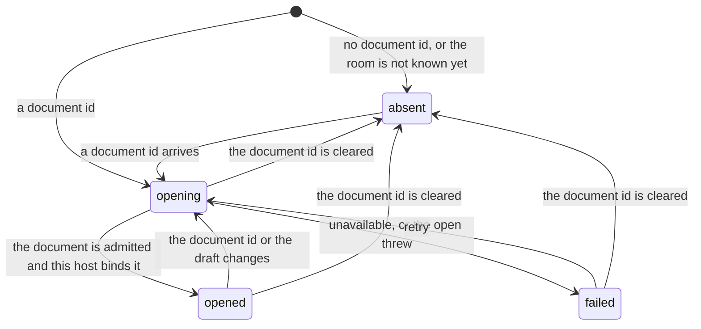

# Project context state machines

## Live document binding

One host's hold on an open document (`LiveDocumentBindingState` in
`use-live-document-binding.ts`). A host is a pane that shows a document. It asks the opener
(`ProjectDocumentLiveOpener`) to admit the document's room, then binds the admission: the
room's session plus a `release()`. The room is the document's Live room, or on a draft page the
draft's fork room (`draftId`), whose session the registry builds over the Live one.

- **Leaving `opened` releases the binding**, and an open that finishes after its effect was
  torn down releases what it bound instead of publishing it. A binding that is never released
  keeps the document's room alive.
- **A cancelled open is not a failure.** Account shutdown cancels opens without aborting the
  effect, and the state stays `opening` through teardown.
- `failed` keeps the reason the opener gave, so the surface can tell "not available to you"
  from "could not be opened".

## Account lifetime

Whether the signed-in account's features take new work (`AccountFeatureLifetime` in
`client/account/account-lifetime.ts`). Its one stored state is `epochSignal`: aborted means closing.
The document session registry, the opener and every account-scoped fetch read that signal
rather than keeping their own. Sign-out, switching accounts, and the account's sign-in in this
browser ending elsewhere close it.

```mermaid
stateDiagram-v2
  [*] --> open
  open --> closing: sign-out or an account switch aborts epochSignal
  open --> closing: the sign-in ended elsewhere (the count moved, or the server refused a request for another account)
  closing --> closing: the close fails; the next close tries again
  closing --> closed: the registry's close retires every session
```

- **Mounting signed in delivers what stored copies hold.** `resumeFeatureLease` runs the
  registry's stored-copy pass (`deliverStoredCopies`): words a held session had not delivered
  when its page went away (a reload, a closed tab) reach the server on the next load in any tab
  of the account, without the writer reopening the document.
- **`closing` refuses new work and lets go of what is held.** The registry refuses `admit`, `get`,
  `retain`, `restartUnavailableRoom`, `whenSentAcknowledged` and `clearLocalCopy`
  once the signal is aborted, but `release` still runs, so a view unmounting during the close
  does not leak a hold. Its `close` throws unless the signal is aborted, so a closed registry can't
  take work again. An open the shutdown cuts off, even mid-bind, is teardown, not a failure (Live
  document binding, above).
- **`closed` is the registry's settled close.** `finishClose` closes the tree lists, Draft
  commands and the removal lease, then joins the registry's one close attempt: a second close
  while one is in flight waits on the same retirement, and a failed one is tried again by the
  next call.
- **One owner signs an account out of this browser: `clearForSignOut`.** Every sign-out started
  in this browser (the menu, `/logout`) runs it, so every one deletes the account's copies after delivering
  what they hold, or refuses ("Couldn't log out", Retry) and deletes nothing. The menu runs it in
  the tab's mounted lifetime, which holds the open sessions and their typing. `/logout`, typed or
  opened in a new tab, runs it in a lifetime it builds for the session's account
  (`/api/auth/me`), shows "Logging out…" meanwhile and "Couldn't log out" with Retry on a
  refusal, and only then goes to `/end-session`. With no session (a 401) it goes straight there;
  any other failure to learn the account is a refusal, since without it nothing can be delivered
  or deleted. A lifetime that ends because its account's count
  moved (the owner ran in another tab) does not delete: it waits on its open sessions, closes,
  releases its holds so the owner's deletion can take them, and goes to `/end-session`. A tab
  whose own sign-out is running when the count moves lets that sign-out finish instead
  (`signOutRunning`): both deliver and delete the same copies, and ending the lifetime under it
  would only make it answer "Couldn't log out" before the tab leaves. If that sign-out refuses
  (its own words couldn't be saved within its wait) and the count has moved meanwhile, the lifetime
  then ends as on a sign-out elsewhere, so the tab doesn't stay open under a session that ended. A copy
  left by a tab closed before the sign-out is a stored copy: the owner's wait reads it, delivers
  what it holds and deletes it with the rest. Words typed in another tab after the owner's wait
  answered, before that tab hears the count, are deleted unsent, and so are words that tab can't
  have saved within its own wait: the window is the time the count takes to reach the tab, plus
  that wait. A lifetime ended by another account signing in is the account-switch rule
  (below), not a sign-out.
- **Closing does not by itself delete local copies.** A copy goes on a fact that is final (the
  node's purge, its Work or chat purged, the account removed from the project:
  `list-removal-observer`) or at sign-out (`clearForSignOut` → `clearAccountCopies`, which fails
  the sign-out with `SignOutIncomplete("copies")` when one remains). Sign-out first waits for
  every edit to be saved by the server, not only received (`SignOutIncomplete("unsent")`
  otherwise): its own, those another tab typed into a copy this tab has open, and those in a
  stored copy no session has open. The wait is `UNSENT_EDITS_WAIT_MS`, the server's save cap
  (`ROOM_SAVE_MAX_WAIT_MS`, 10 s) plus 2 s, since anyone typing in the chapter restarts its 2 s
  save debounce; right after typing it ends in about 2 s. While another tab or device keeps typing
  in the same chapter the server never has everything saved, so sign-out answers "Couldn't log
  out" until the typing stops. The registry reads each current copy, one at a time, for ops beyond
  its saved mark (from the bytes' headers, `storedOpsBeyondMark`) and opens a session on each
  that has them, so it delivers like an open document and then retires; on a timeout it stays
  held until saved, so the next Retry passes once the server has saved it. The wait answers from one fresh
  synchronous pass over every room's session, taken after a last read of the stored copies if it
  waited since the one before; while anything is pending and the deadline holds, it waits for the
  next change and looks again. So typing into any chapter during the wait, or a session opened
  meanwhile, keeps it waiting, and between that pass and `finishClose`'s abort only microtasks run
  (`clearForSignOut` awaits nothing in between). The account closing under it, a session that left
  with ops pending, or a room it could not open (a teardown outlasting the wait) is a no. If
  anything but this sign-out closed the account, `clearForSignOut` refuses too. Only the
  signing-out tab reads stored copies: a tab whose sign-in ended elsewhere (`signedOutElsewhere`)
  waits on its open sessions only.
- **After a sign-out's deletion succeeds, no copy of the account exists in this browser, whatever
  other tabs do.** `clearAccountCopies` first counts a sign-out of the account here
  (`meridian:sign-outs:` in `localStorage`, `core/account-sign-outs.ts`), then deletes each copy under its exclusive Web
  Lock. Each account lifetime notes the count when it starts (`signedInSince`), and opens a copy
  only while the count is unchanged: a document session only once its shared hold is granted; a
  tree list before opening its copy, though with no lock, so one opened at the instant of the
  deletion can still slip through. So a copy open in another tab is deleted once that tab lets
  go, and no lifetime that began before the sign-out opens or re-creates one after it; a sign-in
  afterwards starts a lifetime that may.
- **The count is how every tab hears that a lifetime's account is no longer the browser's.** The
  cookie is the browser's, so a tab learns it only from the server refusing what it named, or
  from the count. Three things count a sign-out: the sign-out (`clearAccountCopies`, before it deletes, from
  the menu or `/logout`); a lifetime's start, for every other account, before it deletes their
  copies (`endOtherAccounts`, which also runs when `/logout` builds its lifetime); and the server
  refusing something this lifetime sent for its account (next bullet). A lifetime records its account
  here when it starts (`signedInSince`), which is what lets another account's start count it. It
  hears the count move through the `storage` event, which never fires in the tab that wrote it, so
  a tab's own sign-out, and a lifetime React builds and never mounts, can't end it; it listens
  only while mounted (`resumeFeatureLease`), and checks the count on mounting and on a restore from
  the back-forward cache (`pageshow`), which hears no `storage` event while cached. Hearing it, the
  lifetime ends as on a sign-out elsewhere: it waits up to 12 s for its open sessions, closes, and
  goes to `/end-session?account=<its sign-in provider id>`. The lifetime holds that id (`externalId`,
  the WorkOS user id) beside its own: `/end-session` compares it with the session's
  (`getAuth().user.id`, already refreshed by the AuthKit middleware), so no call to the API decides
  it. It ends the session only on a match, and otherwise goes to `/`, so a tab whose account left
  never signs out the one that signed in since. A sign-out goes to the address `clearForSignOut`
  resolves to, the same one, never the id AuthKit's client hook holds now, which in a stale tab
  may already be the new account's. Between the count
  moving and the event's task running, a session that opens gets no copy and runs from memory; the
  lifetime then ends.
- **Everything a lifetime sends names its account, and the server compares it with the
  session.** The lifetime's one `requests` (its id and its `accountChanged`) is what is named.
  Every request goes out through `apiFetch` in `http-client.ts`, which adds
  `x-meridian-account` for a same-origin URL and, on a 409 `wrong_account`, runs the named
  account's `changed`; the import upload's XHR, which needs upload progress, uses the same two
  steps (`accountFor` and `accountHeaders`, then `answeredFor`). An `<a download>` or ``
  can't carry a header, and another origin's URL (signed storage, a pasted web address) is never
  named, since the header would cost it a CORS preflight. What a component built for the lifetime
  sends names that lifetime: the command driver's transport, the failure log and the thread
  socket take `requests` from the account context (`useRequestAccount`), and the socket's URL carries
  `?account=`. Anything else names the mounted lifetime: mounting (`resumeFeatureLease`) makes it
  the one `apiFetch` names (`sendRequestsAs`), and it stays named until another lifetime mounts,
  so a request sent while one account closes and the next has not mounted is refused rather than
  sent as whoever the cookie says. Each room Join carries the account in its `auth`. The server
  checks the header once, in `requireAppUser`, and answers 409 `wrong_account`; the thread
  socket's upgrade closes it 4409 `account-changed`; the Join is refused `account-changed`. Each
  runs the `accountChanged` of the account it named: count a sign-out of the account, then end
  as on a sign-out elsewhere. A request with no account (sent before any lifetime mounted: the
  first page's loaders, `/logout`, `./mf`, probes) is not checked, and neither is
  `/api/auth/me`, which is how a tab learns the account. Server-side loaders run with no lifetime
  and send none: they render for the request's cookie, which is the account the page then mounts.
  A chat message refused this way stays in the account's chat journal unanswered, not rejected
  (`classifyWriteFailure`), so it is posted when that account's next lifetime drives its chat,
  and never as another account; a command stays in the account's command journal, paused.
- **A full `localStorage` degrades the signal, not the app.** A count or record that can't be
  written is reported and skipped: a tab that misses it keeps its lifetime, and the server's
  account check is what still keeps its words from going out as another account. A sign-out whose count
  can't be written still deletes; a lifetime in another tab that began earlier may then re-create
  a copy it opens.
- **Words a lifetime ended this way holds undelivered** stay in that account's stored copies.
  The next lifetime of another account in this browser deletes them unread (below), which is
  what happens when the account changed. Otherwise they go out only when their document is opened
  again, or at the next sign-out's wait, which reads every stored copy; nothing at a lifetime's
  start delivers them. Whether to keep them for that account is the open account-switch question.
- **What reaches `clearAll` without that wait**, as it stands: a Retry after
  `SignOutIncomplete("copies")` (the account is already closed, so it deletes again);
  the copies a lifetime ended elsewhere had open, since it closes whatever its own wait answers and
  the owner's deletion then takes them; an account switch, which deletes another
  account's copies unread (below). A lapsed sign-in never reaches `clearAll`: its copies stay.
- **Words in a room the server won't take writes from are dropped** at sign-out, open or stored:
  they aren't waited for and their copy is deleted. Read access shows one "Couldn't save" from the
  menu (likely hidden by the navigation to `/end-session` that follows), and nothing on `/logout`'s
  page, which has no pills; a room unauthorized, deleted or ended drops
  them with no notice. Whether words typed offline into a chapter deleted or made read-only
  meanwhile should be kept is the owner's call.
- **Another account's copies are deleted unread.** `endOtherAccounts`, at each account
  lifetime's start, deletes every copy of every other account in this browser. Their undelivered
  ops are lost, since only that account's session may send them; keeping them for that account's
  next sign-in is the owner's call (privacy on a shared browser against the typing). A session closing, or access
  the account lost for now, never deletes one.
