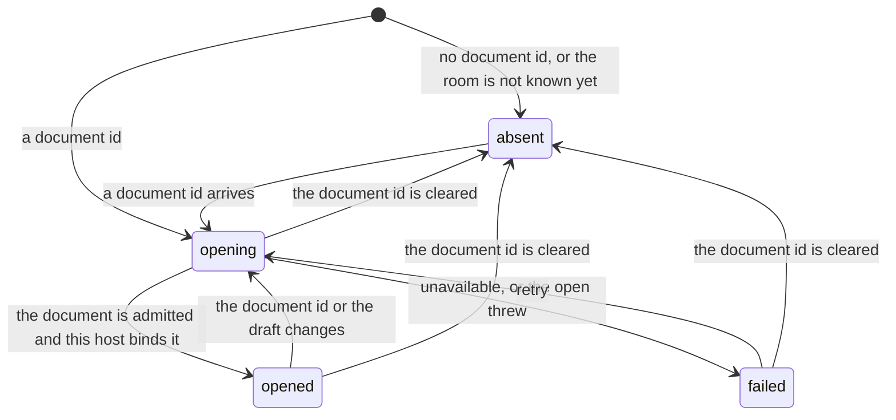

# Project context state machines

## Live document binding

One host's hold on an open document (`LiveDocumentBindingState` in
`use-live-document-binding.ts`). A host is a pane that shows a document. It asks the opener
(`ProjectDocumentLiveOpener`) to admit the document's room, then binds the admission: the
room's session plus a `release()`. The room is the document's Live room, or on a draft page the
draft's fork room (`draftId`), whose session the registry builds over the Live one.

- **Leaving `opened` releases the binding**, and an open that finishes after its effect was
  torn down releases what it bound instead of publishing it. A binding that is never released
  keeps the document's room alive.
- **A cancelled open is not a failure.** Account shutdown cancels opens without aborting the
  effect, and the state stays `opening` through teardown.
- `failed` keeps the reason the opener gave, so the surface can tell "not available to you"
  from "could not be opened".

## Account lifetime

Whether the signed-in account's features take new work (`AccountFeatureLifetime` in
`account-feature-lifetime.ts`). Its one stored state is `epochSignal`: aborted means closing.
The document session registry, the opener and every account-scoped fetch read that signal
rather than keeping their own. Sign-out and switching accounts close it.

```mermaid
stateDiagram-v2
  [*] --> open
  open --> closing: sign-out or an account switch aborts epochSignal
  closing --> closing: the close fails; the next close tries again
  closing --> closed: the registry's close retires every session
```

- **`closing` refuses new work and lets go of what is held.** The registry refuses `admit`, `get`,
  `retain`, `setHosted`, `restartUnavailableRoom`, `whenSentAcknowledged` and `clearLocalCopy`
  once the signal is aborted, but `release` still runs, so a view unmounting during the close
  does not leak a hold. Its `close` throws unless the signal is aborted, so a closed registry can't
  take work again. An open the shutdown cuts off, even mid-bind, is teardown, not a failure (Live
  document binding, above).
- **`closed` is the registry's settled close.** `finishClose` closes the tree lists, Draft
  commands and the removal lease, then joins the registry's one close attempt: a second close
  while one is in flight waits on the same retirement, and a failed one is tried again by the
  next call.
- **Closing does not by itself delete local copies.** A copy goes on a fact that is final (the
  node's purge, its Work or chat purged, the account removed from the project:
  `list-removal-observer`) or at sign-out (`clearForSignOut` → `clearAccountCopies`, which fails
  the sign-out with `SignOutIncomplete("copies")` when one remains). Sign-out first waits up to
  8 s for unsent edits (`SignOutIncomplete("unsent")` otherwise). A session closing, or access
  the account lost for now, never deletes one.
