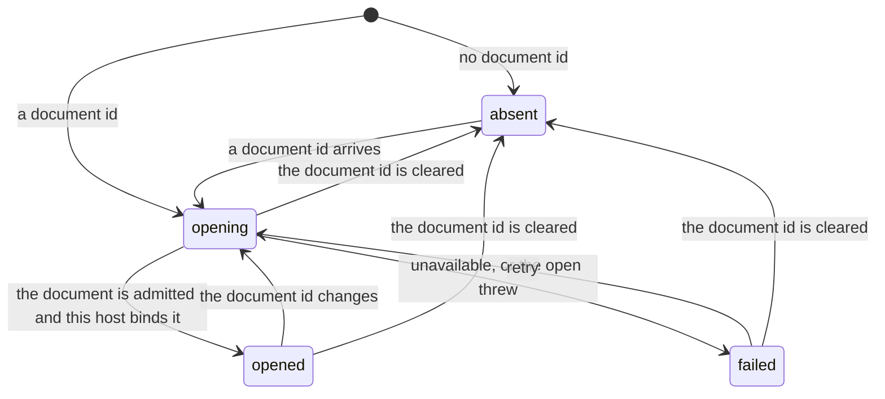

# Project context state machines

## Live document binding

One host's hold on an open document (`LiveDocumentBindingState` in
`use-live-document-binding.ts`). A host is a pane that shows a document. It asks the opener
(`ProjectDocumentLiveOpener`) to admit the document, then binds the admission: the live
document session plus a `release()`.

- **Leaving `opened` releases the binding**, and an open that finishes after its effect was
  torn down releases what it bound instead of publishing it. A binding that is never released
  keeps the document's room alive.
- **A cancelled open is not a failure.** Account shutdown cancels opens without aborting the
  effect, and the state stays `opening` through teardown.
- `failed` keeps the reason the opener gave, so the surface can tell "not available to you"
  from "could not be opened".
