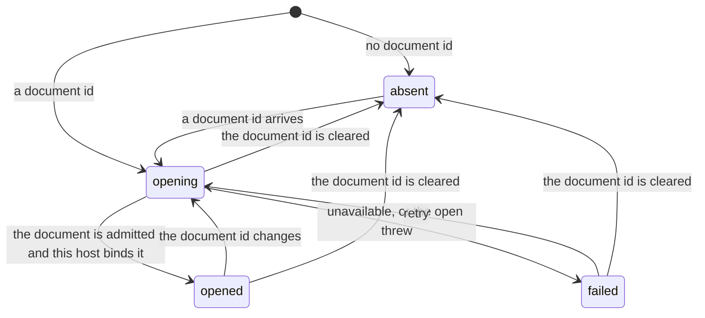
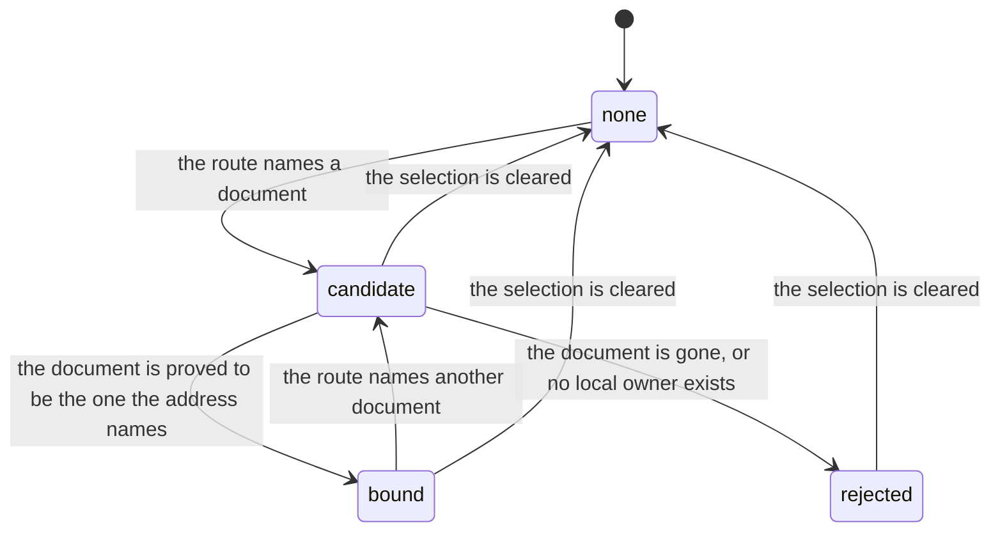
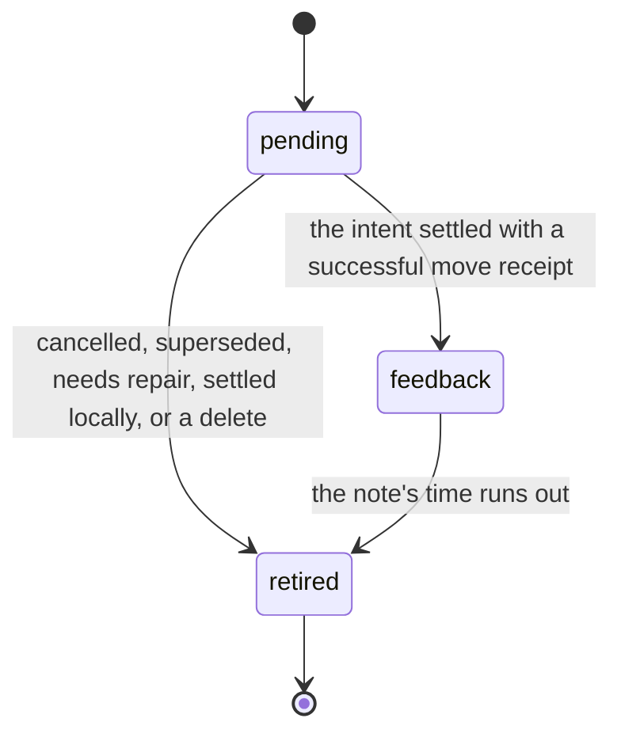

# Project context state machines

## Live document binding

One host's hold on an open document (`LiveDocumentBindingState` in
`use-live-document-binding.ts`). A host is a pane that shows a document. It asks the opener
(`ProjectDocumentLiveOpener`) to admit the document, then binds the admission: the live
document session plus a `release()`.

- **Leaving `opened` releases the binding**, and an open that finishes after its effect was
  torn down releases what it bound instead of publishing it. A binding that is never released
  keeps the document's room alive.
- **A cancelled open is not a failure.** Account shutdown cancels opens without aborting the
  effect, and the state stays `opening` through teardown.
- `failed` keeps the reason the opener gave, so the surface can tell "not available to you"
  from "could not be opened".

## Route selection during removal

Which document the route is trying to show while documents are being removed
(`ContextRouteSelection` in `context-removal-protocol.ts`; the coordinator in
`context-removal-coordinator.ts` holds it).

Three things prove a `candidate`: the navigation named the document, a lookup answered with
it, or the address carries a review item for it. The last holds only for that address.

Every change increments `revision`, and work started for an earlier revision is dropped when it
returns. A `candidate` carries the obligations still pending for it and a guard against
re-entering a document whose removal already finished: binding without checking that guard
reopens a document the writer just deleted.

## Rename and move feedback

What to show for one rename or move of a document or folder the writer made (`operationLifecycle` in
`rename-operation-lifecycle.ts`). It is computed from the newest
[namespace intent](../../../../../../../packages/resource-replica/.context/state-machines.md)
that carries the operation id.

No matching intent yet is `pending`, not `retired`: a cached projection can be read before the
intent is admitted, and retiring on absence would drop the note for an operation that is about
to appear. A rebased successor keeps the operation id, and the intent with the highest
`sequence` decides.
