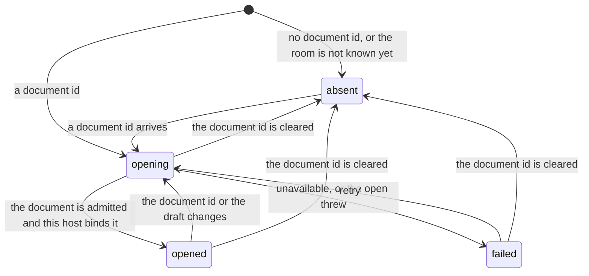

# Project context state machines

## Live document binding

One host's hold on an open document (`LiveDocumentBindingState` in
`use-live-document-binding.ts`). A host is a pane that shows a document. It asks the opener
(`ProjectDocumentLiveOpener`) to admit the document's room, then binds the admission: the
room's session plus a `release()`. The room is the document's Live room, or on a draft page the
draft's fork room (`draftId`), whose session the registry builds over the Live one.

- **Leaving `opened` releases the binding**, and an open that finishes after its effect was
  torn down releases what it bound instead of publishing it. A binding that is never released
  keeps the document's room alive.
- **A cancelled open is not a failure.** Account shutdown cancels opens without aborting the
  effect, and the state stays `opening` through teardown.
- `failed` keeps the reason the opener gave, so the surface can tell "not available to you"
  from "could not be opened".

## Account lifetime

Whether the signed-in account's features take new work (`AccountFeatureLifetime` in
`account-feature-lifetime.ts`). Its one stored state is `epochSignal`: aborted means closing.
The document session registry, the opener and every account-scoped fetch read that signal
rather than keeping their own. Sign-out and switching accounts close it.

```mermaid
stateDiagram-v2
  [*] --> open
  open --> closing: sign-out or an account switch aborts epochSignal
  closing --> closing: the close fails; the next close tries again
  closing --> closed: the registry's close retires every session
```

- **`closing` refuses new work and lets go of what is held.** The registry refuses `admit`, `get`,
  `retain`, `setHosted`, `restartUnavailableRoom`, `whenSentAcknowledged` and `clearLocalCopy`
  once the signal is aborted, but `release` still runs, so a view unmounting during the close
  does not leak a hold. Its `close` throws unless the signal is aborted, so a closed registry can't
  take work again. An open the shutdown cuts off, even mid-bind, is teardown, not a failure (Live
  document binding, above).
- **`closed` is the registry's settled close.** `finishClose` closes the tree lists, Draft
  commands and the removal lease, then joins the registry's one close attempt: a second close
  while one is in flight waits on the same retirement, and a failed one is tried again by the
  next call.
- **Closing does not by itself delete local copies.** A copy goes on a fact that is final (the
  node's purge, its Work or chat purged, the account removed from the project:
  `list-removal-observer`) or at sign-out (`clearForSignOut` → `clearAccountCopies`, which fails
  the sign-out with `SignOutIncomplete("copies")` when one remains). Sign-out first waits up to
  8 s for unsent edits (`SignOutIncomplete("unsent")` otherwise): its own, those another tab
  typed into a copy this tab has open, and those in a stored copy no session has open. The
  registry reads each current copy, one at a time, for ops beyond its server mark (from the
  bytes' headers, `storedOpsBeyondMark`) and opens a session on each that has them, so it
  delivers like an open document and then retires; on a timeout it stays held until
  acknowledged, so the next Retry passes once it has delivered. The wait answers from one fresh
  synchronous pass over every room's session, taken after a last read of the stored copies if it
  waited since the one before; while anything is pending and the deadline holds, it waits for the
  next change and looks again. So typing into any chapter during the wait, or a session opened
  meanwhile, keeps it waiting, and between that pass and `finishClose`'s abort only microtasks run
  (`clearForSignOut` awaits nothing in between). The account closing under it, a session that left
  with ops pending, or a room it could not open (a teardown outlasting the wait) is a no. If
  anything but this sign-out closed the account, `clearForSignOut` refuses too. Only the
  signing-out tab reads stored copies: a tab told of the sign-out (`signedOutElsewhere`) waits on
  its open sessions only.
- **After a sign-out's deletion succeeds, no copy of the account exists in this browser, whatever
  other tabs do.** `clearAll` first counts a sign-out of the account here (`meridian:sign-outs:`
  in `localStorage`), then deletes each copy under its exclusive Web Lock. Each account lifetime
  notes the count when it starts (`copiesOpenSince`), and opens a copy only while the count is
  unchanged: a document session only once its shared hold is granted, else it runs from memory;
  a tree list before opening its copy, though with no lock, so one opened at the instant of the
  deletion can still slip through. So a copy open in another tab is deleted once that tab lets
  go, and no lifetime that began before the sign-out opens or re-creates one after it; a sign-in
  afterwards starts a lifetime that may. Two causes left a chapter's copy behind before: a tab
  whose own sign-out was still opening a copy re-created one another tab had just deleted, and
  in a development build React's StrictMode built a second, never-mounted lifetime per tab whose
  sign-out channel heard the tab's own broadcast and navigated it to `/logout` before its
  deletion finished. The channel now opens only while the lifetime is mounted
  (`resumeFeatureLease`).
- **What reaches `clearAll` without that wait**, as it stands: a Retry after
  `SignOutIncomplete("copies")` (the account is already closed, so it deletes again);
  `signedOutElsewhere`, which ignores its wait's answer; an account switch, which deletes another
  account's copies unread (below). A lapsed sign-in never reaches `clearAll`: its copies stay.
- **Words in a room the server won't take writes from are dropped** at sign-out, open or stored:
  they aren't waited for and their copy is deleted. Read access shows one "Couldn't save" (likely
  hidden by the `/logout` navigation that follows); a room unauthorized, deleted or ended drops
  them with no notice. Whether words typed offline into a chapter deleted or made read-only
  meanwhile should be kept is the owner's call.
- **Another account's copies are deleted unread.** `clearCopiesOfOtherAccounts`, at each account
  lifetime's start, deletes every copy of every other account in this browser. Their undelivered
  ops are lost, since only that account's session may send them; keeping them for that account's
  next sign-in is the owner's call (privacy on a shared browser against the typing). A session closing, or access
  the account lost for now, never deletes one.
