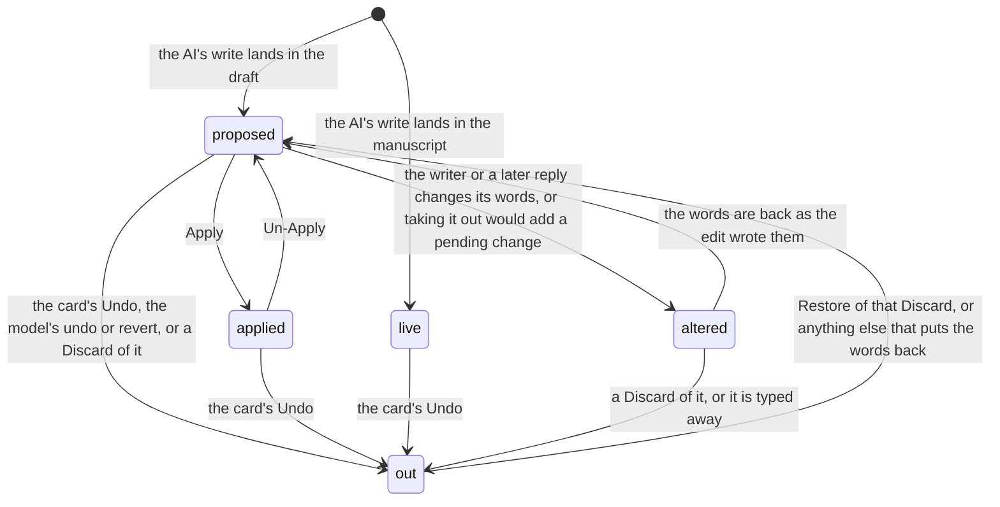

# Collab — reversal contracts

Reversal reads what an edit recorded and writes a merge, for card actions and the model's
Undo/Revert alike. There is no Redo: the card's and the model's `redo` are gone, and to redo, the
model writes the edit again (the writer asks it to). An inverse is an ordinary
immutable journal edit; it never rewrites a target row or marks it reversed.

## An AI edit is text

The card's state and Undo read what an edit recorded, never Yjs item ids. Each AI write records its
`delta` (the blocks it changed, before and after: `document_edit_parts.delta`), in a draft and in
the manuscript alike. A change of the edit is one of the differences its delta cuts
(`content-merge/stands.ts`). It **stands** in a text when the text holds it and merges it out
cleanly (`changeState` against a draft's review base, `changeStateIn` for the manuscript), and a
press writes only a change that stands and adds no pending change to Changes: one state for the
offer and the press, so the card offers Undo exactly when a press takes something back.

One operation takes a change out wherever it is, `takeOut`: the merge of its inverse, as the pull
would turn it around. The card's Undo plans (`prepare` in `domain/turn-inverse-service.ts`), in
step order, newest edit first, each judged on what the steps before it leave:

- **A change proposed in an open draft** (a `content` step): taken out of the draft's text as an
  append under the draft's hold (`commitContentStep`), when it stands there and sits in a pending
  change.
- **A change an Apply took** (a `manuscript` step on the drafted part): the Apply's effect row
  names it in `carried`; it is taken out of Live when it still stands there, and out of the draft's
  base and text where it stands there (`takeBack` in `domain/draft-changes.ts`), so nothing is left
  pending. A change the writer typed inside does not stand, and the card has no Undo for it.
- **An edit the AI wrote straight into Live** (a `manuscript` step): taken out of Live when it
  stands.

A step records one receipt of kind `undo` that names the parts it took, so the card says
"Undone" and a part an Undo took is not a target again until a change of it is back in a draft. The
model's `undo` and `revert` of a part in an open draft are the same `content` step
(`model-inverse-policy.ts`), and those of a part in Live are the same `manuscript` step the card's
Undo of one is: the model's `undo` and `revert` and the card's Undo differ in who asks and in what
stack they count, not in how a change comes out. A step of the model's Undo is recorded as an edit
with its own `delta`, so a later `undo` of that revert reads back like any other edit.

No code steps this machine: each change's state is read on every read, so it cannot go stale.
Applied is the effect row's `carried` while its `unapplied_by` is null; it is read from the
database, not from the draft's text. The card's Undo of an applied change leaves the Apply in force
(a Changes row's Undo and Ctrl+Z still take the rest of it back), and a row's Un-Apply of an Apply
whose words the card already took out finds `live_delta` no longer standing and writes nothing.

## Commands and policy

`reverseThreadContext` is the whole-turn card command. Its authenticated POST
accepts only `{ scope: "turn", target: turnId, commandId }`; the browser mints
`commandId` for each click and each Try again. It is a `reverse_turn` row in `commands`:
`DocumentCommands.run` claims the id and runs the whole reversal in one transaction, and stores
its outcome, the no-op answers included (`nothing_to_undo`, `expired`); every stored answer is
`done`. The turn's Work receipts (`reverseTurnCard`'s `alongside`,
`lib/work-receipt-reversal.ts`) run in the same command, after the documents, so a click holds
both halves or neither; its one stored outcome answers a resend, and another request under the id
is `command_conflict` (409). The receipts the reversal writes carry `document_edits.command_id`. A drafted tree step whose Work's branch no longer places the node (a Discard took it out) is
dropped from the grants and never run: it is left alone, and the rest of the reply still
reverses (`TreePlan.gone`). A target in a closed owner's draft (an archived or deleted Work, a chat
in Trash) is planned per target, not refused: the reversal lands Live and open targets and plans nothing
for a closed one, and the card says nothing about it (its Undo is absent while the owner is
closed). A reversal whose every target is closed answers `expired`. An owner that closes between the capture and the commit is a refusal naming `work_archived` or `chat_frozen`: the reversal is refused with that reason. A denial for another reason refuses the
whole reversal (`permission_denied`), which the card shows as a failed press.
A tab that predates the removal of Redo still sends `direction`; the route accepts it, and a
`"redo"` answers 200 `{ status: "expired", documents: [] }` without running anything.
A Work's thread and Work locks come before every document lock (the order in `CONTEXT.md`), so the
command declares its owners first. After the claim, `reversalOwners` reads, with no lock, the Works
and lineages the commit will lock (the documents' drafts, the reply's tree receipts, and each
document's own Work) and the service adds the receipts' Works; `lockWorkThreadTrees` takes the
threads of the receipt Works (marked ones included) and the chat's own, parents first, each as the
runtime's thread lock does, so the Work step's `stopThreads` re-enters locks it already holds; then
all the Works by id, the lineages and, when receipts exist, the project's tree lists and the
namespace keys a restore takes (`works.lockRestoreNamespaces`). The documents' Works are locked as
rows only. The set includes the owners of the sources the tree steps would change (`plan`'s
`owners`: the estimate, read from the steps' `undoReports`). The commit scope compares the Works it
would lock with that set before taking any lock; a Work outside it throws `TreeOwnersMoved`
(`shared/tree-owners.ts`), which rolls back past the claim and reruns the command with the larger
set and every source the attempt met unlocked (`untilOwnersHold`, the same restart Apply and
Un-Apply use; a restart that names nothing new escapes as 503 with `Retry-After`, and one that names
nothing at all (only a fresh read) escapes after four,
storing nothing). The capture's reads run on the command's own connection, as a model edit's do. Capture resolves each
immutable origin once: live, its active draft, or gone. One turn may reverse a
document's live and draft text together, each on that destination's captured
view, inside one ordered stream. Planning, history and result presentation use
that same resolved object; commit reads the committed text under its locks before it writes.

After selection, one admission call authorizes every content destination. Commit runs under those exact grants and confirms them after
locking their combined Work set. The incoming content grant carries the caller
identity only; it never chooses the inverse branch. Undo lands in the
Work that owns the selected edit, including after the chat is rebound. A user
card uses the same admission boundary.

An invertible active part offers Undo. One eligibility rule, in the captured planner
(`model-reversal-planner.ts`, `taken`/`takenBy`), decides what every reversal may still take: a
part an Undo took (the card's, a writer's revert, or the model's own undo in the same chat) is not
available, whatever the text says. Nothing reverses an Undo, so its action is the
permanent record of what it took. Without the rule, an older edit's Undo that removed the text a
newer edit's Undo restored leaves that newer edit "restorable" again: a card would take it out on
every press, and a model `revert` of it would bring back an intermediate word. The card's Undo and
its chip choose from one selection (`prepare`): a taken part is neither a step nor a skip. The
model's `undo` and `revert` list a taken part as `already removed`, and `read(format: "edits")`
offers neither for it, because the listing asks the same planner. A model's forward revert is its
own edit: undoing it is an Undo of that edit, which leaves the original's parts untaken. Once nothing is left to undo, the chip
(`getDocumentAndTreeChip`) reads `undone` when the writer's own Undo (`actor: "human"`) took some of
the turn's text out, or the card's Undo took any of its tree changes (`treeUndoneByCard`, the
card's undo receipts, whatever has happened to the nodes since): the chip's `undone` flag. Otherwise
it carries no word (the same rule as for tree receipts below). Effective action state is indexed per
immutable part (`effectiveActionIndex`). A model count consumes original
actions: once a partial model Undo reverses any surviving part of an edit, the next count
continues to the preceding edit.

The model owns one strict stack per thread/document. `write undo` accepts a count; `write revert`
creates a new edit at the current (destination) view. Both read the part's `delta`: a part whose change no longer stands is skipped
and listed by its 1-based immutable part ordinal and reason, without quoting old
or current text. Undo refuses `cant_undo_changed` only when nothing of a text-only
edit remains to reverse. The model uses ordinary `read` for the passage;
`read(format: "edits")` reads immutable parts through the host port. Model actions
cannot use a reconstruction endpoint, reversal table, or reserved client. A
multi-edit Undo is all-or-nothing on stack availability; a count beyond what is available
refuses with the available count and changes nothing. User-actuated entries refuse model stack
commands. A card Undo pops the turn's poppable stack prefix and writes forward reverts for its
other text parts, including applied parts. The card plans nothing for a part whose draft was discarded and inverts the rest. A part of an open draft that no change waits on and that was not applied is left alone the same way, so the card offers Undo only while some of the turn's text still stands in a draft; the Discard's own notice Undo covers the rest.
A change **stands** where it landed when its inverse merges into the text without a conflict
and putting it back gives the text again (`content-merge/stands.ts`); an Undo or revert writes
only a change that stands, and leaves the others whole. The text decides, not who typed it:

- Typing beside the AI's words, or in another sentence, stays; the AI's change comes out.
- Typing inside the AI's words, or over them, is an edit the change cannot be merged out around:
  the change stands no longer, and the part is skipped as `edited_since` (`cant_undo_changed`
  when nothing of the edit is left). The AI's words are never half taken out with the writer's
  letters joined to what is left.
- A part an Undo took reads `already_removed`; a card's reversal skips it and the chip reads
  from the actions that took it.

A pull or Apply writes only the insertions inside a changed run that only gained characters
(`retainShared` in `packages/agent-edit/src/resolver/lower-block.ts`; any other change writes the
run whole), which is why typing inside the AI's words in a draft ends up beside the new words in
the pulled text. Un-Apply reads the same way: it takes out the Apply's own `live_delta` when that
stands in Live.
A card's reversal decides which tree steps can still act before it plans or admits any text
(`plan` in `adapters/drizzle-turn-tree-inverse.ts`), from the package's walk (`undoReports`) as the lists
stand (the fates are below, under tree receipts), and a drafted Undo only while its Work's branch
places the node. A step that can't act is a skip and never runs, so one purged document never
refuses the rest of the reply. The text targets and the grants come from the steps that act. A
card never targets the text of a document created by the turn, even after the create was undone;
the tree Undo takes the document back whole (`createdDocuments`).
The Work's draft stays as it is, with any other turn's change in it.
A reversal's result names a document in Trash by where it last stood.
A turn's edit targets include its create transition even when the document is empty. A create
that Undo removed stays addressable through that immutable target. A draft-scoped
edit of a document deleted live stays one: each draft-scoped target names
the Work of the branch its part was drafted in (`document_edit_parts.draft_branch_id`,
recorded with the part, so a draft purged from Trash keeps its target),
and the card's lineage and Undo
authorize it at that Work's draft destination (`turnEditDestination`), where
`survivingDraft` admits it while the draft exists. Its lineage address is the
location it was deleted at. Live-scoped targets authorize live.

Card authorization and change-viewer discovery share immutable edit and
origin targets with inverse admission; mutation and draft transport
journals are never authorization lineage. Card inverse rows are writer rows
with no turn. A model write carries a
`ResponseAuthorship`: `response_id` keeps provider authorship. The command's id
(`document_edits.command_id`) joins the text and tree receipts of one call.

Part disposition is computed once for each resolved destination.
`createDraftDispositionReader` reads receipts from that draft and the draft's Applies in force
(`carried`). A part with a change an Apply took is applied (and names each change's Apply);
otherwise an active draft is pending and a gone draft is discarded. A
revision mismatch between evidence and planning is not checked: the commit plans again on the
committed text.
Closed origins are gone and never stand in for a destination.
A part whose change no longer stands in an open draft (a sibling change in its paragraph was
applied or discarded since, or the writer typed over it) reads from its disposition first: applied
is "Applied to the manuscript", discarded is "Discarded", and only a pending part reads "Stayed as
you edited it". The planner decides these text-part causes once, for the per-edit omissions and the
turn record; the service does not derive them. A one-by-one discard in an open draft
still reads edited: the draft keeps no mark that tells it from retyped text (#1361).
Live destinations carry the captured physical source owner's lifecycle and the document's removal;
the chat's query draft never decides availability for live text. A surviving draft
still ignores live removal and accepts its own inverse.

Applied text is not a refusal. The model's Undo writes its inverse as a forward `revert` in the
active origin draft, leaving live untouched and making a pending change against the review base.
The card's Undo takes an applied change out of Live and the draft (above).

Review disposition is not otherwise inverse eligibility: an effective Undo that restores the
review base has no shown change and can read discarded. In an active draft a change that stands
and sits in a pending change decides Undo and Revert eligibility; a discarded or applied
disposition chooses the copy only when a part is skipped, ahead of the edited-since reading, so an
applied part never reads as the writer's edit. Effective action consumption follows immutable receipts,
regardless of whether those receipts currently contribute to review. A purged draft is never
writable (a Discard closes nothing). History derives its offered command from the same captured origin-resolved plan as the
write command; an archived origin shows no action even when the chat's current destination is
writable. Runtime context reports a card action by turn
and document, not model handle. There are no inverse holds or blocking flags.

## Tree changes

A tree change (create, move, rename, delete, restore, folders included) is its own command
with its records in the project's tree list, and a failed reply leaves what its tree calls did.
A chat card's Undo of a turn takes the reply's tree receipts back too, in the same
`reverse_turn` command as the text (`adapters/drizzle-turn-tree-inverse.ts`, after the text
steps, newest receipt first; a receipt the model's own `undo` reversed in the reply is part of
what the reply did, and the card leaves it). The receipts one list holds go back in one update of that list, so a browser showing
it redraws once for the whole Undo, not once a receipt. A create's receipt holds the folders the
create made on the way (outermost first), so its Undo takes them back with it. It
chooses from the same receipts and `reverses` links the model's `undo` does (`turnSteps`), takes
each list's receipts back in one walk (`takeBackAll`) in the list that holds the node, and records the reversal as a
receipt, so the two histories are one. The model's `undo` reads the same fate (`runTreeUndo`):
`taken` answers `reversed` and records the empty reversal, a receipt that stayed answers
`cant_undo_changed`, the card's skip, or `purged` when what it touched is gone (the card's `purged` too). A reply that touched both a project's
files and `user://` locks both lists; nothing moves between them, so each receipt goes back in
its own list. A reply that only changed the tree has a card: its documents are listed from the
turn's tree receipts too (`readTurnTreeTargets`), its folders as well (`readTurnFolderTargets`:
a folder has no document, so the item carries the node id with `folder: true` and no door), and
the receipt chip counts the tree steps. Every row's words come from the turn's write receipts:
its line (moved, copied, deleted, a folder's too) from each node's `before_at` and `after_at`, a
folder's name where the change left it (a clash's " (2)" included), the rows in the file tree's
order (by section, then rank and id at each level of the view that shows the row: `placesOf`; a
folder row at its address there now), and the same
words after the card's Undo (a change leaves the card only when the newest reversal in its chain
is the model's own undo). A drafted change says each half: `drafts` the text, from the turn's
parts, and `trees` the tree, from `draftedFates` in `@meridian/project-tree` over the receipt's
records (it follows a restored Discard's copies, and a record a later change landed over reads
`replaced`); per node, pending, else applied, else replaced, else discarded. A restored Discard may
put its copies in a new branch of the Work, so the card's tree plan judges and takes back each
drafted receipt in the branch of its newest copy (`newestDrafted`), not the branch it was written in. The card's label and
row word read both. Its lists' keys are taken before the documents' (in
`acquireMutationScope`), and its edit grants are the documents' own, a live restore its own grant.
A turn's text on a document the same turn deleted is not a card target while the document is in
Trash: the card's Undo restores the document, and a second Undo takes the text. The model's tree call
keeps a receipt (`tree_edit_receipts`: the record ids, the Work's branch) and one
`tree_edit_receipt_nodes` row for every node it changed, each with a write ordinal reserved on
that node's counter (`agent_edit_wid_counters`), the sequence the node's text edits take. The
`e<N>` the model is given is the ordinal on the receipt's subject.

A node has one history per chat: this agent's own tree receipts and text edits (each agent is its own peer for the text, as above, so the writer's typing never drops an edit from it; only an edit with no item left to remove or restore does), ordered by that ordinal,
with what was undone left out (`TreeHistory.historyOf`: the receipts that took a step and were
not reversed, and the ordinals the text engine's
own stack gives, `modelStack`). Model `undo` takes the newest `count` of them across both kinds,
and `revert` the receipt
the handle names. Tree records go back through the package's `takeBackAll`, which finds the live
copy of an applied or restored change by `carries`, and takes back only what the receipt did:
what others put in a folder it made stands and keeps it standing. The records an Undo makes name
what they take back (`undoes`), including Undo receipts. A model `move` between a project and `user://`
is a copy into the other list: its receipt is the copy's `create`, and its Undo deletes the copy.
A model `undo` that takes tree and text steps together is one command (the tree receipts
first, then the text engine's), so a refusal of the text half takes the tree half back with it.
The receipts carry the command's id (`tree_edit_receipts.command_id`), as the text receipts do,
and Undo counts by it: the steps of one command (a create with content is a node and its text)
are one step, taken together; `revert` names a handle and takes that receipt only.

Every text inverse (model undo and revert, and the card) is one ordered
stream of text steps (`domain/inverse-stream.ts`): each selected original edit is one step,
with its action and its place on the history axis, planned against the text the steps
before it leave (`planned` in the planner, one text per Live and per open draft). A model count-N Undo records N separate
actions. The commit runs the steps in planned order (the card merges documents newest first). A draft's text commits as one checkpoint rewrite, at its plan's first step.
A document removed at capture plans no live text (`document_deleted`);
a draft that outlived the removal still takes its own inverse. Commit takes the attempt's
document mutation locks in id order.

## Effects and failures

`hasEffect` compares the committed draft's `review_base` and `prosemirror` blocks.
Pending lists and counts include active drafts with `hasEffect`, plus created
nodes (including empty creates). Membership never depends on journal count,
generation, or inverse state. Receipt/chat membership comes from the shared
captured classification, not replayed journal ownership. The projection job is
dirtied after inverse commit; the inverse writes neither effect nor baseline.
Pull snapshot, effect, and projection updates commit in their own root
transaction. Root pulls must not be awaited while holding Work locks.

An inverse is an attempt. It captures its documents with no lock or lease
(live state, committed drafts alone, history, dispositions) and plans off every
lock; those reads need not agree with each other. Its commit scope is one
savepoint whose first locks are the Work rows (the captured drafts' Works and
the bound grants' Works in id order, the grants confirmed: a seam boundary),
then its documents' mutation locks in id order, then its drafts' rows; the
inverse takes no lock of its own, since those locks order two inverses
of one edit. Under them each step plans again on the committed text: a draft's step
re-runs `takeOutStanding` under the draft's hold, the manuscript step re-reads Live and re-runs
`takeBack`. A write that landed after the capture changes what a step takes, never whether the
inverse runs: the card and the model's Undo and Revert are never told to read and try again.
Delivery runs after the commit, outside the scope.

The card's chip answers from the same plan as the card's Undo (`prepare`): it reads each change's
`stands` against the text and builds nothing, so the offer and the press cannot differ. The cost is
one read of each document's blocks and about 2.5 ms per change, one document per turn of the loop
(`setImmediate`). The model's `undo` plans one document at a time on the same reads.

A card outcome reports committed destination per document. The reverse endpoint may return
semantic unavailable outcomes such as `nothing_to_undo`,
`expired`, or `partial` with HTTP 200; callers retain
those outcomes and refresh the turn query. The outcome carries no per-part explanation: the
card reads again and shows what is true.

Each tree receipt's fate is decided once, from the walk's own answers for its records
(`changeUndone` in `@meridian/project-tree`), and the planner, the reversal's status, the chip
and the model's `undo` all read it. The card's planner (`drizzle-turn-tree-inverse.ts` `plan`)
asks with `undoReports`, which writes nothing, inside its one read of each list (one walk over
the list's receipts in press order, each record in its receipt's view: the estimate equals its press
only on the same steps in the same order), then judges the sources they name (`answerOf`). When an
owner is closed it reads the lists again with `judge.closed`, so a held record is out of the tree
its successors are read from, and it judges the sources that read names, until they hold:
- `acts`: some record would be taken back. Only these are steps the chip offers Undo for.
- `taken`: every record's opposite already stands (the writer restored what the model
  deleted, or deleted what it created). It counts as taken back: the Undo records an empty
  reversal for it, the status is `reversed` when nothing else stayed, and the chip reads
  Undone. A receipt an earlier card Undo took counts the same, so a second Undo, concurrent or
  from a stale tab, answers `reversed` too; text an earlier card Undo took out does the same.
- `changed_since` or `purged`: the receipt stays, and nothing is said.
- `closed`: an opposite record would change a closed owner's notes (an archived or deleted Work, a
  chat in Trash): the record stays, as in Un-Apply, and the skip is `returned` with `why` and the
  owner's name. A source with no `context_sources` row reads `purged`. The card's Undo and the
  model's `undo` ask the same `TreeJudge` as Apply and Un-Apply, so a note the model moved out of
  an archived Work's notes does not go back into them. The model's `undo` locks the owners with
  its grants (`runWithEditGrants`' `alsoLock`), judges inside `treeCommand`, and restarts through
  `withTreeOwners`; its answer is `returned` with the owner.

The Work half (`lib/work-receipt-reversal.ts`) has fates of its own, one per Work, from where
the turn started and ended it: `taken` when the Work stands as the turn found it (the writer
deleted the Work the model made, or an earlier Undo did), `acts` when it stands as the turn left
it, and `stayed` anywhere else (the writer renamed it since). A taken Work counts as reversed, so
a second Undo answers `reversed`; a stayed one is a part the Undo left (`partial`, or `expired`
when nothing else was taken back); only a Work step that throws is `partial_failure`. It runs
after every document outcome, and the press's status comes from one count of the parts reversed,
stayed and failed across documents, tree and Works (`combineWorkReversalOutcome`). The reply's
chip is composed once (`getTurnReceiptChip` there; the collab port's `getDocumentAndTreeChip`
knows nothing of Works, so nothing else answers the card with it):
Undo while any part acts, `undone` once a part was taken and none acts now.

