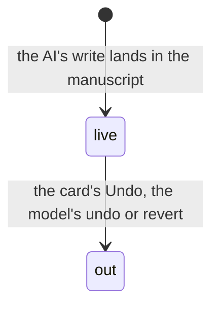

# Collab — reversal contracts

Reversal reads what an edit recorded and writes a merge, for card actions and the model's
Undo/Revert alike. There is no Redo: to redo, the model writes the edit again (the writer asks it
to). An inverse is an ordinary
recorded edit; it never rewrites a target row or marks it reversed.

## An AI edit is a Loro edit

Every Undo of an AI write, the card's and the model's `undo` and `revert`, goes by design §2's one
Undo rule ([undo-and-attribution]), the rule a press's Undo uses: `takeBack` (`take-back.ts`) takes the write
back whatever was written since (`undoEdits` in `@meridian/document-model` `invert.ts`). Each AI write into the manuscript records its Loro `edit`
(`document_edit_parts.edit`: the text docs it wrote with the ops between `before` and `after`, and
the structure values it set, by `editSince`) beside its `delta` (the blocks it changed, as
markdown, which the card's rows and `read(format: "edits")` excerpts read) and the room it wrote
in (`origin`: Live, or a draft's fork; a Draft chat's write into a document only its draft holds
is `live` with the draft's id). A part **stands** while it is not taken back and the room still
holds its history (`holdsEdit`; `compacted` otherwise): the card's offer and every Undo use that
one test (`unavailable` in the planner), so an Undo never takes a part the offer would not.

Every part goes back in the room it was written in, whatever room the chat writes in now: a chat
switched between Draft and Live still undoes and reverts the edits it made before the switch. The
capture (`capture` in `adapters/drizzle-turn-inverse.ts`) reads each room the chat's parts were
written in, and the one it writes in now; the planner (`createCapturedReversalPlanner`) and the
commit both take parts back through `undoInRooms` (`@meridian/agent-edit/integration`), which groups
them by room and runs `undoEdits` in each. The in-memory host's turn Undo and the model's undo run
the same function. The card's Undo takes only what the turn did outside a draft: its parts whose `origin` has no
`draftId`, and its live tree receipts. What it did in a draft, text and tree, is the turn's
restore (the card's `Undo turn`, [press](press.md)), a press with its own Undo (design §5), so one
action takes a reply back and the card offers Undo only when the turn wrote in Live or changed
the Live tree. The model's `undo` and `revert` still take a draft's parts. The card's
Undo plans (`prepare` in `domain/turn-inverse-service.ts`) in step order, newest edit first, each judged on what the steps before it leave (the planner takes planned
steps back on private copies of the captured rooms). A step's receipt has one part per room, with
the targeted parts' own `origin`. Only the batches the chat's current room holds (its own, and
Live's in a fork) join the reply's frontier. History is read in SQL to the chat's own parts and
every Undo and revert, and a fork part whose draft is gone is left out.

A step records one receipt of kind `undo` that names the parts it took, so the card says
"Undone". The model's `undo` and `revert` of a part in Live are the same step the card's Undo of
one is: they differ in who asks and in what stack they count, not in how a change comes out. A
step of the model's Undo is recorded as an edit with its own `delta`, so a later `undo` of that
revert reads back like any other edit.

No code steps this machine: each change's state is read from the document on every read, so it
cannot go stale.

## Commands and policy

`reverseThreadContext` is the whole-turn card command. Its authenticated POST
accepts only `{ scope: "turn", target: turnId, commandId }`; the browser mints
`commandId` for each click and each Try again. It is a `reverse_turn` row in `commands`:
`DocumentCommands.run` claims the id and runs the whole reversal in one transaction, and stores
its outcome, the no-op answers included (`nothing_to_undo`, `expired`); every stored answer is
`done`. The turn's Work receipts (`reverseTurnCard`'s `alongside`,
`lib/work-receipt-reversal.ts`) run in the same command, after the documents, so a click holds
both halves or neither; its one stored outcome answers a resend, and another request under the id
is `command_conflict` (409). The receipts the reversal writes carry `document_edits.command_id`. A target in a closed owner's draft (an archived or deleted Work, a chat
in Trash) is planned per target, not refused: the reversal lands Live and open targets and plans nothing
for a closed one, and the card says nothing about it (its Undo is absent while the owner is
closed). A reversal whose every target is closed answers `expired`. An owner that closes (or a draft that is purged) between the capture and the commit takes nothing, as one closed at the capture does: a closure the locks find rolls the commit back to a result that took nothing, so the card answers `expired` and the model what a fresh plan would. A denial for another reason refuses the
whole reversal (`permission_denied`), which the card shows as a failed press.
A tab of an older build may send `direction`; the route accepts it, and a
`"redo"` answers 200 `{ status: "expired", documents: [] }` without running anything.
A Work's thread and Work locks come before every document lock (the order in `CONTEXT.md`), so the
command declares its owners first. After the claim, `reversalOwners` reads, with no lock, the Works
and lineages the commit will lock (the reply's tree receipts, and each
document's own Work) and the service adds the receipts' Works; `lockWorkThreadTrees` takes the
threads of the receipt Works (marked ones included) and the chat's own, parents first, each as the
runtime's thread lock does, so the Work step's `stopThreads` re-enters locks it already holds; then
all the Works by id, the lineages and, when receipts exist, the project's tree lists and the
namespace keys a restore takes (`works.lockRestoreNamespaces`). The documents' Works are locked as
rows only. The set includes the owners of the sources the tree steps would change (`plan`'s
`owners`: the estimate, read from the steps' `undoReports`). The commit scope compares the Works it
would lock with that set before taking any lock; a Work outside it throws `TreeOwnersMoved`
(`shared/tree-owners.ts`), which rolls back past the claim and reruns the command with the larger
set and every source the attempt met unlocked (`untilOwnersHold`, the same restart Apply and
Un-Apply use; a restart that names nothing new escapes as 503 with `Retry-After`, and one that names
nothing at all (only a fresh read) escapes after four,
storing nothing). The capture's reads run on the command's own connection, as a model edit's do. Capture resolves each
immutable origin once: live or gone. Planning, history and result presentation use
that same resolved object; commit reads the committed text under its locks before it writes.

After selection, one admission call authorizes every content destination. Commit runs under those exact grants and confirms them after
locking their combined Work set. The incoming content grant carries the caller
identity only; it never chooses the inverse branch. Undo lands in the
Work that owns the selected edit, including after the chat is rebound. A user
card uses the same admission boundary.

An invertible active part offers Undo. One eligibility rule, in the captured planner
(`model-reversal-planner.ts`, `taken`/`takenBy`), decides what every reversal may still take: a
part an Undo took (the card's, a writer's revert, or the model's own undo in the same chat) is not
available, whatever the text says. Nothing reverses an Undo, so its action is the
permanent record of what it took. Without the rule, an older edit's Undo that removed the text a
newer edit's Undo restored leaves that newer edit "restorable" again: a card would take it out on
every press, and a model `revert` of it would bring back an intermediate word. The card's Undo and
its chip choose from one selection (`prepare`): a taken part is neither a step nor a skip. The
model's `undo` and `revert` list a taken part as `already removed`, and `read(format: "edits")`
offers neither for it, because the listing asks the same planner. A model's forward revert is its
own edit: undoing it is an Undo of that edit, which leaves the original's parts untaken. Once nothing is left to undo, the chip
(`getDocumentAndTreeChip`) reads `undone` when the writer's own Undo (`actor: "human"`) took some of
the turn's text out, or the card's Undo took any of its tree changes (`byCard` in `adapters/drizzle-tree-history.ts`, the
card's undo receipts, whatever has happened to the nodes since): the chip's `undone` flag. Otherwise
it carries no word (the same rule as for tree receipts below). Effective action state is indexed per
immutable part (`effectiveActionIndex`). A model count consumes original
actions: once a partial model Undo reverses any surviving part of an edit, the next count
continues to the preceding edit.

The model owns one strict stack per thread/document. `write undo` accepts a count; `write revert`
creates a new edit at the current (destination) view. Both read the part's `delta`: a part that no longer stands is skipped
and listed by its 1-based immutable part ordinal and reason, without quoting old
or current text. The model uses ordinary `read` for the passage;
`read(format: "edits")` reads immutable parts through the host port; its excerpt of each edit is
read from the part's `delta` (`deltaExcerpt`), and its state from the text as for any write
(`live`), or `undone` when an undo receipt names the part. The listing
shows the chat's parts in every room, each judged in its own (`too old to undo` for a part whose
room cut its history). Model actions
cannot use a reconstruction endpoint or reversal table. A
multi-edit Undo is all-or-nothing on stack availability; a count beyond what is available
refuses with the available count and changes nothing. User-actuated entries refuse model stack
commands. A card Undo pops the turn's poppable stack prefix and writes forward reverts for its
other text parts, including applied parts.
A part goes back whatever was written over it since (design §2, "An Undo always runs"):

- The write's characters that still stand come out, and what it deleted comes back; typing
  beside or inside the AI's words stays, around them.
- A part the writer deleted or retyped whole still goes back: its words are gone already, so the
  text it deleted comes back beside the writer's.
- A part whose room was compacted below its write can't go back, and the answer says the
  document no longer keeps history that old (`expired` when nothing of the edit is left).
- A model undo in a draft that takes out text an Apply already put in Live says so: the
  manuscript still has the text, and the draft now differs from it there.
- A part an Undo took reads `already_removed`; a card's reversal skips it and the chip reads
  from the actions that took it.

A card's reversal decides which tree steps can still act before it plans or admits any text
(`plan` in `adapters/drizzle-turn-tree-inverse.ts`), from the package's walk (`undoReports`) as the lists
stand (the fates are below, under tree receipts). A step that can't act is a skip and never runs, so one purged document never
refuses the rest of the reply. The text targets and the grants come from the steps that act. A
card never targets the text of a document created by the turn, even after the create was undone;
the tree Undo takes the document back whole (`createdDocuments`).
A reversal's result names a document in Trash by where it last stood.
A turn's edit targets include its create transition even when the document is empty. A create
that Undo removed stays addressable through that immutable target. A part's `origin` names the
room it was written in, Live or its draft's fork, and its Undo commits there.

Card authorization and change-viewer discovery share immutable edit and
origin targets with inverse admission; room batches are never authorization lineage. Card inverse rows are writer rows
with no turn. A model write carries a
`ResponseAuthorship`: `response_id` keeps provider authorship. The command's id
(`document_edits.command_id`) joins the text and tree receipts of one call.

History derives its offered command from the same captured origin-resolved plan as the
write command; an archived origin shows no action even when the chat's current destination is
writable. Runtime context reports a card action by turn
and document, not model handle. There are no inverse holds or blocking flags.

## Tree changes

A tree change (create, move, rename, delete, restore, folders included) is its own command
with its records in the project's tree list, and a failed reply leaves what its tree calls did.
A chat card's Undo of a turn takes the reply's live tree receipts back too, in the same
`reverse_turn` command as the text (`adapters/drizzle-turn-tree-inverse.ts`, after the text
steps, newest receipt first; a receipt the model's own `undo` reversed in the reply is part of
what the reply did, and the card leaves it). The receipts one list holds go back in one update of that list, so a browser showing
it redraws once for the whole Undo, not once a receipt. A create's receipt holds the folders the
create made on the way (outermost first), so its Undo takes them back with it. It
chooses from the same receipts and `reverses` links the model's `undo` does (`turnSteps`), takes
each list's receipts back in one walk (`takeBackAll`) in the list that holds the node, and records the reversal as a
receipt, so the two histories are one. The model's `undo` reads the same fate (`runTreeUndo`):
`taken` answers `reversed` and records the empty reversal, a receipt that stayed answers
`cant_undo_changed`, the card's skip, or `purged` when what it touched is gone (the card's `purged` too). A reply that touched both a project's
files and `user://` locks both lists; nothing moves between them, so each receipt goes back in
its own list. A reply that only changed the tree has a card: its documents are listed from the
turn's tree receipts too (`readTurnTreeTargets`), its folders as well (`readTurnFolderTargets`:
a folder has no document, so the item carries the node id with `folder: true` and no door), and
the receipt chip counts the tree steps. Every row's words come from the turn's write receipts:
its line (moved, copied, deleted, a folder's too) from each node's `before_at` and `after_at`, a
folder's name where the change left it (a clash's " (2)" included), the rows in the file tree's
order (by section, then rank and id at each level of the view that shows the row: `placesOf`; a
folder row at its address there now), and the same
words after the card's Undo (a change leaves the card only when the newest reversal in its chain
is the model's own undo). A drafted change says each half: `drafts` the text, from the turn's
parts, and `trees` the tree, from `draftedFates` in `@meridian/project-tree` over the receipt's
records (it follows a restored Discard's copies, and a record a later change landed over reads
`replaced`); per node, pending, else applied, else undone (the turn's restore in force took it),
else discarded. The card's label and row word read both. Its lists' keys are taken before the documents' (in
`acquireMutationScope`), and its edit grants are the documents' own, a live restore its own grant.
A turn's text on a document the same turn deleted is not a card target while the document is in
Trash: the card's Undo restores the document, and a second Undo takes the text. The model's tree call
keeps a receipt (`tree_edit_receipts`: the record ids, the Work's draft) and one
`tree_edit_receipt_nodes` row for every node it changed, each with a write ordinal reserved on
that node's counter (`agent_edit_wid_counters`), the sequence the node's text edits take. The
`e<N>` the model is given is the ordinal on the receipt's subject.

A node has one history per chat: this agent's own tree receipts and text edits (the writer's typing never drops an edit from it: an Undo always runs), ordered by that ordinal,
with what was undone left out (`TreeHistory.historyOf`: the receipts that took a step and were
not reversed, and the ordinals the text engine's
own stack gives, `modelStack`). Model `undo` takes the newest `count` of them across both kinds,
and `revert` the receipt
the handle names. Tree records go back through the package's `takeBackAll`, which finds the live
copy of an applied or restored change by `carries`, and takes back only what the receipt did:
what others put in a folder it made stands and keeps it standing. The records an Undo makes name
what they take back (`undoes`), including Undo receipts. A model `move` between a project and `user://`
is a copy into the other list: its receipt is the copy's `create`, and its Undo deletes the copy.
A model `undo` that takes tree and text steps together is one command (the tree receipts
first, then the text engine's), so a refusal of the text half takes the tree half back with it.
The receipts carry the command's id (`tree_edit_receipts.command_id`), as the text receipts do,
and Undo counts by it: the steps of one command (a create with content is a node and its text)
are one step, taken together; `revert` names a handle and takes that receipt only.

Every text inverse (model undo and revert, and the card) is one ordered
stream of text steps (`domain/inverse-stream.ts`): each selected original edit is one step,
with its action and its place on the history axis, planned against the text the steps
before it leave (`planned` in the planner, one text per document). A model count-N Undo records N separate
actions. The commit runs the steps in planned order (the card merges documents newest first).
A document removed at capture plans no live text (`document_deleted`). Commit takes the attempt's
document mutation locks in id order.

## Effects and failures

An inverse is an attempt. It captures its documents with no lock or lease
(live state, history) and plans off every
lock; those reads need not agree with each other. Its commit scope is one
savepoint whose first locks are the Work rows (the bound grants' Works in id order, the grants
confirmed: a seam boundary), then its documents' mutation locks in id order; the
inverse takes no lock of its own, since those locks order two inverses
of one edit. Under them each step plans again on the committed room: it reads each captured room again and
re-runs `undoInRooms`. A write that landed after the capture changes what a step takes, never whether the
inverse runs: the card and the model's Undo and Revert are never told to read and try again.
Delivery runs after the commit, outside the scope.

The card's chip and its Undo use the `prepare` plan and its `unavailable` check: one load of each
room the chat wrote the document in, one document per turn of the loop (`setImmediate`). The model's `undo` plans one document at a time on
the same reads.

A card outcome reports committed destination per document. The reverse endpoint may return
semantic unavailable outcomes such as `nothing_to_undo`,
`expired` (every part is past the history cutoff) or `partial` (some are) with HTTP
200; callers retain
those outcomes and refresh the turn query. The outcome carries no per-part explanation: the
card reads again and shows what is true.

Each tree receipt's fate is decided once, from the walk's own answers for its records
(`changeUndone` in `@meridian/project-tree`), and the planner, the reversal's status, the chip
and the model's `undo` all read it. The card's planner (`drizzle-turn-tree-inverse.ts` `plan`)
asks with `undoReports`, which writes nothing, inside its one read of each list (one walk over
the list's receipts in press order, each record in its receipt's view: the estimate equals its press
only on the same steps in the same order), then judges the sources they name (`answerOf`). When an
owner is closed it reads the lists again with `judge.closed`, so a held record is out of the tree
its successors are read from, and it judges the sources that read names, until they hold:
- `acts`: some record would be taken back. Only these are steps the chip offers Undo for.
- `taken`: every record's opposite already stands (the writer restored what the model
  deleted, or deleted what it created). It counts as taken back: the Undo records an empty
  reversal for it, the status is `reversed` when nothing else stayed, and the chip reads
  Undone. A receipt an earlier card Undo took counts the same, so a second Undo, concurrent or
  from a stale tab, answers `reversed` too; text an earlier card Undo took out does the same.
- `changed_since` or `purged`: the receipt stays, and nothing is said.
- `closed`: an opposite record would change a closed owner's notes (an archived or deleted Work, a
  chat in Trash): the record stays, as in Un-Apply, and the skip is `returned` with `why` and the
  owner's name. A source with no `context_sources` row reads `purged`. The card's Undo and the
  model's `undo` ask the same `TreeJudge` as Apply and Un-Apply, so a note the model moved out of
  an archived Work's notes does not go back into them. The model's `undo` locks the owners with
  its grants (`runWithEditGrants`' `alsoLock`), judges inside `treeCommand`, and restarts through
  `withTreeOwners`; its answer is `returned` with the owner.

The Work half (`lib/work-receipt-reversal.ts`) has fates of its own, one per Work, from where
the turn started and ended it: `taken` when the Work stands as the turn found it (the writer
deleted the Work the model made, or an earlier Undo did), `acts` when it stands as the turn left
it, and `stayed` anywhere else (the writer renamed it since). A taken Work counts as reversed, so
a second Undo answers `reversed`; a stayed one is a part the Undo left (`partial`, or `expired`
when nothing else was taken back); only a Work step that throws is `partial_failure`. It runs
after every document outcome, and the press's status comes from one count of the parts reversed,
stayed and failed across documents, tree and Works (`combineWorkReversalOutcome`). The reply's
chip is composed once (`getTurnReceiptChip` there; the collab port's `getDocumentAndTreeChip`
knows nothing of Works, so nothing else answers the card with it):
Undo while any part acts, `undone` once a part was taken and none acts now.

[undo-and-attribution]: https://github.com/haowjy/meridian-flow-docs/blob/main/work/local-first-design/loro-build/design.md#2-drafts
