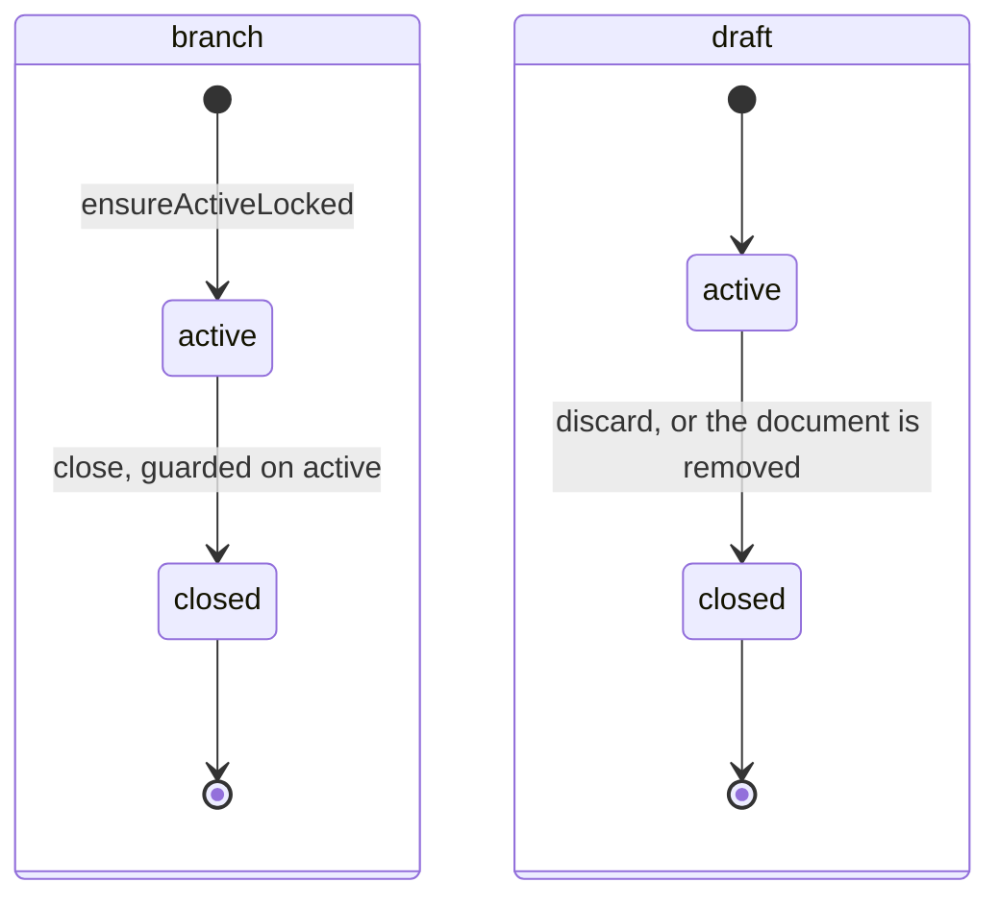

# Collab state machines

The status columns collab owns. A draft is a pending version of one document, and a branch is
the set of drafts one owner holds. None of these machines runs backwards. The model they
belong to is in [draft-model-and-records.md](draft-model-and-records.md).

## Draft and branch

`document_drafts.status` and `branches.status` (`packages/database/src/schema/yjs.ts`,
`branches.ts`).

- **Closed never reopens.** No production code moves a draft or a branch back to `active`; a
  new branch is a new row, and an Undo of a Discard copies a closed draft's bytes into a new
  `active` draft (`discard_command_drafts`), leaving the closed one as it was. Only an `active` draft accepts writes, and a draft room for a closed
  draft is refused at the [handshake](../../../lib/.context/state-machines.md).
- A closed draft keeps `closedCause`, and a closed branch has `closedAt` and a pending document
  count of zero. Restoring a Work does not erase a draft's own cause.
