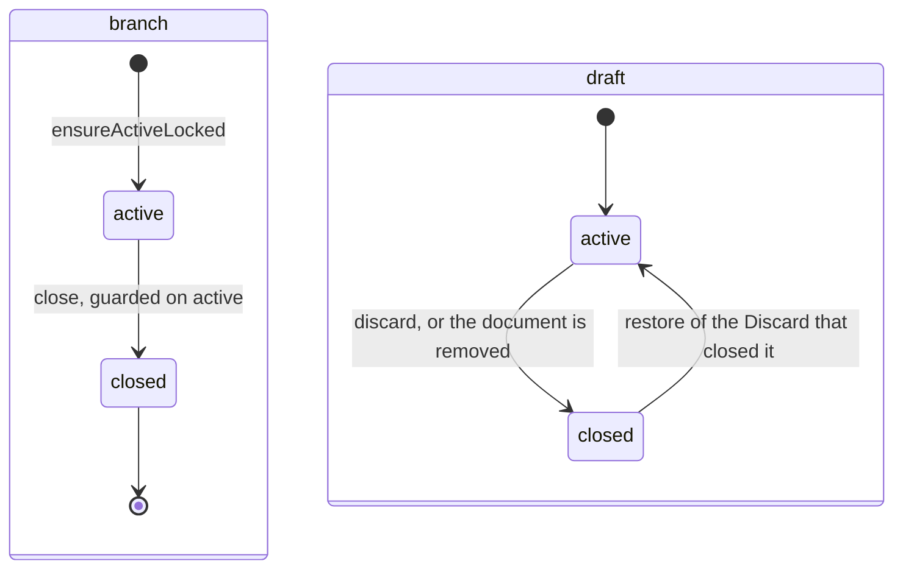

# Collab state machines

The status columns collab owns. A draft is a pending version of one document, and a branch is
the set of drafts one owner holds. A branch never reopens; a draft reopens only by a restore. The model they
belong to is in [draft-model-and-records.md](draft-model-and-records.md).

## Draft and branch

`document_drafts.status` and `branches.status` (`packages/database/src/schema/yjs.ts`,
`branches.ts`).

- **A closed branch never reopens; a closed draft reopens only by a restore.** A Discard
  stamps each draft it closes with `closed_by`, its command id. Restoring that Discard
  (`undo_discard`, from the notice or Trash) sets the same row `active` again in the Work's
  current branch (moving it there when the Discard closed another) and clears `closed_by` and
  `closed_cause`; a newer draft of the document closes under the restore's own id, so restoring
  that entry swaps back. A retirement acts on a command-closed draft only while `closed_by`
  still names its command, so a late one leaves a reopened draft's room alone. Only an `active`
  draft accepts writes, and a draft room for a closed
  draft is refused at the [handshake](../../../lib/.context/state-machines.md).
- A closed draft keeps `closedCause`, and a closed branch has `closedAt` and a pending document
  count of zero. Restoring a Work does not erase a draft's own cause.
