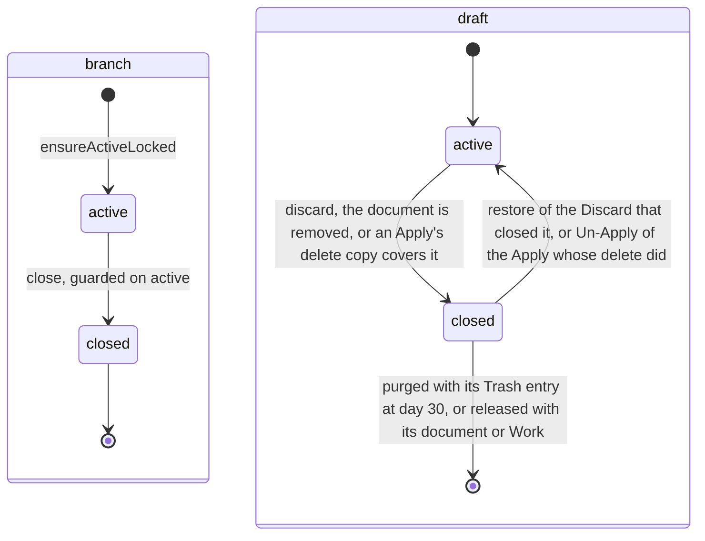

# Collab state machines

The status columns collab owns. A draft is a pending version of one document, and a branch is
the set of drafts one owner holds. A branch never reopens; a draft reopens only through `reopenDrafts`: a restore, or an Un-Apply of a drafted delete. The model they
belong to is in [draft-model-and-records.md](draft-model-and-records.md).

## Draft and branch

`document_drafts.status` and `branches.status` (`packages/database/src/schema/yjs.ts`,
`branches.ts`).

- **A closed draft ends when its Trash entry is purged.** At day 30 the discard purge
  (`adapters/drizzle-discard-purge.ts`) deletes the entry's command row and the closed drafts
  that name it (a drafted create's draft is left to the tree's own purge). A Restore after that
  finds nothing and answers `left_out purged`. Before it deletes a draft, the purge writes what
  became of each of its parts (`document_edit_parts.purged_disposition`, read from the draft's
  bytes), and the turn's card finds the draft's owner from `draft_branch_id`: a purged draft
  reads `applied` or `discarded` as it did before the purge, never as a live edit.
- **A closed branch never reopens; a closed draft reopens only through `reopenDrafts`.** A Discard
  stamps each draft it closes with `closed_by`, its command id. Restoring that Discard
  (`undo_discard`, from the notice or Trash) sets the same row `active` again in the Work's
  current branch (moving it there when the Discard closed another) and clears `closed_by` and
  `closed_cause`; a newer draft of the document closes under the restore's own id, so restoring
  that entry swaps back. An Apply closes only the drafts of its own items that a delete copy it appended covers in
  live afterwards, under its id. An Un-Apply of that Apply reopens such a draft when its tree
  half takes back the delete that covered it (a folder's included), the same way, under the Un-Apply's id, and replays the Un-Applies the draft waited on. A retirement acts on a command-closed draft only while `closed_by`
  still names its command, so a late one leaves a reopened draft's room alone. Only an `active`
  draft accepts writes, and a draft room for a closed
  draft is refused at the [handshake](../../../lib/.context/state-machines.md).
- **A model's edit planned on a closed draft lands in a new draft.** A Discard, or a restore's or
  an Un-Apply's swap, closed the draft the model last saw; the edit takes the path of a first
  write: a draft seeded from the document as it stands, which the result says it opened. A block
  the model names that only the closed draft held is found in the model's view of it, and its words
  land at the nearest block both hold. A closed draft is never written to. Only the document's
  removal, an Apply of its delete or a Work's purge (`closed_by` names the closing command, and a
  null one is a purge, whose chats go with the Work) make the edit a `done` `model_edit` row with
  `settled: returned` (`document_removed`): the test runs before any branch or draft opens,
  nothing is journalled, and the result shows the document as that chat reads it now.
- A closed draft keeps `closedCause`, and a closed branch has `closedAt` and a pending document
  count of zero. Restoring a Work does not erase a draft's own cause.
