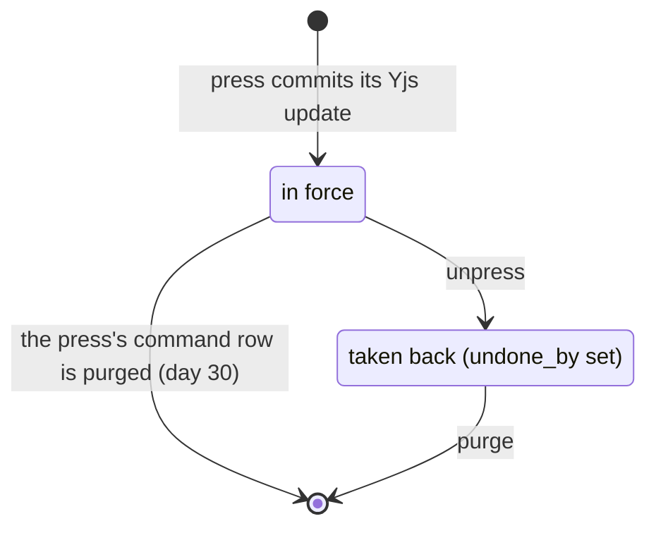

# Collab state machines

The status columns collab owns. A draft's tree records are rows; its text changes are suggestion
marks in Live, which have no status of their own.

## Press text effect

A row of `press_text_effects` (`yjs.ts`): one press's text change to one document, kept for
its Undo ([press](press.md)).

- **An Undo runs once.** `undone_by` is set in the unpress's transaction; a second unpress of
  the same press finds nothing to take back.
- **The effect is content**, so it outlives a version restore and a checkpoint that dropped the
  deleted text: an unpress takes back each change that still stands in the document as it is now.
  An unpress of an effect in a closed owner's notes marks it taken back and leaves the text.
