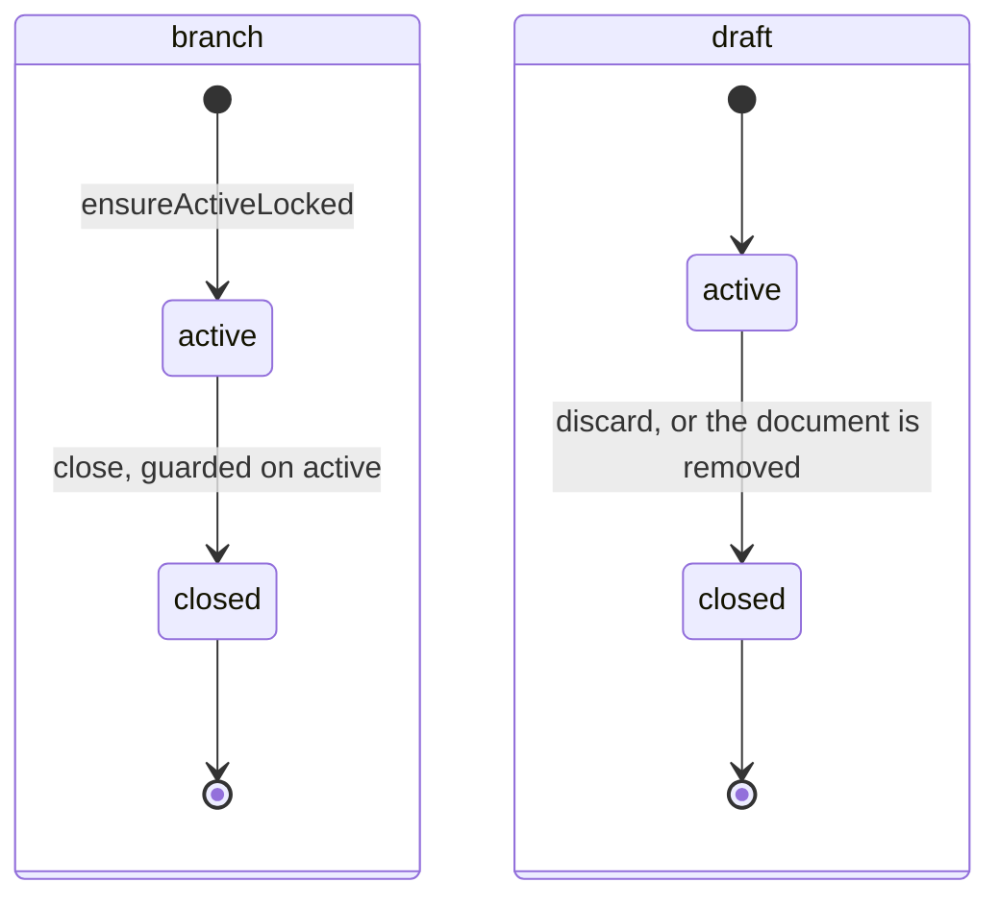
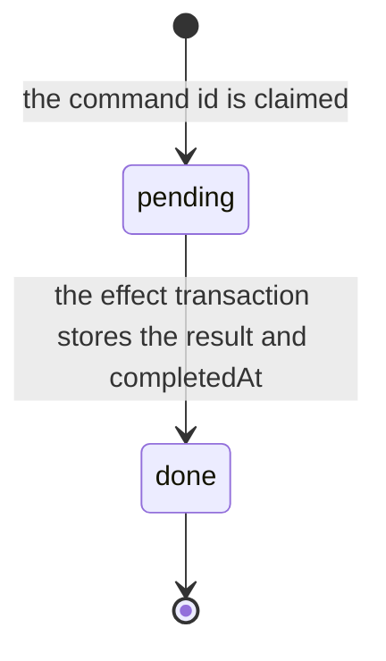
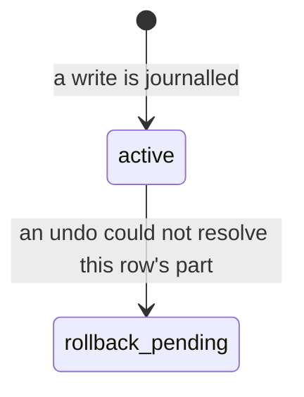

# Collab state machines

The status columns collab owns. A draft is a pending version of one document. A branch is the
set of drafts one Work holds, or, for chats outside any Work, one chat and the chats derived
from it. The model writes into drafts; the writer lands a draft's changes on the live document
with Apply, or drops them with Discard. Each machine is small; what matters is that none of
them runs backwards. The model they belong to is in
[draft-model-and-records.md](draft-model-and-records.md).

## Draft and branch

`document_drafts.status` and `branches.status` (`packages/database/src/schema/yjs.ts`,
`branches.ts`).

- **Closed never reopens.** No production code moves a draft or a branch back to `active`; a
  new branch is a new row. Only an `active` draft accepts writes, and a draft room for a closed
  draft is refused at the [handshake](../../../lib/.context/state-machines.md).
- A closed draft keeps `closedCause`, and a closed branch has `closedAt` and a pending document
  count of zero. Restoring a Work does not erase a draft's own cause.

## Branch command

`branch_commands.state`: one Apply or Discard, which takes effect once however many times its
request is sent.

A second request with the same command id finds the row and gets the stored result instead of
running the effect again (`adapters/drizzle-branch-commands.ts`). `done` and a non-null
`completedAt` always go together.

## Draft write journal row

`draft_write_journal.status`: one part of a recorded write, kept so that the write can be undone.

`adapters/drizzle-turn-inverse.ts` marks the rows whose parts a reversal left unresolved; the
update is guarded on `active`. Reversal itself never rewrites history: an undo is a new forward
update, as [reversal.md](reversal.md) explains.
