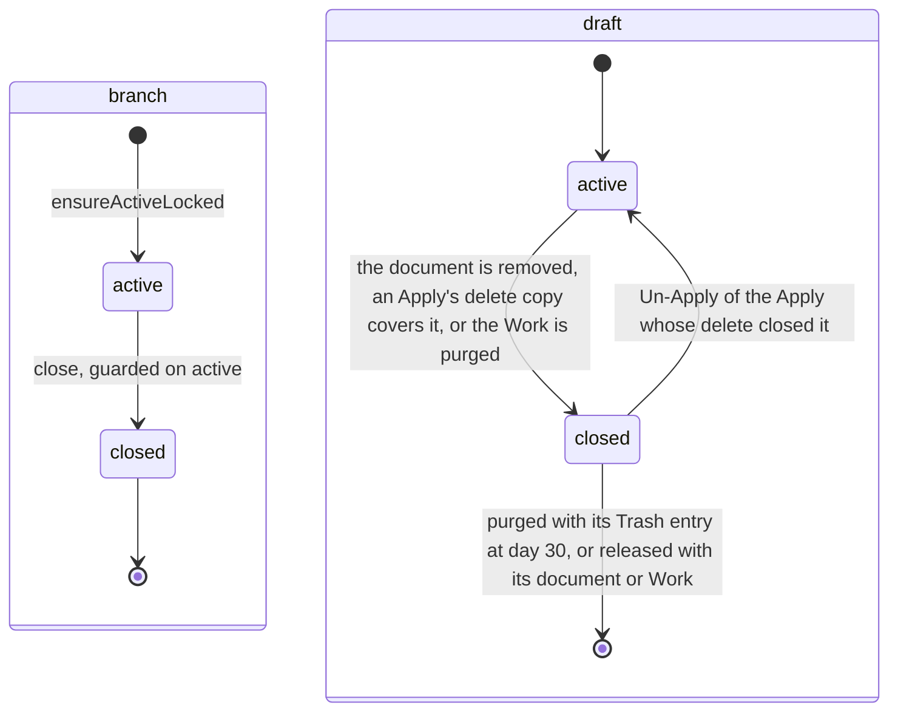

# Collab state machines

The status columns collab owns. A draft is a pending version of one document, and a branch is
the set of drafts one owner holds. A branch never reopens; a draft reopens only through `reopenDrafts`: the Un-Apply of a drafted delete. A Discard of text closes no draft. The model they
belong to is in [draft-model-and-records.md](draft-model-and-records.md).

## Draft and branch

`document_drafts.status` and `branches.status` (`packages/database/src/schema/yjs.ts`,
`branches.ts`).

- **A Discard of text leaves the draft active.** It appends the update that makes the draft read as
  its base for the chosen changes and records a `discard_command_effects` row; Restore appends the
  inverse for the changes that still stand. The day-30 purge (`adapters/drizzle-discard-purge.ts`)
  deletes the Discard's command row, which cascades its effects; a Restore after that finds nothing.
  A turn's card reads what became of each part from the draft's own text.
- **A closed draft reopens only through `reopenDrafts`.** An Apply closes only the drafts of its own
  items that a delete copy it appended covers in live afterwards, under its id. An Un-Apply of that
  Apply reopens such a draft when its tree half takes back the delete that covered it (a folder's
  included), under the Un-Apply's id, and replays the Un-Applies the draft waited on. Only an
  `active` draft accepts writes, and a draft room for a closed draft is refused at the
  [handshake](../../../lib/.context/state-machines.md).
- **A model's edit planned on a closed draft lands in a new draft.** An Apply's delete copy, an
  Un-Apply's swap or a Work's purge closed the draft the model last saw; the edit takes the path of a first
  write: a draft seeded from the document as it stands, which the result says it opened. A block
  the model names that only the closed draft held is found in the model's view of it, and its words
  land at the nearest block both hold. A closed draft is never written to. Only the document's
  removal, an Apply of its delete or a Work's purge (`closed_by` names the closing command, and a
  null one is a purge, whose chats go with the Work) make the edit a `done` `model_edit` row with
  `settled: returned` (`document_removed`): the test runs before any branch or draft opens,
  nothing is journalled, and the result shows the document as that chat reads it now.
- A closed draft keeps `closedCause`, and a closed branch has `closedAt` and a pending document
  count of zero. Restoring a Work does not erase a draft's own cause.
