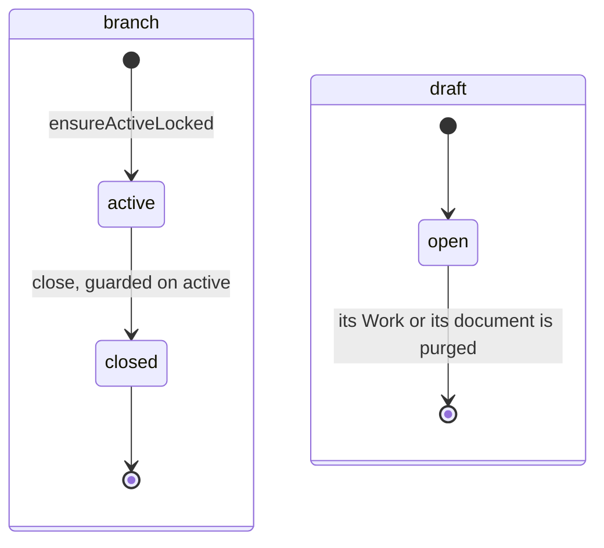
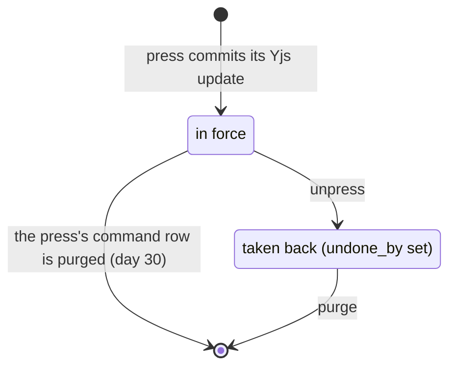

# Collab state machines

The status columns collab owns. A draft is a pending version of one document, and a branch is
the set of drafts one owner holds. A branch never reopens. A draft has no status: it never closes,
and nothing but a purge ends it. The model they belong to is in
[draft-model-and-records.md](draft-model-and-records.md).

## Draft and branch

`branches.status` (`packages/database/src/schema/branches.ts`); a draft is a row of
`document_drafts` (`yjs.ts`).

- **A Discard leaves the draft open.** It appends the update that makes the draft read as its base
  for the chosen changes and records a `discard_command_effects` row; Restore appends the inverse
  for the changes that still stand. Only a Discard of whole drafts is listed in Trash. The
  day-30 purge (`adapters/drizzle-discard-purge.ts`) deletes the Discard's command row, which
  cascades its effects; a Restore after that finds nothing. A turn's card reads what became of
  each part from the draft's own text.
- **An Apply of a delete leaves the Work's drafts of that document open**, like a delete in Live
  any other way. Its text half answers `already removed`; the Un-Apply takes the tree half back and
  has no draft to reopen.
- **A model's edit lands in the draft it names**, discarded words or not: the draft is the same row
  after a Discard, and its text no longer holds the discarded words. The edit is returned only
  when the document is removed (`returned: document_removed`, decided before any branch or draft
  opens).
- **A purge ends a draft by deleting its row** in the purging transaction: a Work's purge
  (`createDrizzleWorkBranchDisposal`) or a document's content purge
  (`createDrizzleDocumentPurgeDisposal`). `DraftClose.endDrafts` names the rows so their rooms
  close (`4205`, or `4208` for a removed document) once the transaction commits; it writes
  nothing, so no closed draft is ever stored.
- A closed branch has `closedAt` and a pending document count of zero.

## Press text effect

A row of `press_text_effects` (`yjs.ts`): one press's text change to one document, kept for
its Undo ([press](press.md)).

- **An Undo runs once.** `undone_by` is set in the unpress's transaction; a second unpress of
  the same press finds nothing to take back.
- **A version restore makes the ranges meaningless**, so an unpress of an effect whose generation
  differs from the document's marks it taken back and leaves the text as it is.
