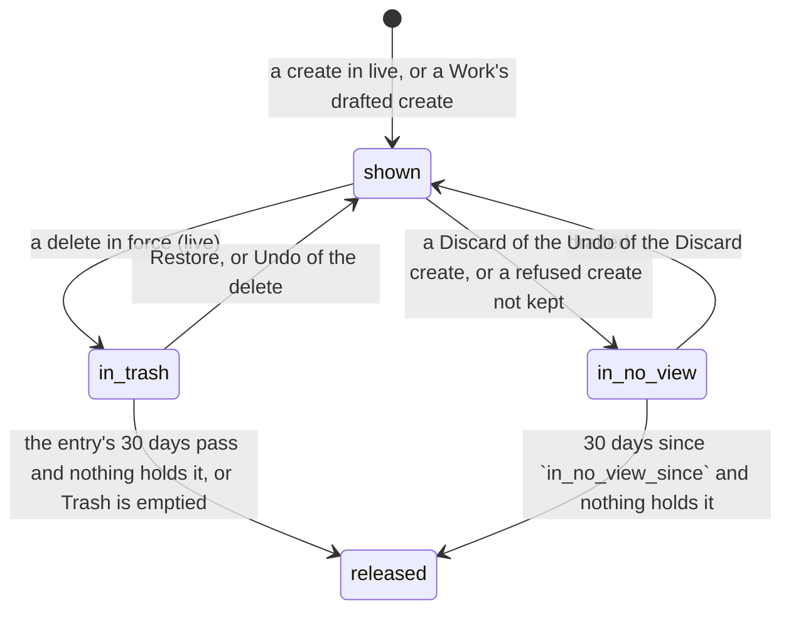

# A document's content, from shown to released

What a document's text and bytes are held for, as the tree's rows and the drafts say it. Retention
(`tree/drizzle-document-trash.ts`) is the only path that releases content: it moves a document to
`released`, which nothing undoes.

- **The text room takes text until `released`.** A document `in_trash` keeps its live room and
  takes writes (`tree/living-document.ts`: `textHeldSql`, the write door's predicate; the room's
  access check reads through Trash like a restore), so text typed offline into a document someone
  else deleted is saved into it and a Restore brings it back. The room closes `4208` at the
  purge, once the content is released (`drizzle-document-purge-disposal.ts`); a write after that
  is refused. A room asked for a document the server does not know yet closes non-terminally
  (`4211`): the browser retries until its create is admitted.
- **Held** is not a state: it stops either way out of `released`. A document is held while any
  kept view shows it (a `branch_tree_nodes` row), an unsettled record for a kept Work names it
  in the list, or a branch that has not ended has an active text draft of it with an effect
  (`tree/retention-holds.ts`). A kept Work is one that can still come back: open, archived, or
  deleted and restorable; only a branch that ended (a whole Discard, a Work purged for good)
  stops being kept. Ask before the purge: a purge removes the rows the question reads.
- **`in_no_view_since`** is written by the rows' sync (`adapters/tree-list-rows.ts`): null while
  any view has a row for the document, the time it left the last view otherwise.
- **Rows follow inputs outside the list.** A branch ending and a Work's text draft closing change
  what a view shows without a record, so those paths call the store's `resync`.
