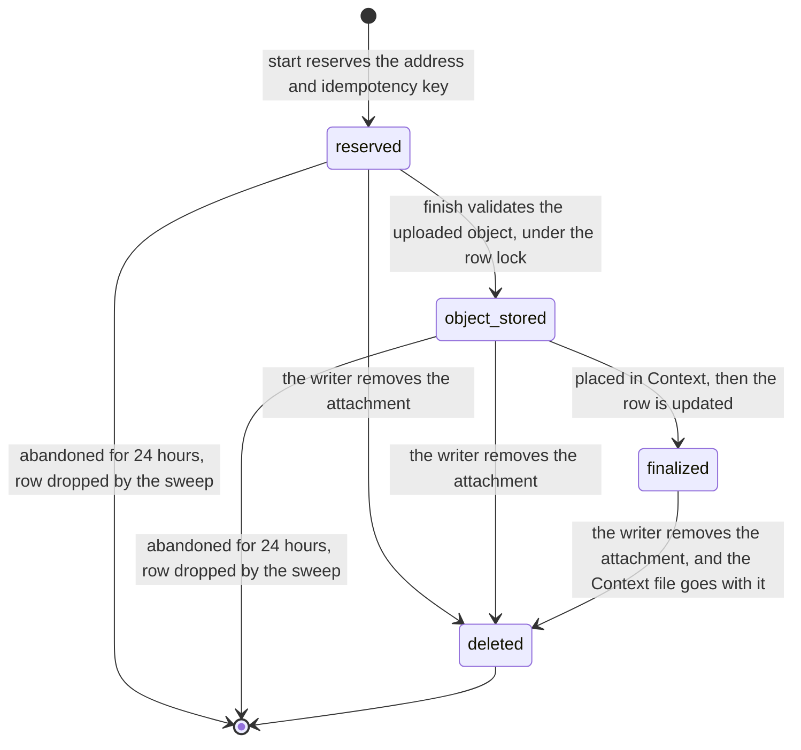

# Upload intake state machine

One uploaded file, from a reserved address to a file in Context, the project's file tree
(`upload_intakes.state`; `upload-intake.ts`, `drizzle-upload-intake.ts`). The file is either a
chat attachment or a file uploaded into the project to become a document. The database checks
only that the value is one of the four; the order is enforced by the guards below.

- **`object_stored` is a resting place, not an error.** When placing in Context fails, the row
  and the stored object stay, and the next `finish` continues from there. `start` and `finish`
  on a row already `object_stored` or `finalized` return what is there.
- **Context first, state second.** `finalize` updates only a row that is `object_stored` or
  already `finalized`, after the Context write, with the intake row locked.
- **A finalized upload keeps its identity through delete.** The row is marked `deleted`, never
  reused, so a reference that settled to it answers "gone" instead of capturing a later upload
  at the same address.
- **Only a chat attachment is removed this way** (`deleteDraft`, the undo of attaching). A
  file uploaded into the project is deleted as the document it became.
- The sweep for abandoned uploads deletes the row before it deletes the stored bytes, and only
  the sweep that deleted the row deletes them: a `finish` that touched the row in between
  keeps its bytes.

The same shape recurs in the app's [direct upload](../../../../../../app/src/core/uploads/.context/state-machines.md),
which drives this machine from the browser.
