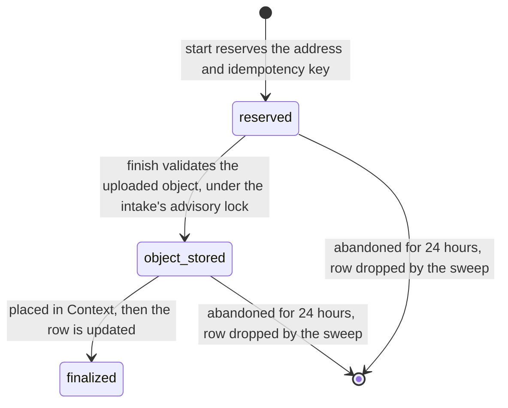

# Upload intake state machine

One uploaded file, a chat attachment or a file that becomes a document, from a reserved
address to a file in Context (`upload_intakes.state`; `upload-intake.ts`,
`drizzle-upload-intake.ts`). The database checks
only that the value is one of the three; the order is enforced by the guards below.

- **`object_stored` is a resting place, not an error.** When placing in Context fails, the row
  and the stored object stay, and the next `finish` continues from there. `start` and `finish`
  on a row already `object_stored` or `finalized` return what is there.
- **Context first, state second.** `finalize` updates only a row that is `object_stored` or
  already `finalized`, after the Context write. Both `claim` and `lockForFinalize` serialize on a
  transaction-scoped advisory key (`upload-intake:<project>:<intake>`), and each step is a
  conditional update guarded on the state it expects, so a late receipt or a second finish
  changes nothing.
- **A finalized upload is deleted as the document it became,** through the tree (Trash,
  Restore, purge). The row stays `finalized`; the node's identity is what keeps a settled
  reference from capturing a later upload at the same address.
- The sweep for abandoned uploads deletes the row before it deletes the stored bytes, and only
  the sweep that deleted the row deletes them: a `finish` that touched the row in between
  keeps its bytes.

The same shape recurs in the app's [direct upload](../../../../../../app/src/core/uploads/.context/state-machines.md),
which drives this machine from the browser.
