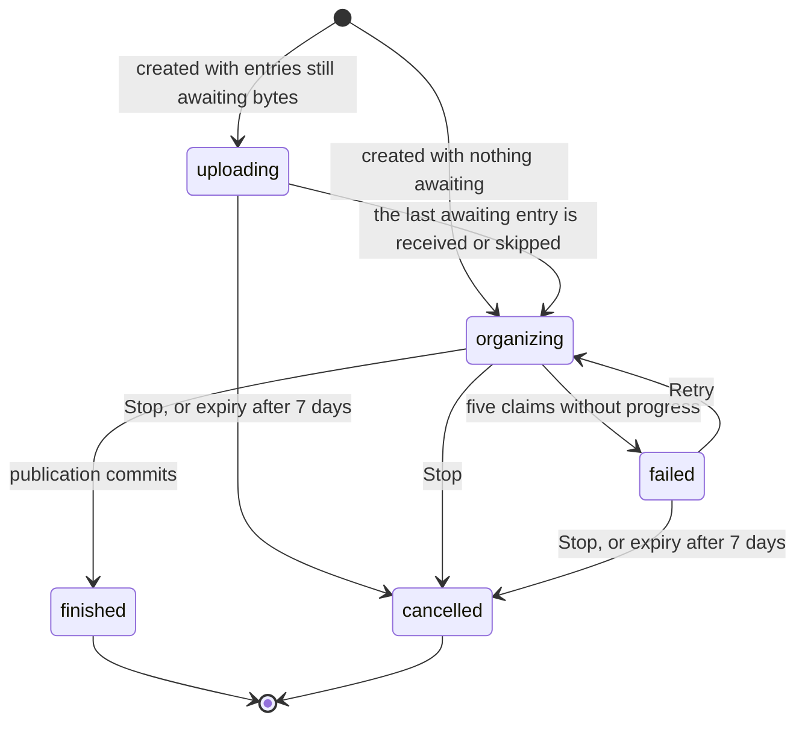
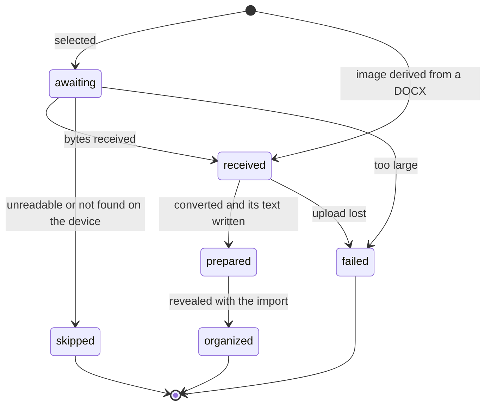

# Import state machines

An import is a durable job (`imports.state`) over its entries, one per file
(`import_entries.state`). The server converts each uploaded file and writes its first text into the journal, where
nothing shows it, then makes every node a record of the project's tree list in one transaction,
the reveal. The wire
states are in `packages/contracts/src/imports.ts`; the lifecycle rules are in
[CONTEXT.md](CONTEXT.md). How the app shows these states:
[app import](../../../../../app/src/features/import/.context/state-machines.md).

## Import

- **`organizing → finished` is one transaction with publication** (`organize/organizer.ts`):
  the prepared entries become `organized` and the tree's `create` records are admitted together. There is no
  state for "published but not finished".
- **`failed` is not terminal.** Retry returns it to `organizing` and clears the reason, the
  lease and the no-progress count (`domain/upload-service.ts`).
- **Stop is refused once revealed**, and does no object-store work: the sweep
  (`domain/object-sweep.ts`) removes objects later. The sweep is also what cancels an
  `uploading` or `failed` import that passed `IMPORT_MAINTENANCE.expiryMs`.
- Acknowledging a `finished` or `cancelled` import sets `acknowledgedAt`; it is not a state.

The organizer works under a lease on the import row
(`adapters/drizzle-organize-queue.ts`): only an `organizing` import with no live lease can be
claimed, and every organizing write rechecks the state and the lease token. Without those checks an organizer that lost its lease writes over its successor.
See [a job worked under a lease](../../../../../../.context/state-machines/job-under-a-lease.md).

## Import entry

`transitionEntries` updates only rows in the named source states, which is what stops a late
receipt or an old organizer from overwriting newer work. A `prepared` entry has its first text in the journal and
what the batch worked out on the entry; the plan is stored once, so nothing sends it back.
