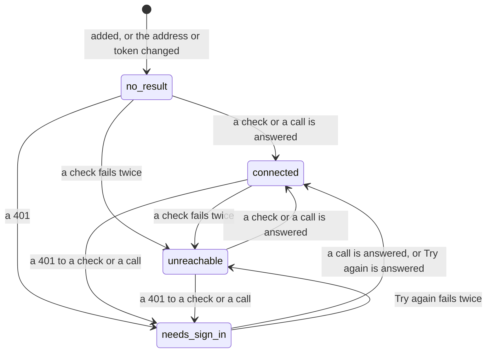

# Connection status

What Flow last learned about whether a connection works. It is stored on the connection row, so
settings, a new chat and every server process read the same one. Design:
[connection status](https://github.com/haowjy/meridian-flow-docs/blob/main/work/shared-mcp-design/design/CONNECTION-STATUS.md).
It follows the [load status](../../../../../../.context/state-machines/load-status.md) rule that a
result counts only if it is still the one being waited for, with two kinds of failure.

`status` is null or one of three values, and `status_version` is the `settings_version` it was
learned under. **No result** is `status` null *or* `status_version` ≠ `settings_version`: an edit
makes a new version and the old status stops counting without being cleared. "Checking…" is never
stored.

## Writes

`ConnectionStore.writeStatus` is one guarded `UPDATE`: it applies only when the check or call ran
under the **current** settings version and **started after** the status already stored (or the
stored status is of an older version). Two races follow from that and are proven on the running
system:

- A check that returns after the writer changed the token: its version is stale, the write is
  refused, the new version's own check decides.
- A check that races a call (or two processes at once): the one that **started later** wins,
  whichever returns first.

`check_finished_at` is separate: it records that a check of the current version ended, kept or not,
and paces the next one. A failure's age (the two-minute rule for listing a chat's connection by name)
is `status_started_at`, never `check_finished_at`.

## What moves the status (`domain/connection-checks.ts`)

| Event | Result |
|---|---|
| Check answered; a call `answered`, `rejected` or `too_large` | `connected` |
| `unauthorized` from a check or a call | `needs_sign_in` |
| A check fails, and a second one 3 s later (`start_failed`, `connect_timeout`, `disconnected`, `server_error`, `bad_reply`, `forbidden`, a timeout) | `unreachable`, with the reason |
| A check Flow refused to make (a private address) or a redirect it will not follow | `unreachable` at once, with no second try, and a reason of its own for a redirect |
| A check is `rate_limited` | unchanged |
| A call `start_failed`, `connect_timeout` or `disconnected` | unchanged; starts a check |
| Any other call failure | unchanged |

A failed call never sets `unreachable`. `needs_sign_in` waits for the writer: background checks
skip it, a new token starts from no result, **Try again** (`POST …/check`) runs one now.

## When a check starts

`startDue` runs a check in the background when there is no result, or the last one finished more
than a minute ago (`CHECK_INTERVAL_MS`), and the connection is not `needs_sign_in`. Callers: the
list route (app open, return after being away, new chat, settings open, and once a minute while
a screen shows a connection not working: the app asks again), and, for the tools, a prompt being
saved and a call that could not reach the session. Adding or editing a connection and Try again
check at once. Within one process a second request joins the check already running. A status that
changes publishes `mcp-connections-hint` to the account's open projects (`publishToUser`), and the
app asks again.
