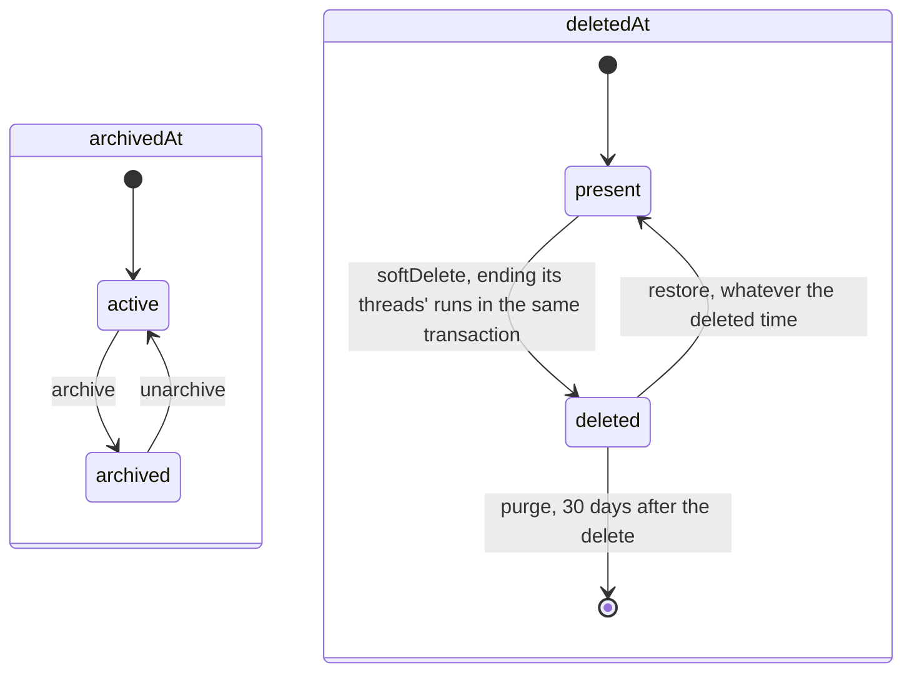

# Work state machines

A Work is a task inside a project. Its availability is two timestamps on its row, changed in
`adapters/work-repository/drizzle.ts`. Neither is the Work's `status`, which is free text the
model owns. The lifecycle contracts are in [CONTEXT.md](CONTEXT.md).

- **Every lifecycle write locks the Work row and publishes `{ workId }` through
  `FileAccessChanges` in the same transaction.** That publication is what makes the Work's
  notes, uploads and draft rooms reconnect at their new access level; without it an archived Work
  stays writable in tabs that are already open. Purge included, each also wakes the project's
  browsers with the Work's `draft-owner-hint` after commit (`WorkProjectionMutation.lifecycleChanged`),
  the hint a moved pending count sends, so another device's Works list and picker follow at once.
- **Delete marks what it took.** The Work's primary chats and results get `deletedByWorkId`, and
  restore clears exactly the rows carrying that mark. The Work's sources are not marked: a deleted
  Work's Scratch stays listed and readable, read-only, until purge, as an archived Work's does. No
  node is written: what is in Trash comes back as it was. A chat the writer
  trashed separately stays trashed
  ([thread trash](../../threads/.context/state-machines.md)).
- **Restore never reads the clock; the purge does.** A Work in Trash restores, even past 30 days,
  until the purge sweep takes it (`drizzle-work-purge.ts`, the only code that compares the deleted
  time with `deletionPurgeCutoff`). Both take the Work's thread-tree lock and the purge re-checks
  under it, so a restore never brings back a half-purged Work. A purged Work is a 404.
- **A second press answers `already`.** Archive of an archived Work, unarchive of a live one,
  delete of a deleted one and restore of a live one store `done` with the Work and
  `settled: [{ rule: "already", state }]` (`lib/work-command.ts`).
- **What changes a closed Work itself bounces.** A writer's rename or goal on an archived or
  deleted Work stores `done`, changes nothing, and carries the Work as it stands with
  `settled: [{ rule: "returned", why: "work_archived" | "work_deleted" }]`, so the client keeps
  the typed words. The model's Work tool answers the same case with its `work_archived` error.
  Names may repeat (no unique index): a Work is told apart by its id and
  handle, and a name that matches two Works resolves to neither in the model's lookups
  (`context/owner-lookup.ts`), which answer with both handles.
- **Branches and drafts outlive the delete** until purge, so restore finds them.
- No Work, the project's Work for chats outside any task, is never archived (the
  `works_no_work_not_archived` check), and the repository refuses to change it
  (`WorkLockedError`, answered 400 `work_locked`).
- A caller that finds the Work unavailable gets `WorkLifecycleUnavailableError` with
  `missing`, `deleted` or `archived` (`domain/work-lifecycle.ts`): the lock layer's draft writes
  and archive of a deleted Work; the writer's update catches it into the `returned` result. `missing` is a lookup result,
  never a stored state.
