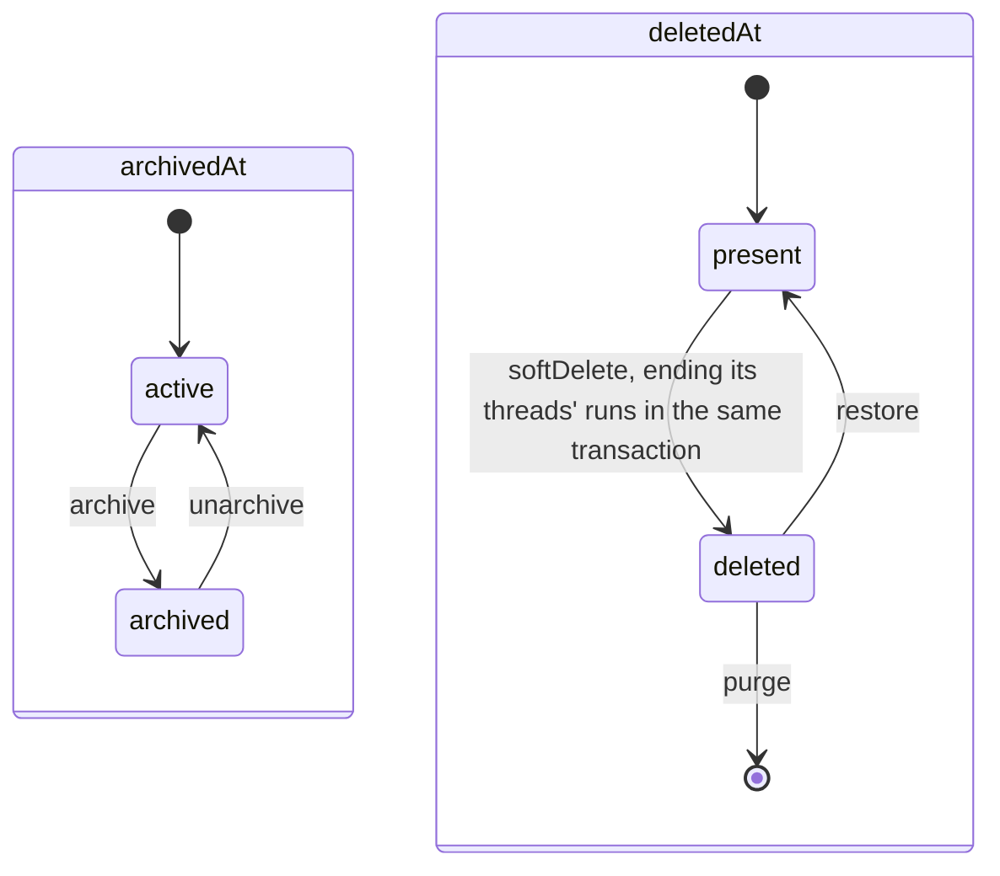

# Work state machines

A Work is a task inside a project. Its availability is two timestamps on its row, changed in
`adapters/work-repository/drizzle.ts`. Neither is the Work's `status`, which is free text the
model owns. The lifecycle contracts are in [CONTEXT.md](CONTEXT.md).

- **Every lifecycle write locks the Work row and publishes `{ workId }` through
  `FileAccessChanges` in the same transaction.** That publication is what makes the Work's
  notes, uploads and draft rooms reconnect at their new access level; without it an archived Work
  stays writable in tabs that are already open. Purge included, each also wakes the project's
  browsers with the Work's `draft-owner-hint` after commit (`WorkProjectionMutation.lifecycleChanged`),
  the hint a moved pending count sends, so another device's Works list and picker follow at once.
- **Delete marks what it took.** The Work's primary chats and results get `deletedByWorkId`, and
  restore clears exactly the rows carrying that mark. The Work's sources are not marked: a deleted
  Work's Scratch stays listed and readable, read-only, until purge, as an archived Work's does. No
  node is written: what is in Trash comes back as it was. A chat the writer
  trashed separately stays trashed
  ([thread trash](../../threads/.context/state-machines.md)).
- **Branches and drafts outlive the delete** until purge, so restore finds them.
- No Work, the project's Work for chats outside any task, is never archived (the
  `works_no_work_not_archived` check), and the repository refuses to change it
  (`WorkLockedError`).
- A caller that finds the Work unavailable gets `WorkLifecycleUnavailableError` with
  `missing`, `deleted` or `archived` (`domain/work-lifecycle.ts`). `missing` is a lookup
  result, never a stored state.
