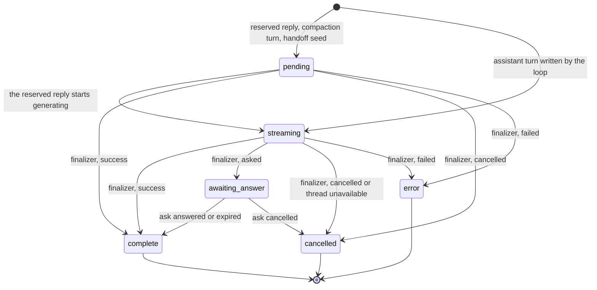
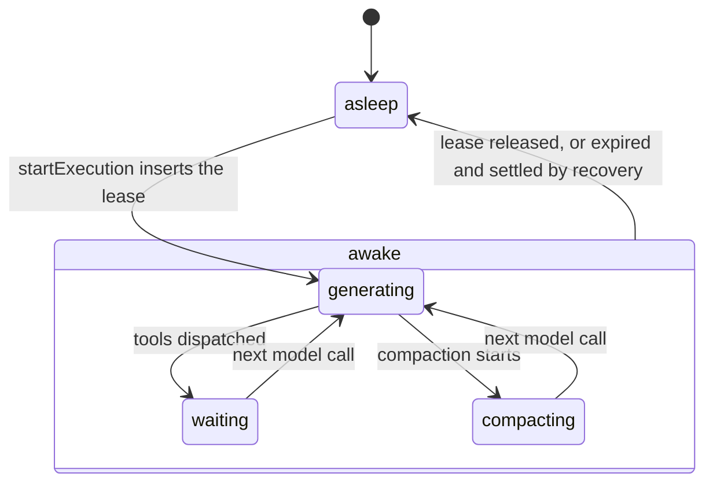
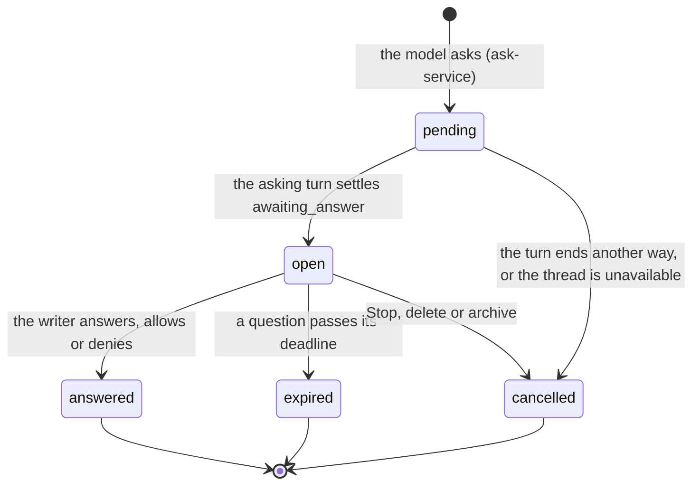
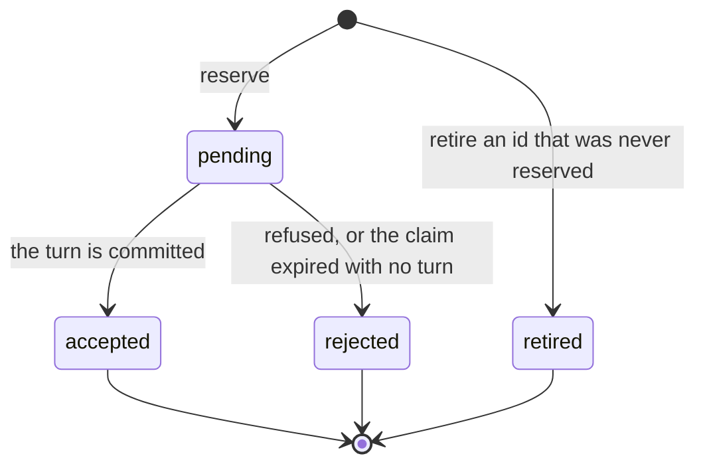
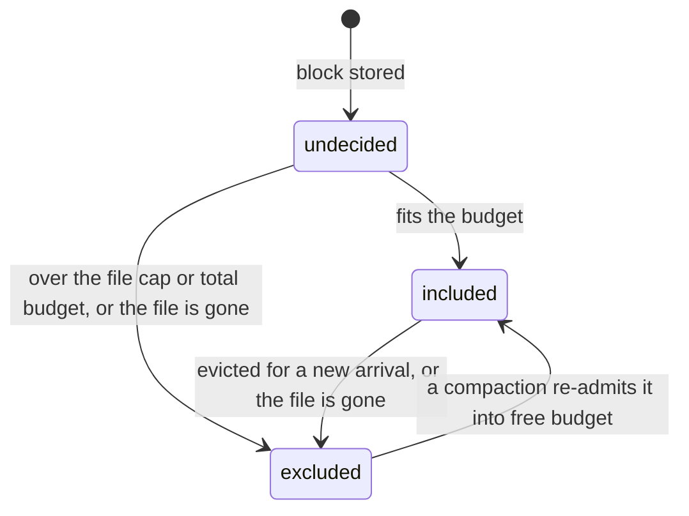
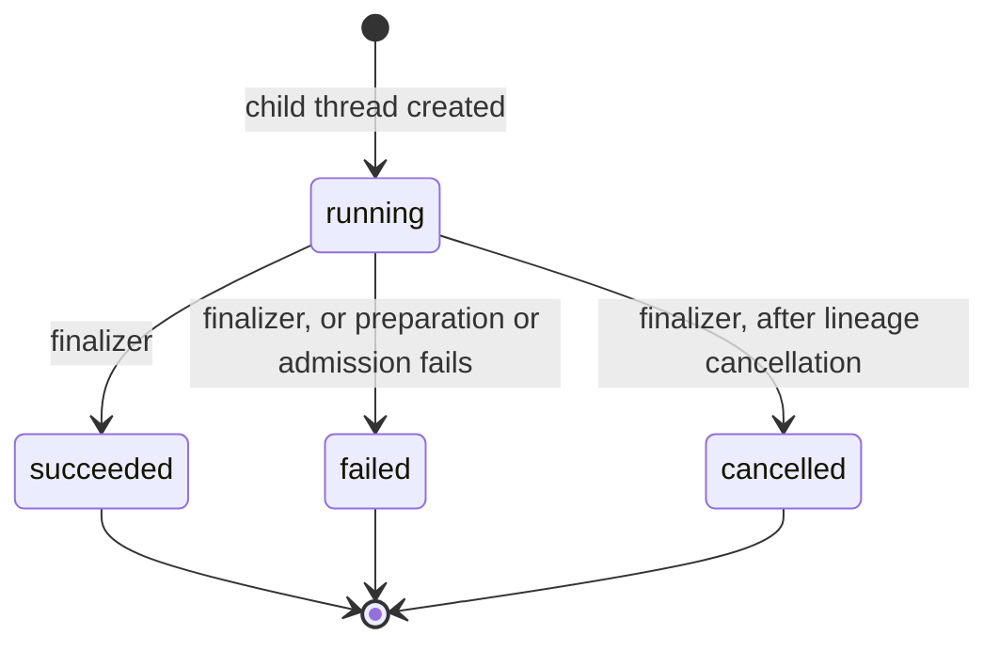

# Runtime state machines

The durable states a run moves through. A run is one stretch of the server working a thread
(a chat), and a turn is one entry in the thread; other product words are in the
[glossary](../../../../../../.context/glossary.md). Thread filing
(archive, trash) is in [threads](../../threads/.context/state-machines.md); every machine in the
repository is indexed in [the root index](../../../../../../.context/state-machines/index.md).

## Turn status

The state of one turn row (`turns.status`). States and the terminal predicate are in
`packages/contracts/src/threads/status.ts`; the column and its check are in
`packages/database/src/schema/agent-threads.ts`.

- **One writer for the end.** `loop/execution-finalizer.ts` maps a terminal cause to a status
  (success → `complete`, asked → `awaiting_answer`, cancelled → `cancelled`, anything else →
  `error`) and returns without writing when the turn is already terminal. A later turn never
  rewrites an earlier one, so an old failed reply stays `error`.
- **`isTerminalTurnStatus` is true for `awaiting_answer`**, although the ask later moves the
  turn to `complete` or `cancelled` (`asks/ask-service.ts`). In that predicate "terminal"
  means no run is working the turn, not that its status is final. Liveness, recovery and "is
  a model call owed" all read it: treating `awaiting_answer` as live makes recovery try to
  resume a run that is waiting on the writer.
- **An ask on an unavailable thread becomes a cancel.** When the cause is "asked" but the thread
  is deleted or archived, the finalizer settles the turn `cancelled` and cancels the ask instead
  of opening it.
- **`pending` covers three kinds of turn**: a reply reserved before the model generates; a
  compaction turn, `pending` while it summarizes older history (`loop/local-turn.ts`); and a
  handoff seed, `pending` while its brief is written.

## Run lease and phase

Whether a thread has a live run, and what the run last said it was doing. The lease is a row in
`thread_run_leases`; `ThreadStatus` (`packages/contracts/src/threads/index.ts`) is derived from
it and stored nowhere else. `threads.status` holds only filing (`idle`, `archived`).

`cancelRequested` is a flag on the lease, set by Stop (`requestCancel`, `cancelExecution` in
`adapters/drizzle-run-claim.ts`) in any phase. It is not a phase: a cancelled lease is still
held until the run settles and releases it.

- **An expired lease reads as asleep.** A dead process never writes "stopped"; its lease runs
  out and [recovery](recovery.md) settles the execution before a new claim. Reading an expired
  lease as live starts no new run; ignoring a live one starts two.
- **Phase is for display.** `publishPhase` in `loop/orchestrator.ts` swallows its own failures,
  so nothing may depend on a phase write having landed.

## Ask

One question or permission request from the model to the writer (`thread_asks`). The lifecycle shape is `askLifecycleSchema`
in `packages/contracts/src/threads/asks.ts`.

- **`pending` is invisible to the writer.** The ask opens in the same transaction that settles
  its turn (`openPending` in the finalizer), so no one can answer an ask whose turn is still
  streaming.
- **Only `open` resolves.** The repository's resolve and expiry updates are guarded on
  `status = 'open'`, and a replayed answer with the same submission id returns the stored result.
- **Resolving writes the tool result and the turn status together**; apart, the card and the
  turn disagree.
- **Lock order: ask rows, then the thread.** Delete and archive take the same order when they
  race a settlement.
- A resolved ask also carries `continuation`: `pending` while the run that continues from the
  answer is owed, `done` once that turn exists, `cancelled` when it never will. An expired
  question resolves from the stored draft answers.

## User-turn admission

One writer submission being admitted exactly once (`user_turn_admissions.state`;
`admission/user-turn-admission.ts`, `admission/drizzle-admission-records.ts`).

A repeat of the same submission id returns the stored record; the same id with another
fingerprint is a conflict. `accepted` is written in the transaction that writes the turn, so a
retry can never produce a second turn. An expired `pending` is rejected only under the thread
claim the runner would hold, because without it the turn may still be committing.

This is the server half of [a command that may have landed](../../../../../../.context/state-machines/command-that-may-have-landed.md).

## Media inclusion

Whether one piece of media is in the model request: a picture the writer attached, a file the
writer mentioned that its read showed as media, or a media part inside a tool result. The unit is
`(blockId, partIndex)`: a picture or a mentioned file is part 0 of its block, and a tool result's
media are the indexes of its `content` parts. `loop/image-context.ts` decides;
decisions are saved per unit in `thread_image_inclusions`, one row per deciding turn, never
updated.

- **Only a decision moves a unit.** A unit with a saved decision keeps it on every later
  request. Included media own the cached prefix: a new arrival may evict them, a re-admission
  candidate never does.
- **Eviction is a chunk.** When a new arrival does not fit, the oldest included media go until
  half the budget is free, so the next several arrivals fit without moving the cached prefix
  again. Each eviction writes a removal notice turn, and the notice turn owns the decisions it
  reports.
- **A model that can't take the file is not a decision.** The unit becomes a text description
  (name, type, size) for that request and stays out of the saved decisions, because switching
  models changes the answer.
- **Links come last.** Only included units get a signed link (or bytes, where the object store has
  no link), after every decision is made. A link is identical for every request in the thread's
  cache window; when the window rolls over the prefix changes once, and
  `loop/prefix-cache-state.ts` predicts that as one miss.
- **Access is checked on every request** by the host's resolver; a file the thread can no longer
  read becomes a first-sight or `asset_unavailable` exclusion, never a link.

## Spawn status

What became of one subagent (a child thread a run starts), as its parent sees it
(`threads.spawn_status`). It is the
outcome of the spawn, not whether the child thread is running now: see [spawn](spawn.md).

`spawn/child-run-coordinator.ts` writes `running` and the early `failed`; the execution
finalizer writes the rest from the same terminal cause that settles the turn. A failed report
stays failed even when partial output was captured.
