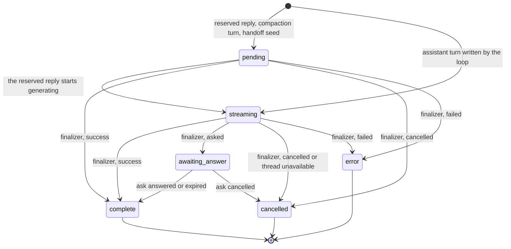
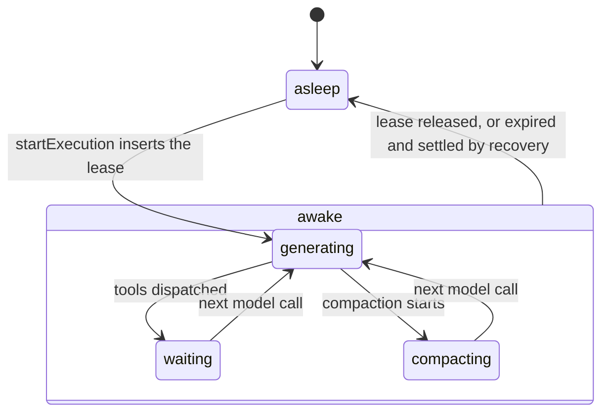
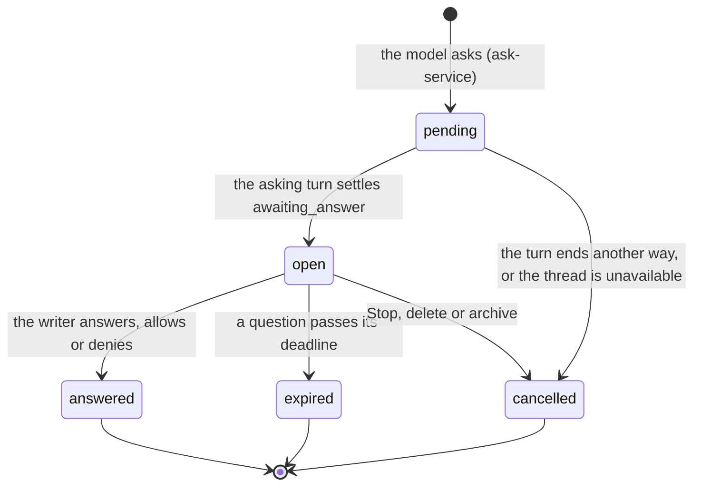
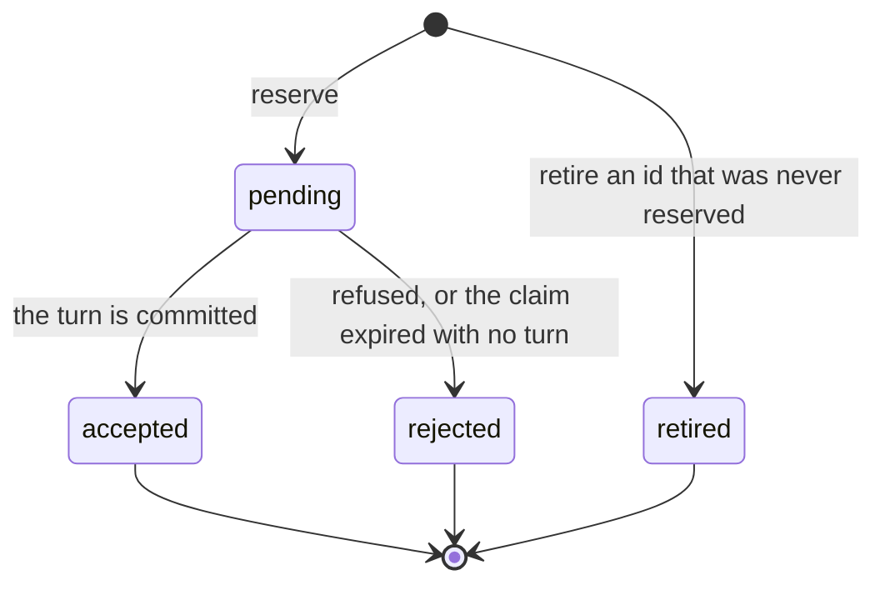
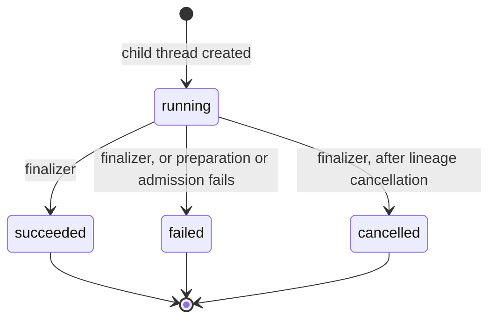

# Runtime state machines

The durable states a run moves through, and what each transition depends on. A thread is a
chat and a turn is one entry in it. A run is one stretch of the server working a thread: it
claims the thread, calls the model and its tools, writes turns and releases the thread. Other
product words are in [product words](../../../../../../.context/glossary.md). Thread filing
(archive, trash) is in [threads](../../threads/.context/state-machines.md); every machine in the
repository is indexed in [the root index](../../../../../../.context/state-machines/index.md).

## Turn status

The state of one turn row (`turns.status`). States and the terminal predicate are in
`packages/contracts/src/threads/status.ts`; the column and its check are in
`packages/database/src/schema/agent-threads.ts`.

- **One writer for the end.** `loop/execution-finalizer.ts` maps a terminal cause to a status
  (success → `complete`, asked → `awaiting_answer`, cancelled → `cancelled`, anything else →
  `error`) and returns without writing when the turn is already terminal. A later turn never
  rewrites an earlier one, so an old failed reply stays `error`.
- **`isTerminalTurnStatus` is true for `awaiting_answer`**, although the ask later moves the
  turn to `complete` or `cancelled` (`asks/ask-service.ts`). In that predicate "terminal"
  means no run is working the turn, not that its status is final. Liveness, recovery and "is
  a model call owed" all read it: treating `awaiting_answer` as live makes recovery try to
  resume a run that is waiting on the writer.
- **An ask on an unavailable thread becomes a cancel.** When the cause is "asked" but the thread
  is deleted or archived, the finalizer settles the turn `cancelled` and cancels the ask instead
  of opening it.
- **`pending` covers three kinds of turn.** A reserved reply is the assistant turn created
  before the model starts generating. A compaction turn, which replaces older history with a
  summary, is created `pending` and stays there while it runs (`loop/local-turn.ts`). A
  handoff seed, the first turn of a chat made by handoff, is `pending` while its brief is
  written.

## Run lease and phase

Whether a thread has a live run, and what the run last said it was doing. The lease is a row in
`thread_run_leases`; `ThreadStatus` (`packages/contracts/src/threads/index.ts`) is derived from
it and stored nowhere else. `threads.status` holds only filing (`idle`, `archived`).

`cancelRequested` is a flag on the lease, set by Stop (`requestCancel`, `cancelExecution` in
`adapters/drizzle-run-claim.ts`) in any phase. It is not a phase: a cancelled lease is still
held until the run settles and releases it.

- **An expired lease reads as asleep.** A dead process never writes "stopped"; its lease runs
  out and [recovery](recovery.md) settles the execution before a new claim. Reading an expired
  lease as live starts no new run; ignoring a live one starts two.
- **Phase is for display.** `publishPhase` in `loop/orchestrator.ts` swallows its own failures,
  so nothing may depend on a phase write having landed.

## Ask

One question or permission request from the model to the writer (`thread_asks`). The lifecycle shape is `askLifecycleSchema`
in `packages/contracts/src/threads/asks.ts`.

- **`pending` is invisible to the writer.** The ask opens in the same transaction that settles
  its turn (`openPending` in the finalizer), so no one can answer an ask whose turn is still
  streaming.
- **Only `open` resolves.** The repository's resolve and expiry updates are guarded on
  `status = 'open'`, and a replayed answer with the same submission id returns the stored result.
- **Resolving writes the tool result and the turn status together**; apart, the card and the
  turn disagree.
- **Lock order: ask rows, then the thread.** Delete and archive take the same order when they
  race a settlement.
- A resolved ask also carries `continuation`: `pending` while the run that continues from the
  answer is owed, `done` once that turn exists, `cancelled` when it never will. An expired
  question resolves from the stored draft answers.

## User-turn admission

One writer submission being admitted exactly once (`user_turn_admissions.state`;
`admission/user-turn-admission.ts`, `admission/drizzle-admission-records.ts`).

A repeat of the same submission id returns the stored record; the same id with another
fingerprint is a conflict. `accepted` is written in the transaction that writes the turn, so a
retry can never produce a second turn. An expired `pending` is rejected only under the thread
claim the runner would hold, because without it the turn may still be committing.

This is the server half of [a command that may have landed](../../../../../../.context/state-machines/command-that-may-have-landed.md).

## Spawn status

What became of one subagent, a child thread a run starts to do part of its work, as its
parent sees it (`threads.spawn_status`). It is the
outcome of the spawn, not whether the child thread is running now: see [spawn](spawn.md).

`spawn/child-run-coordinator.ts` writes `running` and the early `failed`; the execution
finalizer writes the rest from the same terminal cause that settles the turn. A failed report
stays failed even when partial output was captured.
