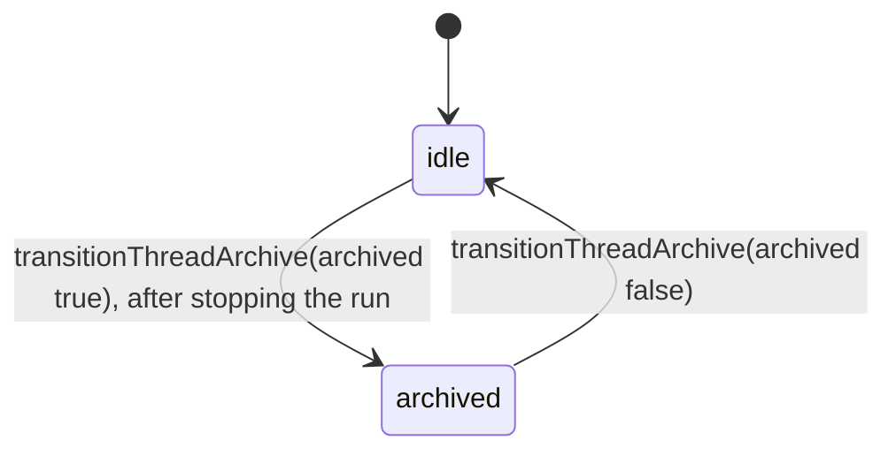
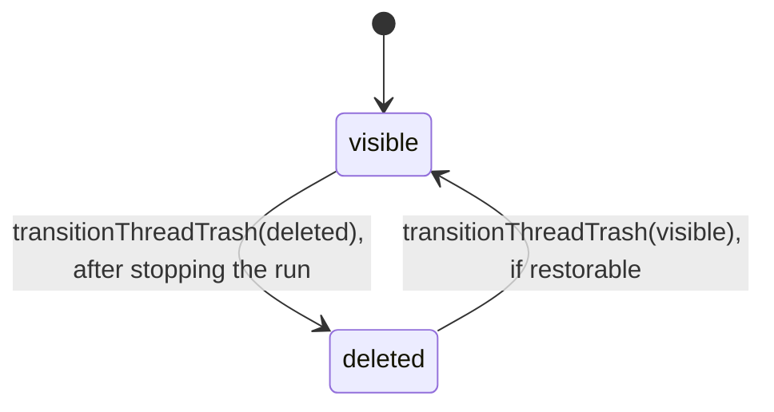

# Thread filing state machines

A thread (a chat) has two independent filing states, both changed in `domain/thread-trash-lifecycle.ts`.
Neither says whether a run is live: that is the
[run lease](../../runtime/.context/state-machines.md), and turn status is documented there too.

## Archive

`threads.status`, checked to `idle` or `archived`.

No HTTP route calls `transitionThreadArchive` yet. Asking for the state a thread is already in
returns it unchanged; a trashed thread refuses both directions.

## Trash

`threads.deleted_at`: null is `visible`, set is `deleted`.

- **Stop first, then lock.** Archive and delete end the thread's run and its subagent subtree
  (`stopThreads`) before taking the thread row lock, because stopping takes thread locks
  parents first, each after its ask rows.
- **Restore is refused** when the thread was deleted by a Work delete (`deletedByWorkId`), or
  when the Work of its root is deleted; the root is the chat at the top of the chain of forks
  and subagents the thread came from. Those threads come back only with the Work. When the
  thread's own Work is unavailable, restore moves it to No Work, the Work every project has
  for chats outside any task.
