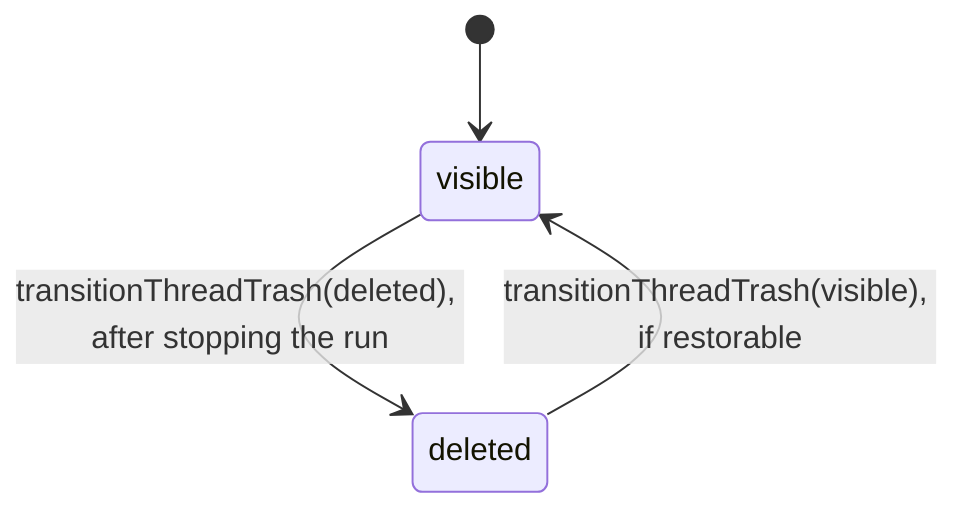

# Thread filing state machine

A thread (a chat) is filed as visible or in the Trash, changed in `domain/thread-trash-lifecycle.ts`.
That does not say whether a run is live: that is the
[run lease](../../runtime/.context/state-machines.md), and turn status is documented there too.

## Trash

`threads.deleted_at`: null is `visible`, set is `deleted`.

- **Stop first, then lock.** Delete ends the thread's run and its subagent subtree
  (`stopThreads`) before taking the thread row lock, because stopping takes thread locks
  parents first, each after its ask rows.
- **Restore is refused** when the thread was deleted by a Work delete (`deletedByWorkId`), or
  the Work of its root chat is deleted: those come back only with the Work. When the thread's
  own Work is unavailable, restore moves it to No Work.
