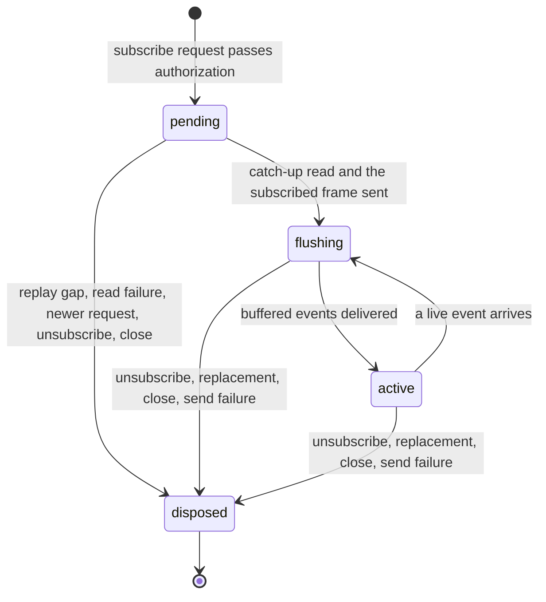
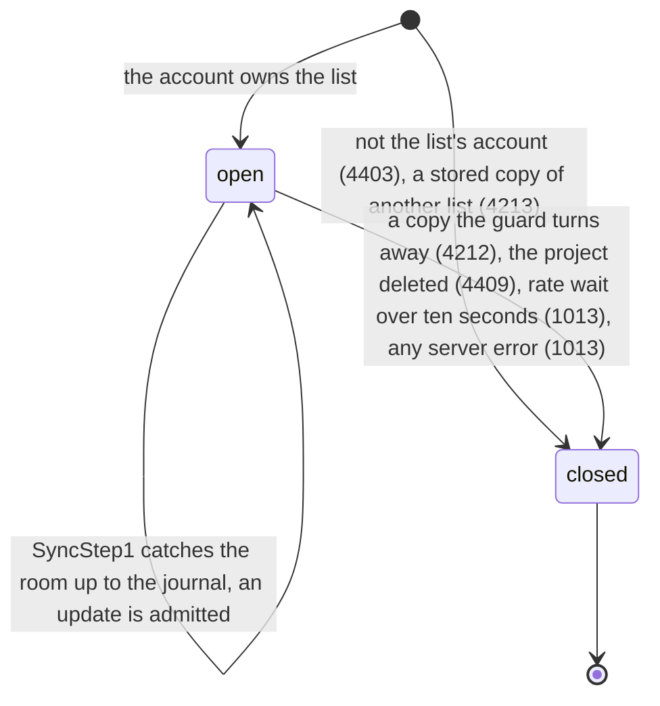

# WebSocket handler state machines

Two per-connection machines held in process memory. Both exist so that a client never receives
or sends frames for a room it has not been admitted to.

## Thread subscription, server half

One thread subscription on one WebSocket peer (`ThreadSubscriptionLease.phase` in
`ws-thread-handler.ts`). The client half is the
[subscription in thread-client](../../../../../packages/thread-client/.context/state-machines.md).

- **Events that arrive during catch-up are buffered**, then sent in sequence order above the
  last delivered sequence. Sending them as they arrive would put live events before the replay.
- **A newer request does not drop a working subscription early.** An `active` subscription stays until
  the new request is authorized; a `pending` one is replaced at once.
- `disposeLease` unsubscribes from the event hub and clears the buffer. A replay gap sends the
  client a `gap` frame; any other read failure is the one retryable subscribe error.

## Tree list room connection

One connection to a project's (or an account's) tree list room (`yjs-tree-room.ts`; its state is
`TreeRoomConnection` in the connection's context). The room is named `tree:project:<id>` or
`tree:account:<id>` and admitted by the project, not a document.

- **A client's update never reaches the room's document.** It goes to `TreeListStore.admit`;
  the room's document gains what the store committed (the client's items with the `dropped`
  stamps the server appended), delivered from `onCommitted`, so every connection hears them.
- **Every close is a close of the socket, with its code**, through the gateway's one close path
  (`withTreeRefusal`, as `withRemovalRefusal` is for documents): Hocuspocus's own close message
  reaches a provider as 1000 and leaves the socket open, so a refusal that relied on it would
  leave the client offline for good. A copy the guard turns away is `4212 copy-broken`
  and applies nothing: the client does not reconnect (the same bytes would go again), keeps the
  broken copy and loads a fresh one. A stored copy of another list (a reset database, a
  recreated account list) is `4213 list-changed:<list id>`, sent at connect from the `?list=` the
  client's socket URL carries: the client loads from nothing. A copy with no stored id learns the
  room's from a stateless message after it connects. A server error is `1013`, which the client
  reconnects on. One connection's messages are admitted in order. A refused
  connection is marked, and the messages Hocuspocus has queued behind the refusal are refused
  without reaching the store.
- **Access has a lifecycle.** A tree connection registers under the room's name with the gateway's
  access index, a document connection under its Work and lineage owners, its project and its
  document; a project's deletion publishes a file-access change that closes them with `4409`,
  and the reconnect is refused (`4403`). A document that changes source (a move between Works)
  publishes a change under its own key, and its open sockets close and are admitted again. A Work's archive or delete, or a chat's move to Trash that
  leaves its lineage with no live chat, closes its rooms with `4409 access-changed:<why>`
  (`work_archived`, `work_deleted`, `chat_frozen`, carried on the file-access change); an unarchive,
  a restore to an open Work, or a thaw sends plain `4409`; a restore of a Work that is still archived
  sends `access-changed:work_archived`. A draft frame turned away by a closed owner gets the same
  reason, read from the owner's facts. A change between the first check and the registration
  is caught by asking again.
- **Admissions are rate limited per connection** (a burst of 60, 30 a second). Each admission
  spends one token at once and the balance may go below zero; the debt is the wait, and the
  connection is closed only when it would pass ten seconds.
- **What the client sends comes in parts** (`splitSyncFrame`, in the client); what the server
  sends is not cut, since the browser has no limit on an update's size.
- **A room learns of any process's commit from Postgres `NOTIFY`** (`tree_list_advanced`, the
  list's id), and catches up from the journal; a SyncStep1 does the same, which heals a
  notification missed while the listener reconnected.

