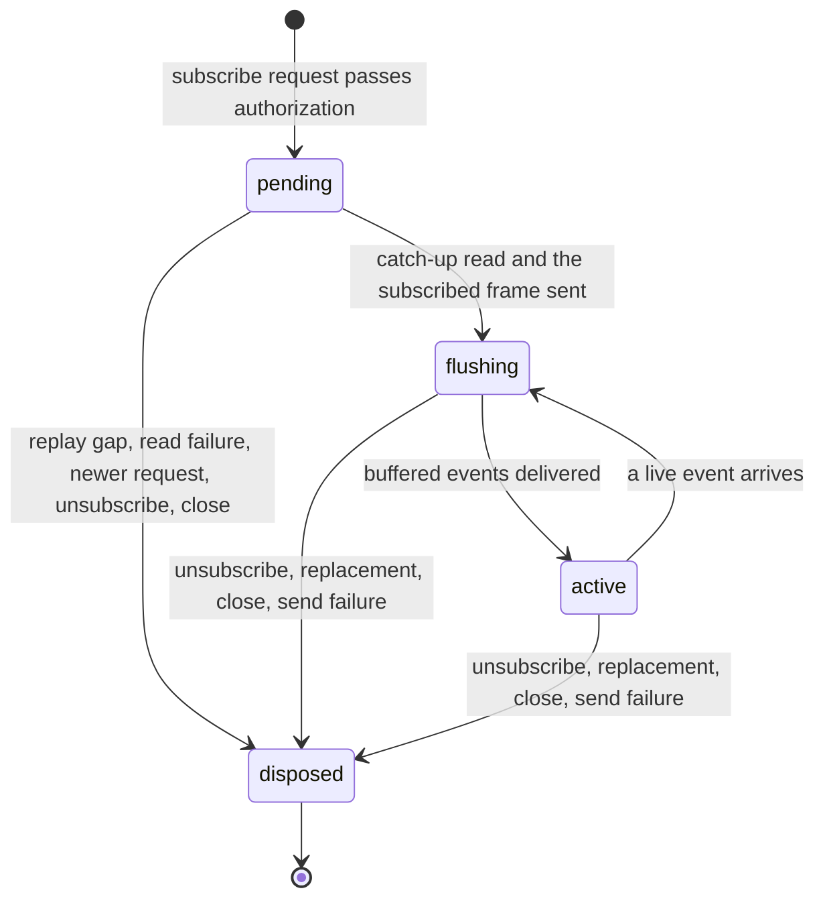
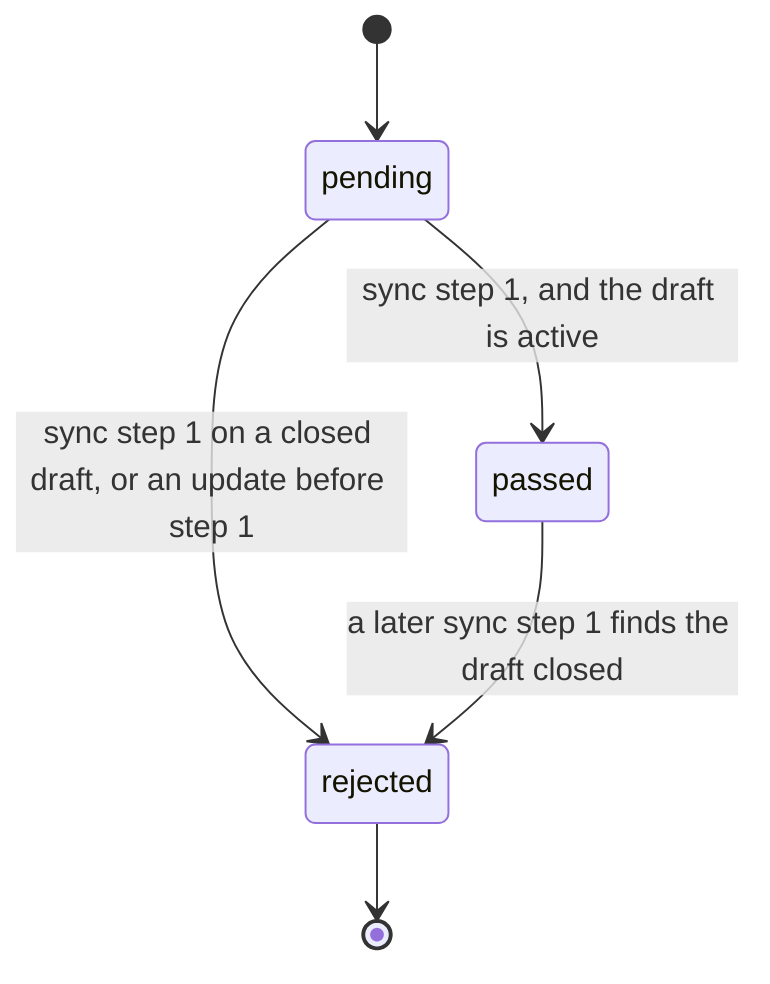

# WebSocket handler state machines

Two per-connection machines held in process memory. Both exist so that a client never receives
or sends frames for a room it has not been admitted to.

## Thread subscription, server half

One thread subscription on one WebSocket peer (`ThreadSubscriptionLease.phase` in
`ws-thread-handler.ts`). The client half is the
[subscription in thread-client](../../../../../packages/thread-client/.context/state-machines.md).

- **Events that arrive during catch-up are buffered**, then sent in sequence order above the
  last delivered sequence. Sending them as they arrive would put live events before the replay.
- **A newer request does not drop a working subscription early.** An `active` subscription stays until
  the new request is authorized; a `pending` one is replaced at once.
- `disposeLease` unsubscribes from the event hub and clears the buffer. A replay gap sends the
  client a `gap` frame; any other read failure is the one retryable subscribe error.

## Draft room handshake

Whether one connection may send edits to one draft room (`DraftHandshakeState` in
`yjs-ws-handler.ts`, keyed by draft id in the connection's context). In a Yjs sync, step 1
says what a client has and step 2 carries what the other side is missing. The server checks
the draft is active at the client's step 1.

`enforceDraftHandshake` refuses every sync step 2 and update until the room is `passed`, and
closes the socket with a typed close code (`DRAFT_CLOSED`, `DRAFT_PREFIX_MISSING`). `rejected`
is final for that connection: the client reconnects, or reads the close code and gives the room
up. Authorization happens at the upgrade; no frame can grant it later.
