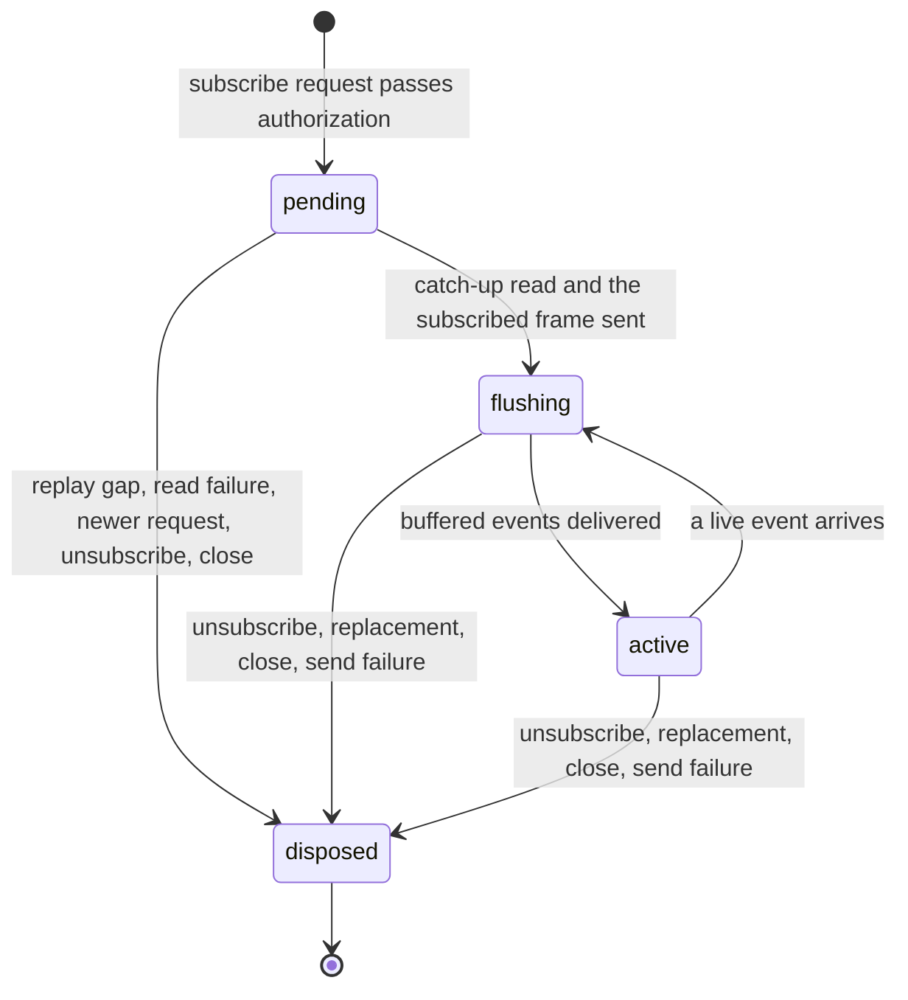

# WebSocket handler state machines

Three machines held in process memory: two per WebSocket connection, which exist so that a client
never receives or sends frames for a room it has not been admitted to, and one per chat, the agent
caret the server publishes into rooms.

## Thread subscription, server half

One thread subscription on one WebSocket peer (`ThreadSubscriptionLease.phase` in
`ws-thread-handler.ts`). The client half is the
[subscription in thread-client](../../../../../packages/thread-client/.context/state-machines.md).

- **Events that arrive during catch-up are buffered**, then sent in sequence order above the
  last delivered sequence. Sending them as they arrive would put live events before the replay.
- **A newer request does not drop a working subscription early.** An `active` subscription stays until
  the new request is authorized; a `pending` one is replaced at once.
- `disposeLease` unsubscribes from the event hub and clears the buffer. A replay gap sends the
  client a `gap` frame; any other read failure is the one retryable subscribe error.

## A joined `/ws/loro` room

One room a socket has joined on `/ws/loro` (`loro-ws-handler.ts`; its state is the socket's
`Joined` entry): a document's `live:<doc>` or `fork:<draft>:<doc>`, or a tree list's
`tree:project:<id>` / `tree:account:<id>` (`loro-tree-rooms.ts`). One socket holds many rooms, and
a refusal or an end is a frame for that room, never a socket close.

```mermaid
stateDiagram-v2
  [*] --> joining: JoinRequest
  joining --> refused: JoinError (bad auth, permission, unknown or deleted document, schema)
  joining --> joined: JoinResponseOk, then the catch-up batch, then batches held while joining
  joined --> joined: DocUpdate imported (or admitted, for a tree) and acked; another copy's batch forwarded
  joined --> ended: RoomError (access changed, document deleted, corrupt bytes, history cutoff, server error)
  joined --> [*]: Leave, or the socket closes
  refused --> [*]
  ended --> [*]
```

- **Subscribe before sync.** The room is subscribed before the Join's catch-up is read, and what
  it hears in between is held and sent after the answer, so no batch falls between the catch-up
  and the stream.
- **A batch is never refused for what it says.** A document room's batch is imported into the
  room (`DocumentRooms.write`); a tree room's is admitted as sent (`TreeListStore.admit`) and its
  sockets, the sender's included, hear the stored list past what the room last sent, after each
  commit's `NOTIFY` (`tree_list_advanced`). Only bytes Loro cannot read (`corrupt-update`) and an
  update below a shallow cutoff (`history-cutoff`) end the room; a failure of the server's own is
  `server-error`, which the client rejoins on, and the Join resends what the room lacks.
- **Access is decided at Join and ends by access key.** A document room registers under its Work
  and lineage owners, its project and its document; a tree room under its own name, which is its
  project's access key. A change publishes under one of them and ends the room with
  `access-changed` (`access-changed:<why>` for a closed owner), and the client rejoins at the new
  access. A change between the first check and the registration is caught by asking again.
- **A tree room's answer names its list** (`JoinResponseOk.extra.list`): a client whose stored
  copy is of another list (a reset database, a recreated account list) drops it and joins again
  with no version.
- **Frames over the protocol's cap come in fragments** (`docUpdateFrames`, `createFrameReader` in
  `@meridian/contracts/protocol`), joined back into one batch before it is handled.

## An agent's caret

One chat's agent as a peer in the room it last wrote in (`agent-presence.ts`, a `Chat` entry in
process memory), shown on every screen in that room through the presence relay
(`loro-presence.ts`, which holds the server's own entries while no socket is on the room and
re-sends them before peers time them out).

```mermaid
stateDiagram-v2
  [*] --> awake: a model request (orchestrator)
  awake --> awake: a request moves warmUntil; a committed write places, moves or clears the caret
  awake --> warm: the run settles (onRunSettled, a Stop included), warmUntil ahead
  awake --> [*]: the run settles and warmUntil has passed, or the model names no cache lifetime
  warm --> awake: a model request
  warm --> [*]: warmUntil passes (the caret is cleared)
  awake --> [*]: the chat is deleted (cleared once the delete commits)
  warm --> [*]: the chat is deleted
```

- **Lifetime is the cache prediction's rule.** `warmUntil` is the request's start plus the cache
  lifetime the thread asks for (`cacheColdAt` in `runtime/loop/prefix-cache-state.ts`, built on
  `cacheTtlSeconds`, the one lifetime rule `derivePrefixCacheState` applies too). While the run is awake the caret has no expiry, whatever
  `warmUntil` says. The prediction's other cold reasons (a compaction, a model change) are known
  only at the next request, which wakes the chat anyway.
- **A caret is placed only after its write commits** (`loro-agent-edit-host.ts`, after the room's
  own after-commit import), so a tab has the batch before the caret that points into it; a
  rolled-back write places none. A write from a chat this process sent no request for places none.
- **Every committed write places it** (`writeCaret` in agent-edit): after the replacement or
  insertion the command wrote, or beside the blocks it removed, moved or restyled when it changed
  no text. The plan's point is resolved and re-encoded on the room copy after its batch merges, so
  concurrent text and a shared suffix cannot move it inside the write. A write that leaves no
  block to hold it clears the caret, so it never stays at an older edit.
- **One room at a time.** A write in another room clears the caret where it was.
- **Stop is a settle.** Stop ends the reply, the run settles, and the caret stays while the cache
  is warm, as after any turn: the chat can still be asked to go on. Deleting the chat (or its Work)
  clears it once the delete commits (`stopThreads` in `lib/compose.ts`).
- The state is per process and gone on a restart; a tab drops the entry 30 s after the last
  refresh.
