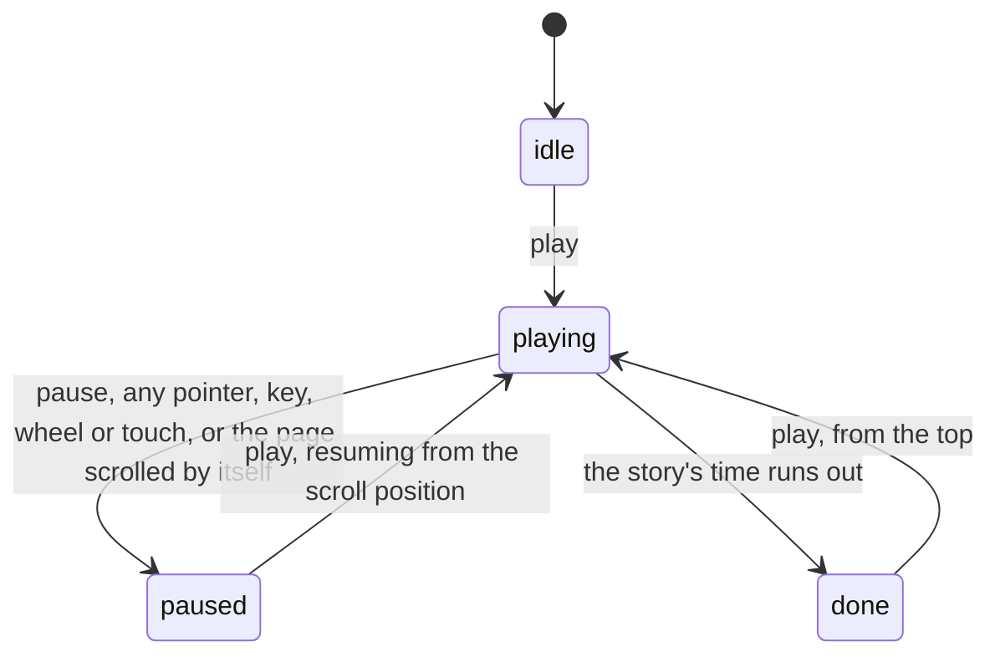

# Landing page state machine

The public landing page tells a short story as the visitor scrolls. This machine is whether
the page is scrolling that story by itself (`AutoplayState` in `../transport.ts`). The state
is mirrored to `html[data-auto]` for styling and to the play button's label.

- **The visitor always wins.** Any input pauses playback, and so does a scroll position that
  moved more than a few pixels between frames without the transport moving it.
- **Resume starts where the page is**, not where playback stopped: the time is recomputed from
  the scroll position. At the end of the page, or after `done`, play starts again from the top.
- The story ends on a question card with a "Send answer" button. The movement that follows a
  press is a separate flag (`glide.active`), not an autoplay state, and any interruption
  clears it.
