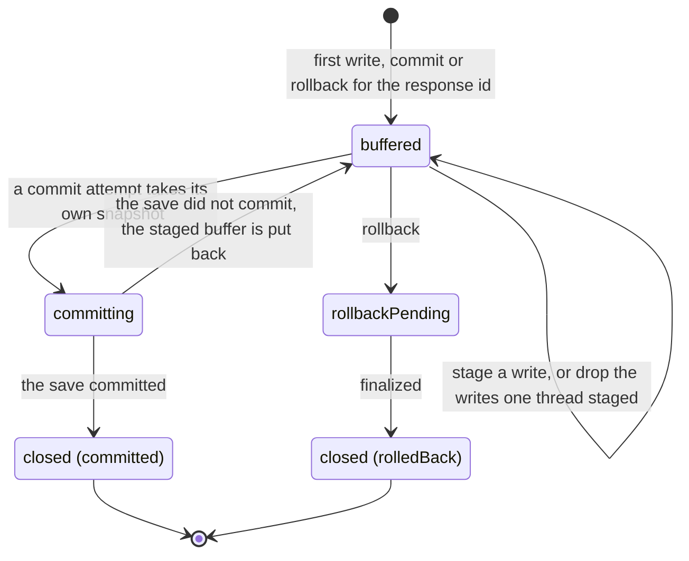

# agent-edit state machines

## Response

The document writes of one model reply (`ResponseState` in
`src/tool/response-committer.ts`). The package stages a reply's writes in a buffer and hands
them to its host, the server code that embeds it, to save together. The write path around it is in
[write-architecture.md](write-architecture.md).

- **A failed save loses nothing.** The commit works on a snapshot and keeps the buffer as
  staged; `restoreStaged` returns to it, so the caller can retry the same response.
- **Rollback is refused while a commit is running**, and while another rollback is pending. A
  rollback that joined the commit would report a commit's result as a rollback.
- **Closed is final.** A write, commit or rollback on a closed response throws
  `ResponseLifecycleError` naming `committed` or `rolledBack`. Closed responses are kept as
  tombstones up to `CLOSED_RESPONSE_TOMBSTONE_CAP`, then forgotten.
- The response is durable when the host's save commits to the database, not when the update
  reaches a room, the live Yjs session that browsers are connected to.

`onTransition` reports a coarser `ResponseCommitterPhase` (`buffered`, `journalStaged`,
`closed`) for observers. It is not this state and nothing branches on it.

A write's result carries the same progress: `success` with phase `staged` while the response
is buffered, `committed` once it closes committed (`src/tool/model-result.ts`).

## Not a machine: undo part state

`PartState` in `src/undo/forward-inverse.ts` (`active`, `undone`, `rolled_back`, `changed`,
`excluded`) is computed from the current document and the edit's history each time undo or
redo is planned. Nothing stores it, so there are no transitions to keep in order.
