# Command machine

One `CommandRecord` in the account's journal (`types.ts`). A screen reads three states; the
record has `sent` and `observed` besides.

```mermaid
stateDiagram-v2
  state sending {
    [*] --> waiting: saved, then shown
    waiting --> sent: heads its lanes; marked sent, then the request leaves
    sent --> sent: no answer, 5xx, 408, 429: same request again after a wait
  }
  [*] --> sending: submit commits to the journal
  sending --> done: 2xx, or the server's stored outcome is done
  sending --> never: the stored outcome is never or refused
  never --> sending: retry, new sendId; same place only while nothing later in its lanes was sent
  never --> [*]: dismissed, or after 30 days
  done --> done: observed, once a read of the domain's data that started after it settled returns
  done --> [*]: observed and a minute old
```

- **Saved before it is shown.** `submit` resolves when the append commits; the domain projects
  then. `seq` comes from commit order, so no record is ordered ahead of an earlier commit.
- **One tab delivers.** The tab holding the Web Lock `meridian:commands:<account>` sends every
  record of the account. It lets go on `pagehide` and freeze and asks again on `pageshow` and
  resume. A `wrong_account` or 401 pauses the account and releases the lock until a tab shows
  again.
- **Lanes.** Only the earliest `sending` record of a lane is sent; a record with several lanes
  waits to head all of them. A `done` or `never` record releases its lane, except a `never` of
  a kind with `holdsLane`, which keeps its lanes closed until it is retried (same place) or
  dismissed (the records behind it then go, and and the server answers for them).
- **An unread journal is not an empty one.** If the first read fails, the driver still asks for the
  lock; the read is tried again when the lock is held, on a nudge, and by any successful write.
- **A lost answer is resent under the same `sendId`** with backoff (1 s doubling to 30 s); a 500
  is resent slowly (30 s to 5 min) and logged. After a reload a `sent` record is looked up
  (`GET /api/commands/:id`) before it is sent again.
- **Any other 4xx calls `resolve`**, which answers what an earlier attempt did, or stores `never`.
- **Retention is by obligation.** A `done` record stays until a domain read observes it, then a
  minute so other tabs react; a `never` stays until dismissed or retried.
- **Every tab runs `onSettled` once per record it sees settle**, so it must be safe to run twice.
- **Not sent yet.** `notSent` is true while a record has been unanswered for 10 s, or the
  browser is offline with one waiting. It is the app's only marker of an unsent change.
- The Work kinds (`work_create` ... `work_restore`) are the first instances: `apps/app/src/client/query/work-commands.ts`. `project_create` is the second (`project-commands.ts`): its record is the unsent project, it has `holdsLane`, and a Work command submitted while the project's create is unsettled also queues on its lane `project:<id>`, so it waits through a refusal and Retry of the create. The loader (by account) and the read gate read it through `awaitPendingProjectCreation` and `readPendingProjectCreation`.

Pattern: [a command that may have landed](../../../.context/state-machines/command-that-may-have-landed.md).
