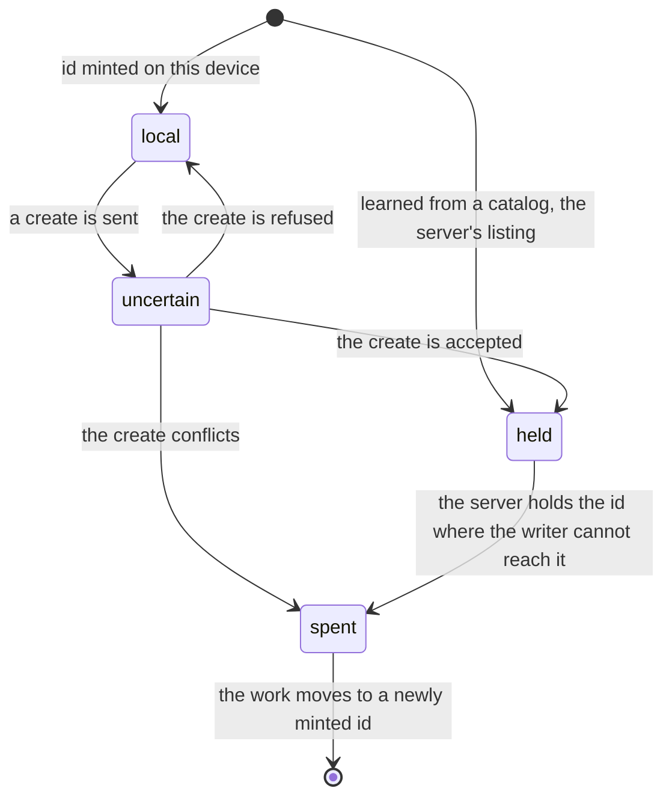
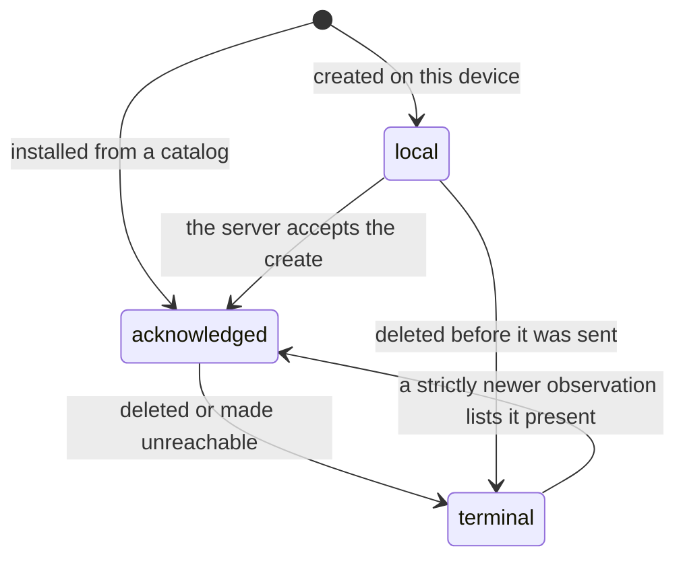
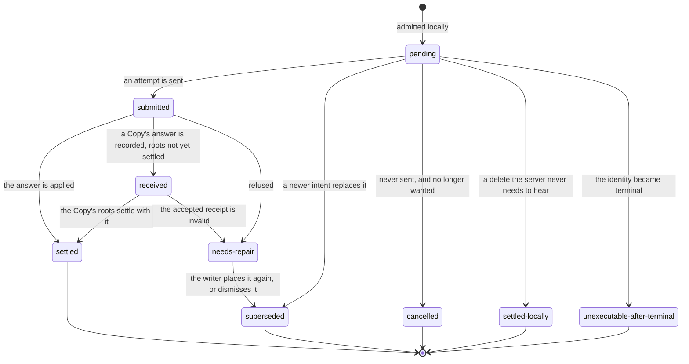

# resource-replica state machines

The browser's local copy of a project's documents and folders, which get their ids in the
browser before the server has them. Server hold and lifecycle are recorded per document or
folder, a namespace intent per operation the writer asked for, and they are read together. [CONTEXT.md](CONTEXT.md) has the rules in prose; this page draws them.

## Server hold

What the server holds under an id this device minted (`ServerHold` in `src/server-hold.ts`).
It decides whether the next send is a create or a move, and whether a delete needs the server.

- **Only a create's answer changes the hold** (`holdAfterAttempt`). A refused move leaves a
  `held` id `held`.
- **`uncertain` is treated as held for deletes** (`deleteNeedsServer`): the create may have
  landed, so deleting locally only would leave a document on the server.
- **`spent` never recovers.** The runner mints a new id and carries the work to it; nothing
  resends under the old one.
- Nothing derives the hold from `canonical`, `lifecycle` or the shape of an attempt, so a
  document and its folder cannot disagree about it.

One instance of
[a command that may have landed](../../../.context/state-machines/command-that-may-have-landed.md).

## Resource lifecycle

Whether the identity exists for the server (`ResourceDescriptor.lifecycle` in
`src/resource-records.ts`).

A `terminal` identity revives only from an observation newer than the `deletionVersion` that
proved the delete. An older catalog page listing it is stale, and reviving from it brings back
a document the writer deleted. A terminal resource accepts no ordinary placement.

## Namespace intent

One thing the writer asked for (place, move, delete, copy) on its way to the server
(`NamespaceIntent.state`). The diagram shows the main paths; the writers are
`src/namespace-journal-policy.ts`, `resource-namespace.ts`, `folder-namespace.ts`,
`operation-journal.ts`, `resource-deletion.ts` and `resource-intent-policy.ts`.

- **`needs-repair` is never resent**, and the 30-second retry does not wake it. It waits for
  the writer, and it survives a reload.
- **Only an unsent `pending` intent can be cancelled.** One with an attempt may have reached
  the server and must be answered or superseded.
- **A Copy settles its operation record and its roots together.** The roots are the outermost
  things the writer copied. Left at `received`, the Copy keeps the keys that order operations
  on the same places (`PlacementAdmission.scope`) and blocks later ones.
- The app turns the newest intent for an operation into `pending`, `feedback` or `retired`:
  [project context](../../../apps/app/src/features/project/context/.context/state-machines.md).
